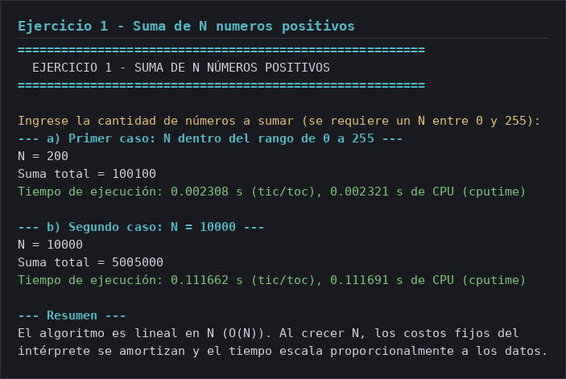
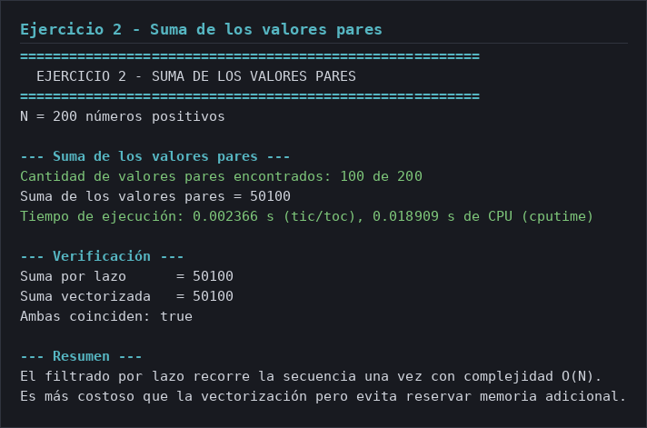
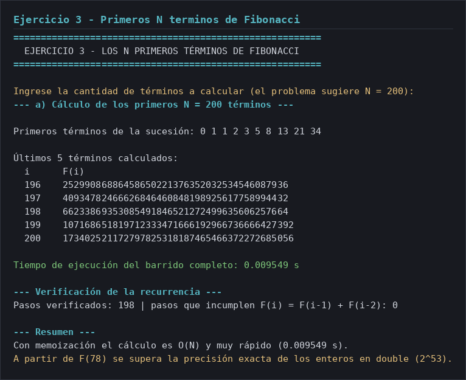
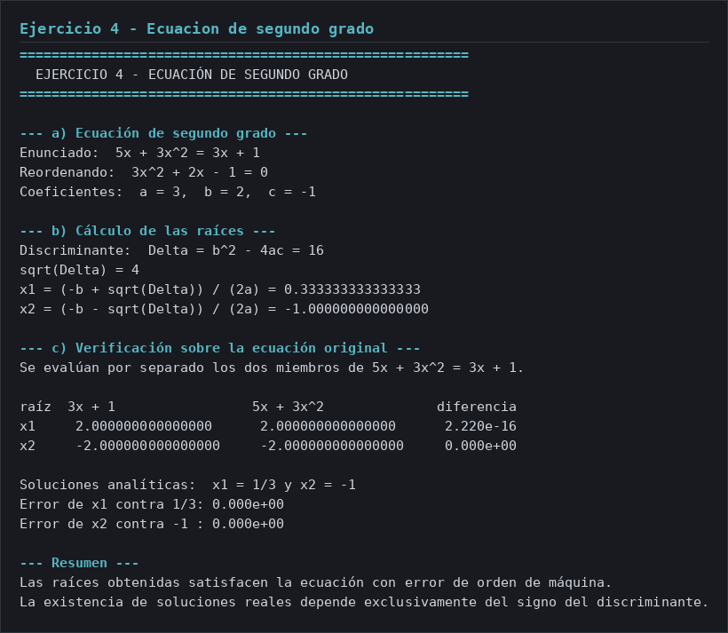
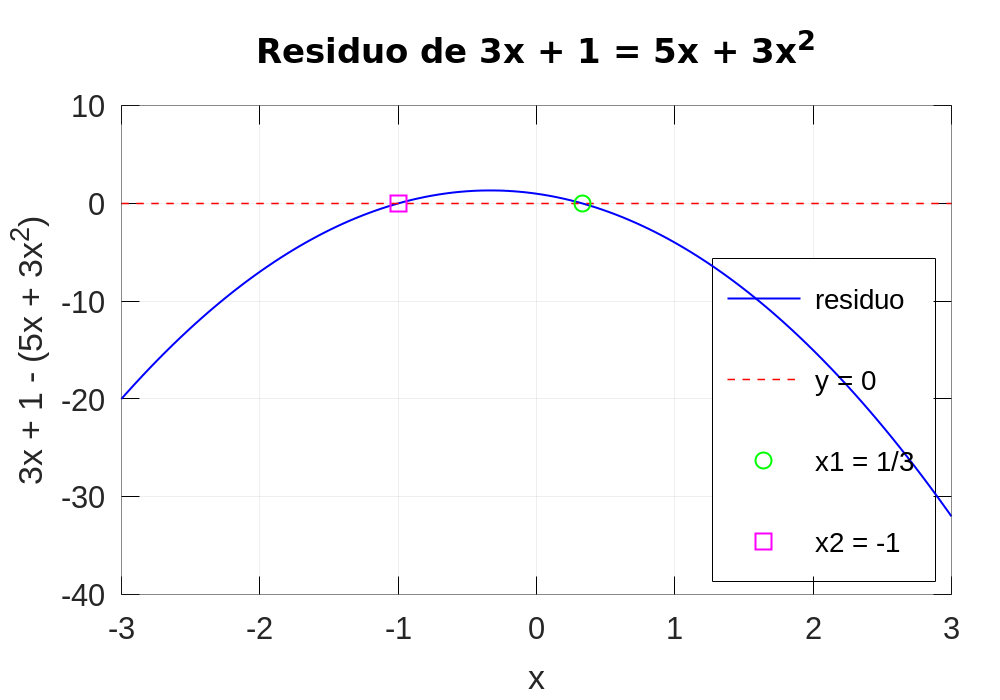
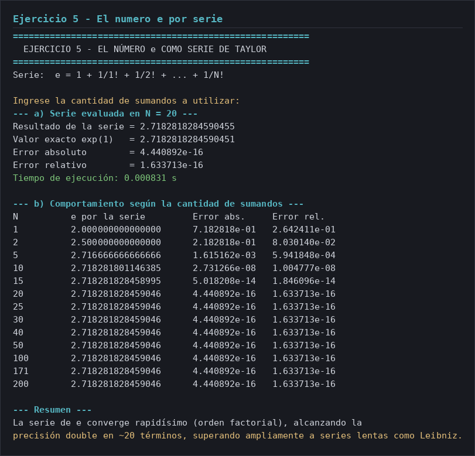
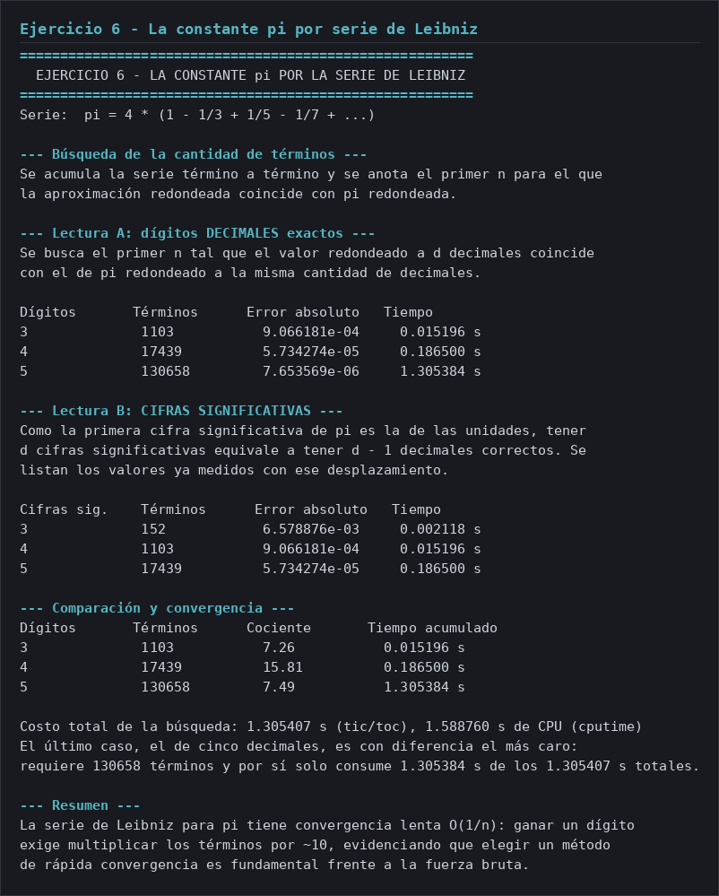

# Informe — Guía 1: Introducción a los procesos algorítmicos

**Alumnos:** Franco Zambrano · Gabriel Bazzola

Métodos Computacionales · Laboratorio 1 · Octave 6.4.0

---

## Ejercicio 1 — Suma de N números positivos

### `01-suma-n-numeros.m`

````octave
% 01-suma-n-numeros.m - Ejercicio 1 de la Guía 1: suma de N números positivos.
%
% Problema: dado N números positivos X1, X2, ..., XN, hallar
%   S = X1 + X2 + ... + XN.
%
% Se prueba con N dentro del rango de enteros de 0 a 255 y después con
% N = 10000, para comparar los tiempos.
%
% El acumulado crece de a un término por iteración, así que el algoritmo es
% O(N): cada dato se recorre una sola vez.

clc;

% ----------------------------------------------------------------------
% Generador de los datos del problema
% ----------------------------------------------------------------------
% Secuencia determinista de enteros positivos: (i * 7919) mod 1000 + 1.
% No usa el generador aleatorio, así que la suma es siempre la misma y el tiempo
% depende solo de N.
generar_valor = @(i) mod(i * 7919, 1000) + 1;

fprintf('\n========================================================\n');
fprintf('  EJERCICIO 1 - SUMA DE N NÚMEROS POSITIVOS\n');
fprintf('========================================================\n');

N = 0;
entrada_valida = false;
intentos_maximos = 5;    % tope para no quedar repreguntando si se agota la entrada
for intento = 1:intentos_maximos
  texto = input(sprintf('\nIngrese la cantidad de números a sumar (se requiere un N entre 0 y 255): '), 's');
  N = str2double(texto);
  if (isscalar(N) && isfinite(N) && N == fix(N) && N >= 0 && N <= 255)
    entrada_valida = true;
    break;
  endif
  fprintf('El valor debe ser un entero entre 0 y 255.\n');
endfor

if (!entrada_valida)
  fprintf('Se agotaron los %d intentos sin recibir un valor válido.\n', intentos_maximos);
  return;
endif

% ----------------------------------------------------------------------
% a) Primer caso: N dentro del rango de representación de 0 a 255
% ----------------------------------------------------------------------
N_primer_caso = N;

fprintf('\n--- a) Primer caso: N dentro del rango de 0 a 255 ---\n');
fprintf('N = %d\n', N);

% cputime devuelve tiempo de CPU consumido por el proceso; se toma antes y
% después para medir lo que realmente costó la suma.
cpu_inicio = cputime;
tic;
total = 0;
for i = 1:N
  % Reemplazar por "x = input('Ingrese el valor a sumar: ')" para el modo interactivo.
  x = generar_valor(i);
  total = total + x;
endfor
tiempo_a = toc;
cpu_a = cputime - cpu_inicio;

fprintf('Suma total = %d\n', total);
fprintf('Tiempo de ejecución: %.6f s (tic/toc), %.6f s de CPU (cputime)\n', tiempo_a, cpu_a);

% ----------------------------------------------------------------------
% b) Segundo caso: N = 10000
% ----------------------------------------------------------------------
N = 10000;

fprintf('\n--- b) Segundo caso: N = 10000 ---\n');
fprintf('N = %d\n', N);

cpu_inicio = cputime;
tic;
total = 0;
for i = 1:N
  x = generar_valor(i);
  total = total + x;
endfor
tiempo_b = toc;
cpu_b = cputime - cpu_inicio;

fprintf('Suma total = %d\n', total);
fprintf('Tiempo de ejecución: %.6f s (tic/toc), %.6f s de CPU (cputime)\n', tiempo_b, cpu_b);

% ----------------------------------------------------------------------
% Resumen
% ----------------------------------------------------------------------
fprintf('\n--- Resumen ---\n');
fprintf('El algoritmo es lineal en N (O(N)). Al crecer N, los costos fijos del\n');
fprintf('intérprete se amortizan y el tiempo escala proporcionalmente a los datos.\n');
````

### Salida de ejecución



---

## Ejercicio 2 — Suma de los valores pares

### `02-suma-pares.m`

````octave
% 02-suma-pares.m - Ejercicio 2 de la Guía 1: suma de los valores pares.
%
% Problema: dados 200 números positivos X1, X2, ..., X200, hallar la suma de
% todos los valores pares de la sucesión y reportar el tiempo de ejecución.
%
% El predicado de pertenencia es mod(Xi, 2) == 0. Una sola pasada, con una
% comparación y una posible adición por dato: O(N).
%
% Los datos se generan con una secuencia determinista, no aleatoria, para que la
% suma y el tiempo sean reproducibles entre corridas.

clc;

% ----------------------------------------------------------------------
% Generador de los datos del problema
% ----------------------------------------------------------------------
% Secuencia determinista de enteros positivos: (i * 7919) mod 1000 + 1.
generar_valor = @(i) mod(i * 7919, 1000) + 1;

% ----------------------------------------------------------------------
% Datos del problema
% ----------------------------------------------------------------------
N = 200;

fprintf('\n========================================================\n');
fprintf('  EJERCICIO 2 - SUMA DE LOS VALORES PARES\n');
fprintf('========================================================\n');
fprintf('N = %d números positivos\n', N);

% ----------------------------------------------------------------------
% a) Suma de los valores pares
% ----------------------------------------------------------------------
fprintf('\n--- Suma de los valores pares ---\n');

cpu_inicio = cputime;
tic;
total = 0;
cantidad_pares = 0;
for i = 1:N
  % Reemplazar por "x = input('Ingrese el valor a sumar: ')" para el modo interactivo.
  x = generar_valor(i);

  if (x > 0 && mod(x, 2) == 0)
    total = total + x;
    cantidad_pares = cantidad_pares + 1;
  endif
endfor
tiempo = toc;
cpu = cputime - cpu_inicio;

fprintf('Cantidad de valores pares encontrados: %d de %d\n', cantidad_pares, N);
fprintf('Suma de los valores pares = %d\n', total);
fprintf('Tiempo de ejecución: %.6f s (tic/toc), %.6f s de CPU (cputime)\n', tiempo, cpu);

% ----------------------------------------------------------------------
% Verificación
% ----------------------------------------------------------------------
% Contraste: la misma suma se recalcula vectorizada, sin recorrer el lazo.
valores = generar_valor(1:N);
total_verificado = sum(valores(mod(valores, 2) == 0));

fprintf('\n--- Verificación ---\n');
fprintf('Suma por lazo      = %d\n', total);
fprintf('Suma vectorizada   = %d\n', total_verificado);
fprintf('Ambas coinciden: %s\n', mat2str(total == total_verificado));

% ----------------------------------------------------------------------
% Resumen
% ----------------------------------------------------------------------
fprintf('\n--- Resumen ---\n');
fprintf('El filtrado por lazo recorre la secuencia una vez con complejidad O(N).\n');
fprintf('Es más costoso que la vectorización pero evita reservar memoria adicional.\n');
````

### Salida de ejecución



---

## Ejercicio 3 — Los N primeros términos de Fibonacci

### `03-fibonacci.m`

````octave
% 03-fibonacci.m - Ejercicio 3 de la Guía 1: los N primeros términos de Fibonacci.
%
% Problema: obtener los N primeros números de la sucesión, con la recurrencia
%   F(1) = 0,  F(2) = 1,  F(n) = F(n-1) + F(n-2)   para n > 2,
% y probarlo con N = 200.
%
% La recursión ingenua cuesta O(phi^n) con phi = (1 + sqrt(5))/2, así que para
% n = 200 no termina. Por eso fibonacci.m calcula de forma iterativa y memoriza:
% cada término se resuelve una sola vez.
%
% El algoritmo vive en fibonacci.m; este script lo invoca término a término.

clc;

fprintf('\n========================================================\n');
fprintf('  EJERCICIO 3 - LOS N PRIMEROS TÉRMINOS DE FIBONACCI\n');
fprintf('========================================================\n');

% ----------------------------------------------------------------------
% a) Número de términos a calcular
% ----------------------------------------------------------------------
N = 0;
entrada_valida = false;
intentos_maximos = 5;    % tope para no quedar repreguntando si se agota la entrada
for intento = 1:intentos_maximos
  texto = input(sprintf('\nIngrese la cantidad de términos a calcular (el problema sugiere N = 200): '), 's');
  N = str2double(texto);
  if (isscalar(N) && isfinite(N) && N == fix(N) && N >= 1)
    entrada_valida = true;
    break;
  endif
  fprintf('N debe ser un entero positivo.\n');
endfor

if (!entrada_valida)
  fprintf('Se agotaron los %d intentos sin recibir un valor válido.\n', intentos_maximos);
  return;
endif

fprintf('\n--- a) Cálculo de los primeros N = %d términos ---\n', N);

% ----------------------------------------------------------------------
% b) Cálculo de los N términos
% ----------------------------------------------------------------------
tic;
terminos = zeros(1, N);
for i = 1:N
  terminos(i) = fibonacci(i);
endfor
tiempo = toc;

% ----------------------------------------------------------------------
% Los términos calculados
% ----------------------------------------------------------------------
% Con N grande no se imprimen 200 filas: van los primeros términos y los últimos cinco.
fprintf('\nPrimeros términos de la sucesión: ');
fprintf('%d ', terminos(1:min(10, N)));
fprintf('\n');

fprintf('\nÚltimos %d términos calculados:\n', min(5, N));
fprintf('  %-6s %s\n', 'i', 'F(i)');
inicio_tabla = max(1, N - 4);
for i = inicio_tabla:N
  fprintf('  %-6d %.0f\n', i, terminos(i));
endfor

fprintf('\nTiempo de ejecución del barrido completo: %.6f s\n', tiempo);

% ----------------------------------------------------------------------
% Verificación
% ----------------------------------------------------------------------
% Se comprueba que la sucesión cumple la recurrencia en cada paso.
fprintf('\n--- Verificación de la recurrencia ---\n');
if (N >= 3)
 Fallos = 0;
  for i = 3:N
    if (terminos(i) != terminos(i - 1) + terminos(i - 2))
      Fallos = Fallos + 1;
    endif
  endfor
  fprintf('Pasos verificados: %d | pasos que incumplen F(i) = F(i-1) + F(i-2): %d\n', ...
          N - 2, Fallos);
else
  fprintf('N es demasiado chico para verificar la recurrencia (hace falta N >= 3).\n');
endif

% ----------------------------------------------------------------------
% Resumen
% ----------------------------------------------------------------------
fprintf('\n--- Resumen ---\n');
fprintf('Con memoización el cálculo es O(N) y muy rápido (%.6f s).\n', tiempo);
fprintf('A partir de F(78) se supera la precisión exacta de los enteros en double (2^53).\n');
````

### Salida de ejecución



---

## Ejercicio 4 — Ecuación de segundo grado

### `04-ecuacion-segundo-grado.m`

````octave
% 04-ecuacion-segundo-grado.m - Ejercicio 4 de la Guía 1: ecuación de segundo grado.
%
% Problema: "Si al quíntuple de un número se le suma el triple de su cuadrado, se
% obtiene el triple del mismo más 1", es decir
%   5x + 3x^2 = 3x + 1
% Llevando todo a un lado:
%   3x^2 + 2x - 1 = 0,      con a = 3, b = 2, c = -1
% y se aplica la fórmula general
%   x1 = (-b + sqrt(b^2 - 4ac)) / (2a)
%   x2 = (-b - sqrt(b^2 - 4ac)) / (2a)
%
% El discriminante es Delta = b^2 - 4ac = 16, positivo, así que hay dos raíces
% reales distintas: x1 = 1/3 y x2 = -1.

clc;

% ----------------------------------------------------------------------
% Datos del problema
% ----------------------------------------------------------------------
% Coeficientes de 3x^2 + 2x - 1 = 0.
a = 3;
b = 2;
c = -1;

% Miembros de 5x + 3x^2 = 3x + 1 evaluados por separado: 3x + 1 y 5x + 3x^2.
miembro_izquierdo = @(x) 3 * x + 1;
miembro_derecho = @(x) 5 * x + 3 * x.^2;

% Residuo de la ecuación original, que es lo que se grafica.
residuo = @(x) miembro_izquierdo(x) - miembro_derecho(x);

fprintf('\n========================================================\n');
fprintf('  EJERCICIO 4 - ECUACIÓN DE SEGUNDO GRADO\n');
fprintf('========================================================\n');

% ----------------------------------------------------------------------
% a) Ecuación de segundo grado
% ----------------------------------------------------------------------
fprintf('\n--- a) Ecuación de segundo grado ---\n');
fprintf('Enunciado:  5x + 3x^2 = 3x + 1\n');
fprintf('Reordenando:  3x^2 + 2x - 1 = 0\n');
fprintf('Coeficientes:  a = %g,  b = %g,  c = %g\n', a, b, c);

% ----------------------------------------------------------------------
% b) Cálculo de las raíces
% ----------------------------------------------------------------------
delta = b^2 - 4 * a * c;
fprintf('\n--- b) Cálculo de las raíces ---\n');
fprintf('Discriminante:  Delta = b^2 - 4ac = %g\n', delta);
fprintf('sqrt(Delta) = %g\n', sqrt(delta));

x1 = (-b + sqrt(delta)) / (2 * a);
x2 = (-b - sqrt(delta)) / (2 * a);

fprintf('x1 = (-b + sqrt(Delta)) / (2a) = %s\n', sprintf('%.15f', x1));
fprintf('x2 = (-b - sqrt(Delta)) / (2a) = %s\n', sprintf('%.15f', x2));

% ----------------------------------------------------------------------
% c) Verificación sobre la ecuación original
% ----------------------------------------------------------------------
fprintf('\n--- c) Verificación sobre la ecuación original ---\n');
fprintf('Se evalúan por separado los dos miembros de 5x + 3x^2 = 3x + 1.\n\n');
fprintf('%-6s %-22s %-22s %s\n', 'raíz', '3x + 1', '5x + 3x^2', 'diferencia');
fprintf('%-6s %-22.15f %-22.15f %.3e\n', 'x1', miembro_izquierdo(x1), miembro_derecho(x1), ...
        miembro_izquierdo(x1) - miembro_derecho(x1));
fprintf('%-6s %-22.15f %-22.15f %.3e\n', 'x2', miembro_izquierdo(x2), miembro_derecho(x2), ...
        miembro_izquierdo(x2) - miembro_derecho(x2));

% Las soluciones analíticas, para contrastar.
fprintf('\nSoluciones analíticas:  x1 = 1/3 y x2 = -1\n');
fprintf('Error de x1 contra 1/3: %.3e\n', abs(x1 - 1/3));
fprintf('Error de x2 contra -1 : %.3e\n', abs(x2 + 1));

% ----------------------------------------------------------------------
% c) Gráfico
% ----------------------------------------------------------------------
% Se grafica el residuo 3x + 1 - (5x + 3x^2), que se anula en las raíces.
% fplot evalúa vectores, así que los operadores element-wise son obligatorios.
figure('Name', 'Ejercicio 1 - Ecuación de segundo grado');
fplot(residuo, [-3, 3], 'b-', 'LineWidth', 2);
grid on;
hold on;

% Eje horizontal en y = 0: sus cruces con la curva son las raíces.
plot([-3, 3], [0, 0], 'r--', 'LineWidth', 1.5);
plot(x1, 0, 'go', 'MarkerSize', 8, 'LineWidth', 2);
plot(x2, 0, 'ms', 'MarkerSize', 8, 'LineWidth', 2);

title('Residuo de 3x + 1 = 5x + 3x^2');
xlabel('x');
ylabel('3x + 1 - (5x + 3x^2)');
legend({'residuo', 'y = 0', 'x1 = 1/3', 'x2 = -1'}, 'Location', 'southeast');

hold off;

% ----------------------------------------------------------------------
% Resumen
% ----------------------------------------------------------------------
fprintf('\n--- Resumen ---\n');
fprintf('Las raíces obtenidas satisfacen la ecuación con error de orden de máquina.\n');
fprintf('La existencia de soluciones reales depende exclusivamente del signo del discriminante.\n');
````

### Salida de ejecución



### Gráfico



---

## Ejercicio 5 — El número e como suma de una serie

### `05-serie-e.m`

````octave
% 05-serie-e.m - Ejercicio 5 de la Guía 1: el número e como serie.
%
% Problema: calcular e como suma de la serie
%   e = 1 + 1/1! + 1/2! + 1/3! + ... + 1/N!
% con N entero positivo, y observar cómo mejora la precisión al crecer N.
%
% Es el desarrollo de Taylor de e^x en el origen evaluado en x = 1. O(N): un
% acumulado por iteración.
%
% A partir de N = 171, factorial(N) desborda a Inf y el término 1/Inf vale 0:
% esos términos ya están por debajo de la precisión de un double.

clc;

fprintf('\n========================================================\n');
fprintf('  EJERCICIO 5 - EL NÚMERO e COMO SERIE DE TAYLOR\n');
fprintf('========================================================\n');
fprintf('Serie:  e = 1 + 1/1! + 1/2! + ... + 1/N!\n');

% ----------------------------------------------------------------------
% a) Cálculo de la serie con el N pedido por el usuario
% ----------------------------------------------------------------------
N = 0;
entrada_valida = false;
intentos_maximos = 5;    % tope para no quedar repreguntando si se agota la entrada
for intento = 1:intentos_maximos
  texto = input(sprintf('\nIngrese la cantidad de sumandos a utilizar: '), 's');
  N = str2double(texto);
  if (isscalar(N) && isfinite(N) && N == fix(N) && N >= 1)
    entrada_valida = true;
    break;
  endif
  fprintf('N debe ser un entero positivo.\n');
endfor

if (!entrada_valida)
  fprintf('Se agotaron los %d intentos sin recibir un valor válido.\n', intentos_maximos);
  return;
endif

fprintf('\n--- a) Serie evaluada en N = %d ---\n', N);

tic;
total = 1;          % el primer término de la serie es 1/0! = 1
for i = 1:N
  total = total + 1 / factorial(i);
endfor
tiempo = toc;

exacto = exp(1);

fprintf('Resultado de la serie = %s\n', sprintf('%.16f', total));
fprintf('Valor exacto exp(1)   = %s\n', sprintf('%.16f', exacto));
fprintf('Error absoluto        = %.6e\n', abs(exacto - total));
fprintf('Error relativo        = %.6e\n', abs(exacto - total) / exacto);
fprintf('Tiempo de ejecución: %.6f s\n', tiempo);

% ----------------------------------------------------------------------
% b) Barrido de distintas cantidades de sumandos
% ----------------------------------------------------------------------
fprintf('\n--- b) Comportamiento según la cantidad de sumandos ---\n');
fprintf('%-10s %-22s %-14s %s\n', 'N', 'e por la serie', 'Error abs.', 'Error rel.');

valores_N = [1, 2, 5, 10, 15, 20, 25, 30, 40, 50, 100, 171, 200];
for N_actual = valores_N
  total = 1;
  for i = 1:N_actual
    total = total + 1 / factorial(i);
  endfor
  fprintf('%-10d %-22.15f %-14.6e %.6e\n', N_actual, total, ...
          abs(exacto - total), abs(exacto - total) / exacto);
endfor

% ----------------------------------------------------------------------
% Resumen
% ----------------------------------------------------------------------
fprintf('\n--- Resumen ---\n');
fprintf('La serie de e converge rapidísimo (orden factorial), alcanzando la\n');
fprintf('precisión double en ~20 términos, superando ampliamente a series lentas como Leibniz.\n');
````

### Salida de ejecución



---

## Ejercicio 6 — La constante pi por la serie de Leibniz

### `06-serie-pi.m`

````octave
% 06-serie-pi.m - Ejercicio 6 de la Guía 1: la constante pi por la serie de Leibniz.
%
% Problema: calcular pi con n cifras exactas a partir del desarrollo
%   pi = 4 * (1 - 1/3 + 1/5 - 1/7 + ...)
%   i.  Cantidad de términos necesarios para 3 dígitos exactos.
%   ii. La misma cuenta para 4 y 5 dígitos, comparando el costo.
%
% La serie converge como 1/n: el resto queda acotado por el primer término
% omitido, |pi - 4*S_n| <= 4/(2n + 1). Ganar un dígito decimal exige multiplicar
% la cantidad de términos por 10.
%
% El script informa el resultado con dos lecturas de "n dígitos exactos":
%   A) n dígitos decimales: la aproximación redondeada a n decimales.
%   B) n cifras significativas: como pi empieza en 3, equivale a n-1 decimales.
% En ambos casos se compara contra pi redondeado a esa misma precisión.

clc;

fprintf('\n========================================================\n');
fprintf('  EJERCICIO 6 - LA CONSTANTE pi POR LA SERIE DE LEIBNIZ\n');
fprintf('========================================================\n');
fprintf('Serie:  pi = 4 * (1 - 1/3 + 1/5 - 1/7 + ...)\n');

% ----------------------------------------------------------------------
% Búsqueda de la cantidad de términos para cada precisión
% ----------------------------------------------------------------------
% La serie se acumula una sola vez y en cada paso se anota el primer n que
% cumple cada criterio, así el costo es el de la corrida más exigente.
%
% Los criterios están anidados: coincidir con d decimales implica coincidir con
% d-1, así que alcanza con vigilar la precisión pendiente más gruesa.
%
% Se cubren d = 1 a 5 decimales, que alcanzan para las dos lecturas.
%
% El escalado reemplaza a round(X, n), que Octave no tiene: se multiplica por
% 10^d, se redondea y se divide. Escalas y referencia se calculan una sola vez,
% fuera del lazo.
pi_referencia = pi;
maximo_decimales = 5;
escalas = 10 .^ (1:maximo_decimales);
referencia_redondeada = round(pi_referencia * escalas) ./ escalas;

% Cada fila guarda: [decimales, n alcanzado, error absoluto, tiempo acumulado].
resultados = zeros(maximo_decimales, 4);

fprintf('\n--- Búsqueda de la cantidad de términos ---\n');
fprintf('Se acumula la serie término a término y se anota el primer n para el que\n');
fprintf('la aproximación redondeada coincide con pi redondeada.\n');

tic;
suma_parcial = 0;
n = 0;
d_pendiente = 1;                       % precisión todavía no alcanzada
cpu_inicio = cputime;
while (n < 200000 && d_pendiente <= maximo_decimales)
  n = n + 1;

  % Término n-ésimo de la serie: signo alternado y denominador 2n - 1.
  if (mod(n, 2) == 1)
    suma_parcial = suma_parcial + 1 / (2 * n - 1);
  else
    suma_parcial = suma_parcial - 1 / (2 * n - 1);
  endif

  aproximacion = 4 * suma_parcial;

  if (round(aproximacion * escalas(d_pendiente)) / escalas(d_pendiente) ...
      == referencia_redondeada(d_pendiente))
    resultados(d_pendiente, :) = [d_pendiente, n, ...
                                  abs(aproximacion - pi_referencia), toc];
    d_pendiente = d_pendiente + 1;
  endif
endwhile
tiempo_total = toc;
cpu_total = cputime - cpu_inicio;

% ----------------------------------------------------------------------
% Lectura A: dígitos decimales exactos
% ----------------------------------------------------------------------
fprintf('\n--- Lectura A: dígitos DECIMALES exactos ---\n');
fprintf('Se busca el primer n tal que el valor redondeado a d decimales coincide\n');
fprintf('con el de pi redondeado a la misma cantidad de decimales.\n\n');
fprintf('%-14s %-14s %-16s %s\n', 'Dígitos', 'Términos', 'Error absoluto', 'Tiempo');
for d = 3:5
  fila = resultados(d, :);
  fprintf('%-14d %-14d %-16.6e %.6f s\n', d, fila(2), fila(3), fila(4));
endfor

% ----------------------------------------------------------------------
% Lectura B: cifras significativas
% ----------------------------------------------------------------------
fprintf('\n--- Lectura B: CIFRAS SIGNIFICATIVAS ---\n');
fprintf('Como la primera cifra significativa de pi es la de las unidades, tener\n');
fprintf('d cifras significativas equivale a tener d - 1 decimales correctos. Se\n');
fprintf('listan los valores ya medidos con ese desplazamiento.\n\n');
fprintf('%-14s %-14s %-16s %s\n', 'Cifras sig.', 'Términos', 'Error absoluto', 'Tiempo');
for c = 3:5
  fila = resultados(c - 1, :);
  fprintf('%-14d %-14d %-16.6e %.6f s\n', c, fila(2), fila(3), fila(4));
endfor

% ----------------------------------------------------------------------
% Convergencia
% ----------------------------------------------------------------------
fprintf('\n--- Comparación y convergencia ---\n');
fprintf('%-14s %-14s %-14s %s\n', 'Dígitos', 'Términos', 'Cociente', 'Tiempo acumulado');
for d = 3:5
  fila = resultados(d, :);
  cociente = fila(2) / resultados(d - 1, 2);
  fprintf('%-14d %-14d %-14.2f %.6f s\n', d, fila(2), cociente, fila(4));
endfor

fprintf('\nCosto total de la búsqueda: %.6f s (tic/toc), %.6f s de CPU (cputime)\n', ...
        tiempo_total, cpu_total);
fprintf('El último caso, el de cinco decimales, es con diferencia el más caro:\n');
fprintf('requiere %d términos y por sí solo consume %.6f s de los %.6f s totales.\n', ...
        resultados(5, 2), resultados(5, 4), tiempo_total);

% ----------------------------------------------------------------------
% Resumen
% ----------------------------------------------------------------------
fprintf('\n--- Resumen ---\n');
fprintf('La serie de Leibniz para pi tiene convergencia lenta O(1/n): ganar un dígito\n');
fprintf('exige multiplicar los términos por ~10, evidenciando que elegir un método\n');
fprintf('de rápida convergencia es fundamental frente a la fuerza bruta.\n');
````

### Salida de ejecución



---

# Anexo — Métodos numéricos

## Sucesión de Fibonacci (memoizada)

````octave
function resultado = fibonacci(n)
  % FIBONACCI - n-esimo termino de la sucesion de Fibonacci.
  % Entradas:
  %   n - posicion del termino, entero positivo (1 o mayor)
  % Salidas:
  %   resultado - valor del termino n
  %
  % Convencion: fibonacci(1) = 0 y fibonacci(2) = 1, es decir la sucesion es
  % 0, 1, 1, 2, 3, 5, 8, ...
  %
  % El calculo es iterativo y con cache persistente: cada termino se resuelve una
  % sola vez y las consultas posteriores lo reutilizan, de modo que un barrido
  % i = 1:N cuesta O(N). El cache se reinicia con "clear fibonacci".
  %
  % Los terminos son enteros exactos mientras fibonacci(n) < 2^53 (n <= 78). A
  % partir de ahi el resultado es el double mas cercano al entero: es una
  % limitacion de la aritmetica de punto flotante, no de esta implementacion.

  if (nargin != 1)
    error("fibonacci: se requiere exactamente 1 argumento (n)");
  endif

  if (!isnumeric(n) || !isscalar(n) || !isfinite(n) || n != fix(n) || n < 1)
    error("fibonacci: n debe ser un entero positivo (n >= 1)");
  endif

  % Cache persistente: memo(i) guarda el termino i. Empieza con los dos
  % terminos que fijan la convencion.
  persistent memo

  if (isempty(memo))
    memo = [0, 1];
  endif

  % Si el termino ya fue calculado en una llamada anterior, se devuelve directo.
  if (n <= numel(memo))
    resultado = memo(n);
    return;
  endif

  % Caso general: se sigue la recurrencia hacia adelante desde el cache.
  for k = (numel(memo) + 1):n
    memo(end + 1) = memo(end) + memo(end - 1);
  endfor

  resultado = memo(n);
endfunction
````
