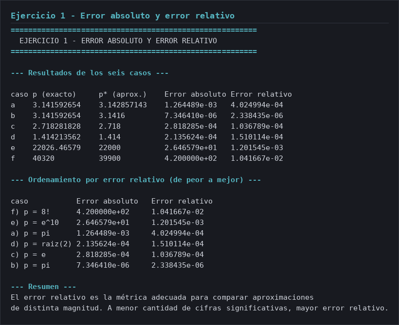
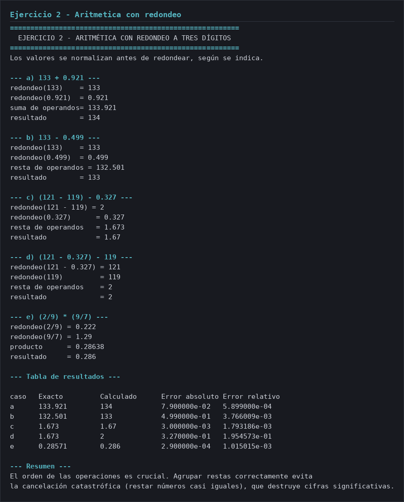
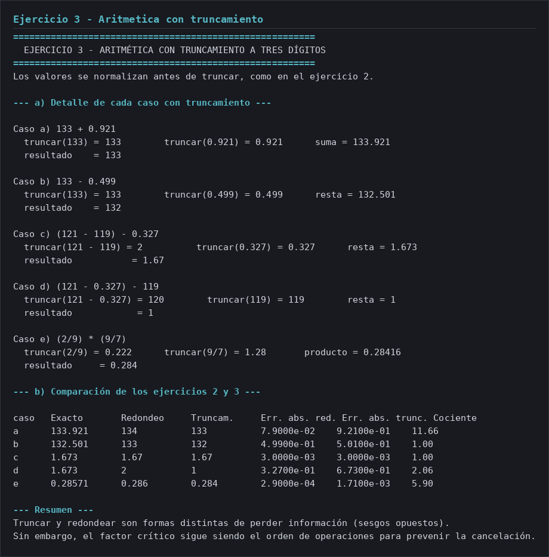
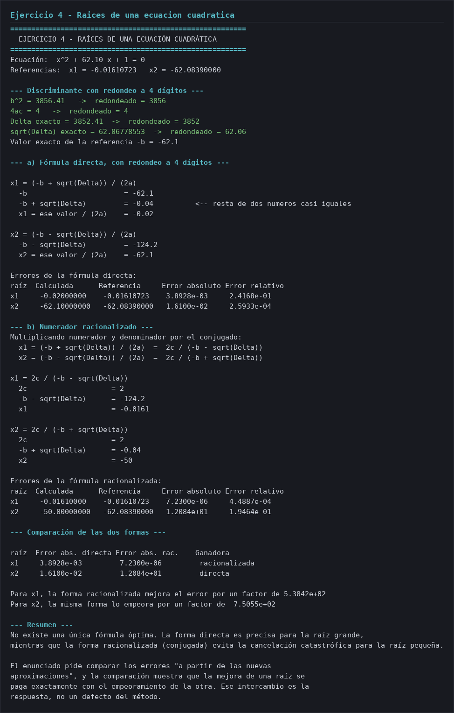
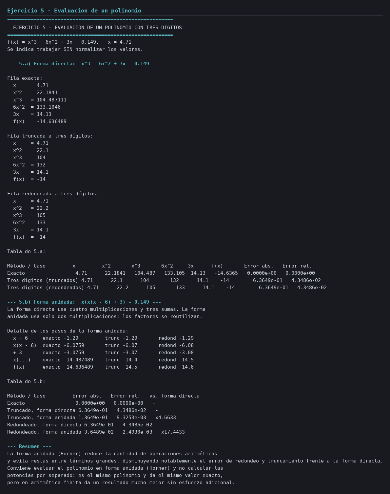

# Informe — Guía 2: Aproximaciones numéricas y errores

**Alumnos:** Franco Zambrano · Gabriel Bazzola

Métodos Computacionales · Laboratorio 2 · Octave 6.4.0

---

## Ejercicio 1 — Error absoluto y error relativo

### `01-error-absoluto-relativo.m`

````octave
% 01-error-absoluto-relativo.m - Ejercicio 1 de la Guía 2: errores de aproximación.
%
% Problema: calcular el error absoluto y el error relativo en seis
% aproximaciones de p por p*:
%   a) p = pi,      p* = 22/7
%   b) p = pi,      p* = 3.1416
%   c) p = e,       p* = 2.718
%   d) p = raiz(2), p* = 1.414
%   e) p = e^10,    p* = 22000
%   f) p = 8!,      p* = 39900
%
%   error absoluto = |p - p*|
%   error relativo = |p - p*| / |p|
% El absoluto mide la distancia en las unidades del problema; el relativo la
% divide por el propio valor, así que es adimensional y comparable entre
% problemas de distinta magnitud.

clc;

% ----------------------------------------------------------------------
% Datos de los seis casos
% ----------------------------------------------------------------------
% Cada fila es [valor_exacto, aproximacion].
% El valor exacto se evalúa con la función de Octave correspondiente.
casos = [ pi,     22 / 7;
          pi,     3.1416;
          exp(1), 2.718;
          sqrt(2), 1.414;
          exp(10), 22000;
          factorial(8), 39900 ];

etiquetas = {'a) p = pi', 'b) p = pi', 'c) p = e', ...
             'd) p = raiz(2)', 'e) p = e^10', 'f) p = 8!'};

fprintf('\n========================================================\n');
fprintf('  EJERCICIO 1 - ERROR ABSOLUTO Y ERROR RELATIVO\n');
fprintf('========================================================\n');

% ----------------------------------------------------------------------
% a-f) Cálculo de los seis casos
% ----------------------------------------------------------------------
fprintf('\n--- Resultados de los seis casos ---\n\n');
fprintf('%-4s %-14s %-14s %-14s %-14s\n', ...
        'caso', 'p (exacto)', 'p* (aprox.)', 'Error absoluto', 'Error relativo');

errores_absolutos = zeros(rows(casos), 1);
errores_relativos = zeros(rows(casos), 1);

for k = 1:rows(casos)
  exacto = casos(k, 1);
  aproximado = casos(k, 2);

  errores_absolutos(k) = error_absoluto(exacto, aproximado);
  errores_relativos(k) = error_relativo(exacto, aproximado);

  fprintf('%-4s %-14.10g %-14.10g %-14.6e %.6e\n', ...
          etiquetas{k}(1:1), exacto, aproximado, ...
          errores_absolutos(k), errores_relativos(k));
endfor

% ----------------------------------------------------------------------
% Ordenamiento por error relativo
% ----------------------------------------------------------------------
% Los casos se ordenan de peor a mejor error relativo: así se ve que el error
% absoluto y el relativo no coinciden en el orden.
fprintf('\n--- Ordenamiento por error relativo (de peor a mejor) ---\n\n');
fprintf('%-14s %-16s %-16s\n', 'caso', 'Error absoluto', 'Error relativo');

[~, orden] = sort(errores_relativos, 'descend');
for j = 1:numel(orden)
  k = orden(j);
  fprintf('%-14s %-16.6e %.6e\n', etiquetas{k}, ...
          errores_absolutos(k), errores_relativos(k));
endfor

% ----------------------------------------------------------------------
% Resumen
% ----------------------------------------------------------------------
fprintf('\n--- Resumen ---\n');
fprintf('El error relativo es la métrica adecuada para comparar aproximaciones\n');
fprintf('de distinta magnitud. A menor cantidad de cifras significativas, mayor error relativo.\n');
````

### Salida de ejecución



---

## Ejercicio 2 — Aritmética con redondeo a tres dígitos

### `02-aritmetica-redondeo.m`

````octave
% 02-aritmetica-redondeo.m - Ejercicio 2 de la Guía 2: aritmética de redondeo.
%
% Se redondean a tres dígitos significativos los operandos de cada cálculo, se
% opera y se redondea otra vez el resultado. Los valores se normalizan antes de
% redondear.
%
%   a) 133 + 0.921        b) 133 - 0.499
%   c) (121 - 119) - 0.327
%   d) (121 - 0.327) - 119
%   e) (2/9) * (9/7)
%
% El redondeo no es distributivo con la resta: redondear los operandos por
% separado no da lo mismo que redondear solo el resultado. Por eso c) y d) usan
% los mismos números y dan resultados muy distintos.

clc;

% ----------------------------------------------------------------------
% Datos del problema
% ----------------------------------------------------------------------
digitos = 3;

% Valor exacto de referencia: el resultado con cinco dígitos decimales.
exactos = [133.921, 132.501, 1.673, 1.673, 0.28571];

fprintf('\n========================================================\n');
fprintf('  EJERCICIO 2 - ARITMÉTICA CON REDONDEO A TRES DÍGITOS\n');
fprintf('========================================================\n');
fprintf('Los valores se normalizan antes de redondear, según se indica.\n');

% ----------------------------------------------------------------------
% a) 133 + 0.921
% ----------------------------------------------------------------------
fprintf('\n--- a) 133 + 0.921 ---\n');
a_operandos = redondear(133) + redondear(0.921);
a = redondear(a_operandos);
fprintf('redondeo(133)    = %.10g\n', redondear(133));
fprintf('redondeo(0.921)  = %.10g\n', redondear(0.921));
fprintf('suma de operandos= %.10g\n', a_operandos);
fprintf('resultado        = %.10g\n', a);

% ----------------------------------------------------------------------
% b) 133 - 0.499
% ----------------------------------------------------------------------
fprintf('\n--- b) 133 - 0.499 ---\n');
b_operandos = redondear(133) - redondear(0.499);
b = redondear(b_operandos);
fprintf('redondeo(133)    = %.10g\n', redondear(133));
fprintf('redondeo(0.499)  = %.10g\n', redondear(0.499));
fprintf('resta de operandos = %.10g\n', b_operandos);
fprintf('resultado        = %.10g\n', b);

% ----------------------------------------------------------------------
% c) (121 - 119) - 0.327
% ----------------------------------------------------------------------
fprintf('\n--- c) (121 - 119) - 0.327 ---\n');
c_resta_interna = redondear(121 - 119);
c_operandos = c_resta_interna - redondear(0.327);
c = redondear(c_operandos);
fprintf('redondeo(121 - 119) = %.10g\n', c_resta_interna);
fprintf('redondeo(0.327)      = %.10g\n', redondear(0.327));
fprintf('resta de operandos   = %.10g\n', c_operandos);
fprintf('resultado            = %.10g\n', c);

% ----------------------------------------------------------------------
% d) (121 - 0.327) - 119
% ----------------------------------------------------------------------
fprintf('\n--- d) (121 - 0.327) - 119 ---\n');
d_resta_interna = redondear(121 - 0.327);
d_operandos = d_resta_interna - redondear(119);
d = redondear(d_operandos);
fprintf('redondeo(121 - 0.327) = %.10g\n', d_resta_interna);
fprintf('redondeo(119)         = %.10g\n', redondear(119));
fprintf('resta de operandos    = %.10g\n', d_operandos);
fprintf('resultado             = %.10g\n', d);

% ----------------------------------------------------------------------
% e) (2/9) * (9/7)
% ----------------------------------------------------------------------
fprintf('\n--- e) (2/9) * (9/7) ---\n');
e_operandos = redondear(2 / 9) * redondear(9 / 7);
e = redondear(e_operandos);
fprintf('redondeo(2/9) = %.10g\n', redondear(2 / 9));
fprintf('redondeo(9/7) = %.10g\n', redondear(9 / 7));
fprintf('producto      = %.10g\n', e_operandos);
fprintf('resultado     = %.10g\n', e);

% ----------------------------------------------------------------------
% Tabla de resultados
% ----------------------------------------------------------------------
calculados = [a, b, c, d, e];
errores_abs = zeros(1, 5);
errores_rel = zeros(1, 5);

fprintf('\n--- Tabla de resultados ---\n\n');
fprintf('%-6s %-14s %-14s %-14s %s\n', ...
        'caso', 'Exacto', 'Calculado', 'Error absoluto', 'Error relativo');
for k = 1:5
  errores_abs(k) = error_absoluto(exactos(k), calculados(k));
  errores_rel(k) = error_relativo(exactos(k), calculados(k));
  fprintf('%-6s %-14.8g %-14.8g %-14.6e %.6e\n', ...
          char('a' + k - 1), exactos(k), calculados(k), errores_abs(k), errores_rel(k));
endfor

% ----------------------------------------------------------------------
% Resumen
% ----------------------------------------------------------------------
fprintf('\n--- Resumen ---\n');
fprintf('El orden de las operaciones es crucial. Agrupar restas correctamente evita\n');
fprintf('la cancelación catastrófica (restar números casi iguales), que destruye cifras significativas.\n');
````

### Salida de ejecución



---

## Ejercicio 3 — Aritmética con truncamiento a tres dígitos

### `03-aritmetica-truncamiento.m`

````octave
% 03-aritmetica-truncamiento.m - Ejercicio 3 de la Guía 2: aritmética con truncamiento.
%
% Se repiten los cinco casos del ejercicio 2 truncando a tres dígitos
% significativos en lugar de redondear, normalizando los valores, y se comparan
% los resultados de ambos métodos.
%
% El truncamiento no mira el dígito que descarta, así que siempre se queda con
% la parte baja de la magnitud: truncar(133.921) = 133, mientras que
% redondear(133.921) = 134.
%
% El truncamiento vive en truncar.m y depende de normalizar.m. Los errores se
% miden con error_absoluto.m y error_relativo.m.

clc;

% ----------------------------------------------------------------------
% Datos del problema
% ----------------------------------------------------------------------
% Valor exacto de referencia: el resultado con cinco dígitos decimales.
exactos = [133.921, 132.501, 1.673, 1.673, 0.28571];

% Resultados del ejercicio 2 (redondeo), recalculados con las mismas funciones
% para comparar en igualdad de condiciones.
redondeados = [redondear(redondear(133) + redondear(0.921)), ...
               redondear(redondear(133) - redondear(0.499)), ...
               redondear(redondear(121 - 119) - redondear(0.327)), ...
               redondear(redondear(121 - 0.327) - redondear(119)), ...
               redondear(redondear(2 / 9) * redondear(9 / 7))];

fprintf('\n========================================================\n');
fprintf('  EJERCICIO 3 - ARITMÉTICA CON TRUNCAMIENTO A TRES DÍGITOS\n');
fprintf('========================================================\n');
fprintf('Los valores se normalizan antes de truncar, como en el ejercicio 2.\n');

% ----------------------------------------------------------------------
% a) Los cinco casos con truncamiento
% ----------------------------------------------------------------------
fprintf('\n--- a) Detalle de cada caso con truncamiento ---\n');

fprintf('\nCaso a) 133 + 0.921\n');
a_t = truncar(133) + truncar(0.921);
a = truncar(a_t);
fprintf('  truncar(133) = %-10.10g truncar(0.921) = %-10.10g suma = %.10g\n', ...
        truncar(133), truncar(0.921), a_t);
fprintf('  resultado    = %.10g\n', a);

fprintf('\nCaso b) 133 - 0.499\n');
b_t = truncar(133) - truncar(0.499);
b = truncar(b_t);
fprintf('  truncar(133) = %-10.10g truncar(0.499) = %-10.10g resta = %.10g\n', ...
        truncar(133), truncar(0.499), b_t);
fprintf('  resultado    = %.10g\n', b);

fprintf('\nCaso c) (121 - 119) - 0.327\n');
c_t = truncar(121 - 119) - truncar(0.327);
c = truncar(c_t);
fprintf('  truncar(121 - 119) = %-10.10g truncar(0.327) = %-10.10g resta = %.10g\n', ...
        truncar(121 - 119), truncar(0.327), c_t);
fprintf('  resultado           = %.10g\n', c);

fprintf('\nCaso d) (121 - 0.327) - 119\n');
d_t = truncar(121 - 0.327) - truncar(119);
d = truncar(d_t);
fprintf('  truncar(121 - 0.327) = %-10.10g truncar(119) = %-10.10g resta = %.10g\n', ...
        truncar(121 - 0.327), truncar(119), d_t);
fprintf('  resultado            = %.10g\n', d);

fprintf('\nCaso e) (2/9) * (9/7)\n');
e_t = truncar(2 / 9) * truncar(9 / 7);
e = truncar(e_t);
fprintf('  truncar(2/9) = %-10.10g truncar(9/7) = %-10.10g producto = %.10g\n', ...
        truncar(2 / 9), truncar(9 / 7), e_t);
fprintf('  resultado     = %.10g\n', e);

truncados = [a, b, c, d, e];

% ----------------------------------------------------------------------
% b) Comparación con el ejercicio 2
% ----------------------------------------------------------------------
% Los dos métodos van en la misma tabla, con sus errores.
err_abs_trunc = zeros(1, 5);
err_rel_trunc = zeros(1, 5);
err_abs_redon = zeros(1, 5);
err_rel_redon = zeros(1, 5);

fprintf('\n--- b) Comparación de los ejercicios 2 y 3 ---\n\n');
fprintf('%-6s %-12s %-12s %-12s %-13s %-13s %s\n', ...
        'caso', 'Exacto', 'Redondeo', 'Truncam.', 'Err. abs. red.', ...
        'Err. abs. trunc.', 'Cociente');

for k = 1:5
  err_abs_trunc(k) = error_absoluto(exactos(k), truncados(k));
  err_rel_trunc(k) = error_relativo(exactos(k), truncados(k));
  err_abs_redon(k) = error_absoluto(exactos(k), redondeados(k));
  err_rel_redon(k) = error_relativo(exactos(k), redondeados(k));

  fprintf('%-6s %-12.6g %-12.6g %-12.6g %-13.4e %-13.4e %.2f\n', ...
          char('a' + k - 1), exactos(k), redondeados(k), truncados(k), ...
          err_abs_redon(k), err_abs_trunc(k), ...
          err_abs_trunc(k) / max(err_abs_redon(k), eps));
endfor

% ----------------------------------------------------------------------
% Resumen
% ----------------------------------------------------------------------
fprintf('\n--- Resumen ---\n');
fprintf('Truncar y redondear son formas distintas de perder información (sesgos opuestos).\n');
fprintf('Sin embargo, el factor crítico sigue siendo el orden de operaciones para prevenir la cancelación.\n');
````

### Salida de ejecución



---

## Ejercicio 4 — Raíces de una ecuación cuadrática

### `04-raices-cuadraticas.m`

````octave
% 04-raices-cuadraticas.m - Ejercicio 4 de la Guía 2: raíces de una cuadrática.
%
% Para x^2 + 62.10x + 1 = 0, con referencias x1 = -0.01610723 y
% x2 = -62.08390, se calculan las raíces con la fórmula directa
%   x1 = (-b + sqrt(Delta)) / (2a),  x2 = (-b - sqrt(Delta)) / (2a)
% redondeando a cuatro dígitos, y luego con el numerador racionalizado
%   x1 = 2c / (-b - sqrt(Delta)),  x2 = 2c / (-b + sqrt(Delta)).
%
% Delta = b^2 - 4ac = 3852.41 y sqrt(Delta) = 62.0677855... El numerador de x1
% es -b + sqrt(Delta) = -0.0322: una resta de números casi iguales que destruye
% cifras significativas. Racionalizar traslada esa cancelación al denominador de
% x2, así que cada forma es buena para una raíz y mala para la otra.
%
% La división por 2a lleva paréntesis explícito: en Octave / y * tienen la misma
% prioridad y se evalúan de izquierda a derecha.

clc;

% ----------------------------------------------------------------------
% Datos del problema
% ----------------------------------------------------------------------
a = 1;
b = 62.10;
c = 1;

% Valores de referencia dados por el problema.
referencia_x1 = -0.01610723;
referencia_x2 = -62.08390;

% Cantidad de dígitos con que se trabaja en la parte a).
digitos = 4;

fprintf('\n========================================================\n');
fprintf('  EJERCICIO 4 - RAÍCES DE UNA ECUACIÓN CUADRÁTICA\n');
fprintf('========================================================\n');
fprintf('Ecuación:  x^2 + %.2f x + 1 = 0\n', b);
fprintf('Referencias:  x1 = %.8f   x2 = %.8f\n', referencia_x1, referencia_x2);

% ----------------------------------------------------------------------
% Valores de partida
% ----------------------------------------------------------------------
% Se calcula el discriminante con aritmética de cuatro dígitos para ver cuánto
% se pierde desde el principio.
delta = redondear(b^2 - 4 * a * c, digitos);
sqrt_delta = redondear(sqrt(delta), digitos);

fprintf('\n--- Discriminante con redondeo a %d dígitos ---\n', digitos);
fprintf('b^2 = %.10g   ->  redondeado = %-10.10g\n', b^2, redondear(b^2, digitos));
fprintf('4ac = %.10g   ->  redondeado = %-10.10g\n', 4 * a * c, redondear(4 * a * c, digitos));
fprintf('Delta exacto = %.10g  ->  redondeado = %-10.10g\n', b^2 - 4 * a * c, delta);
fprintf('sqrt(Delta) exacto = %.10g  ->  redondeado = %-10.10g\n', ...
        sqrt(b^2 - 4 * a * c), sqrt_delta);
fprintf('Valor exacto de la referencia -b = %.10g\n', -b);

% ----------------------------------------------------------------------
% a) Fórmula directa
% ----------------------------------------------------------------------
fprintf('\n--- a) Fórmula directa, con redondeo a %d dígitos ---\n', digitos);

% x1 = (-b + sqrt(Delta)) / (2a)
paso1 = redondear(-b, digitos);
paso2 = redondear(-b + sqrt_delta, digitos);
x1_directa = redondear(paso2 / (2 * a), digitos);

% x2 = (-b - sqrt(Delta)) / (2a)
paso3 = redondear(-b - sqrt_delta, digitos);
x2_directa = redondear(paso3 / (2 * a), digitos);

fprintf('\nx1 = (-b + sqrt(Delta)) / (2a)\n');
fprintf('  -b                       = %-12.10g\n', paso1);
fprintf('  -b + sqrt(Delta)         = %-12.10g   <-- resta de dos numeros casi iguales\n', paso2);
fprintf('  x1 = ese valor / (2a)    = %-12.10g\n', x1_directa);

fprintf('\nx2 = (-b - sqrt(Delta)) / (2a)\n');
fprintf('  -b - sqrt(Delta)         = %-12.10g\n', paso3);
fprintf('  x2 = ese valor / (2a)    = %-12.10g\n', x2_directa);

fprintf('\nErrores de la fórmula directa:\n');
fprintf('%-6s %-14s %-14s %-14s %s\n', 'raíz', 'Calculada', 'Referencia', 'Error absoluto', 'Error relativo');
fprintf('%-6s %-14.8f %-14.8f %-14.4e %.4e\n', 'x1', x1_directa, referencia_x1, ...
        error_absoluto(referencia_x1, x1_directa), error_relativo(referencia_x1, x1_directa));
fprintf('%-6s %-14.8f %-14.8f %-14.4e %.4e\n', 'x2', x2_directa, referencia_x2, ...
        error_absoluto(referencia_x2, x2_directa), error_relativo(referencia_x2, x2_directa));

% ----------------------------------------------------------------------
% b) Fórmula con el numerador racionalizado
% ----------------------------------------------------------------------
fprintf('\n--- b) Numerador racionalizado ---\n');
fprintf('Multiplicando numerador y denominador por el conjugado:\n');
fprintf('  x1 = (-b + sqrt(Delta)) / (2a)  =  2c / (-b - sqrt(Delta))\n');
fprintf('  x2 = (-b - sqrt(Delta)) / (2a)  =  2c / (-b + sqrt(Delta))\n');

% x1 = 2c / (-b - sqrt(Delta))
r1_numerador = redondear(2 * c, digitos);
r1_denominador = redondear(-b - sqrt_delta, digitos);
x1_racionalizada = redondear(r1_numerador / r1_denominador, digitos);

% x2 = 2c / (-b + sqrt(Delta))
r2_numerador = redondear(2 * c, digitos);
r2_denominador = redondear(-b + sqrt_delta, digitos);
x2_racionalizada = redondear(r2_numerador / r2_denominador, digitos);

fprintf('\nx1 = 2c / (-b - sqrt(Delta))\n');
fprintf('  2c                    = %-12.10g\n', r1_numerador);
fprintf('  -b - sqrt(Delta)      = %-12.10g\n', r1_denominador);
fprintf('  x1                    = %-12.10g\n', x1_racionalizada);

fprintf('\nx2 = 2c / (-b + sqrt(Delta))\n');
fprintf('  2c                    = %-12.10g\n', r2_numerador);
fprintf('  -b + sqrt(Delta)      = %-12.10g\n', r2_denominador);
fprintf('  x2                    = %-12.10g\n', x2_racionalizada);

fprintf('\nErrores de la fórmula racionalizada:\n');
fprintf('%-6s %-14s %-14s %-14s %s\n', 'raíz', 'Calculada', 'Referencia', 'Error absoluto', 'Error relativo');
fprintf('%-6s %-14.8f %-14.8f %-14.4e %.4e\n', 'x1', x1_racionalizada, referencia_x1, ...
        error_absoluto(referencia_x1, x1_racionalizada), error_relativo(referencia_x1, x1_racionalizada));
fprintf('%-6s %-14.8f %-14.8f %-14.4e %.4e\n', 'x2', x2_racionalizada, referencia_x2, ...
        error_absoluto(referencia_x2, x2_racionalizada), error_relativo(referencia_x2, x2_racionalizada));

% ----------------------------------------------------------------------
% Comparación
% ----------------------------------------------------------------------
fprintf('\n--- Comparación de las dos formas ---\n\n');
fprintf('%-6s %-18s %-18s %s\n', 'raíz', 'Error abs. directa', 'Error abs. rac.', 'Ganadora');

% Se calculan los cuatro errores una vez y se reutilizan en la tabla.
err_x1_directa = error_absoluto(referencia_x1, x1_directa);
err_x1_racionalizada = error_absoluto(referencia_x1, x1_racionalizada);
err_x2_directa = error_absoluto(referencia_x2, x2_directa);
err_x2_racionalizada = error_absoluto(referencia_x2, x2_racionalizada);

% La ganadora es la de menor error absoluto. El texto se arma acá porque Octave
% no permite llamar a una función definida más abajo en un script.
if (err_x1_racionalizada < err_x1_directa)
  ganadora_x1 = 'racionalizada';
else
  ganadora_x1 = 'directa';
endif
if (err_x2_racionalizada < err_x2_directa)
  ganadora_x2 = 'racionalizada';
else
  ganadora_x2 = 'directa';
endif

fprintf('%-6s %-18.4e %-18.4e %s\n', 'x1', err_x1_directa, err_x1_racionalizada, ganadora_x1);
fprintf('%-6s %-18.4e %-18.4e %s\n', 'x2', err_x2_directa, err_x2_racionalizada, ganadora_x2);

fprintf('\nPara x1, la forma racionalizada mejora el error por un factor de %.4e\n', ...
        err_x1_directa / max(err_x1_racionalizada, eps));
fprintf('Para x2, la misma forma lo empeora por un factor de  %.4e\n', ...
        err_x2_racionalizada / max(err_x2_directa, eps));

% ----------------------------------------------------------------------
% Resumen
% ----------------------------------------------------------------------
fprintf('\n--- Resumen ---\n');
fprintf('No existe una única fórmula óptima. La forma directa es precisa para la raíz grande,\n');
fprintf('mientras que la forma racionalizada (conjugada) evita la cancelación catastrófica para la raíz pequeña.\n');
fprintf('\nEl enunciado pide comparar los errores "a partir de las nuevas\n');
fprintf('aproximaciones", y la comparación muestra que la mejora de una raíz se\n');
fprintf('paga exactamente con el empeoramiento de la otra. Ese intercambio es la\n');
fprintf('respuesta, no un defecto del método.\n');
````

### Salida de ejecución



---

## Ejercicio 5 — Evaluación de un polinomio con tres dígitos

### `05-evaluacion-polinomio.m`

````octave
% 05-evaluacion-polinomio.m - Ejercicio 5 de la Guía 2: evaluación de un polinomio.
%
% Se evalúa f(x) = x^3 - 6x^2 + 3x - 0.149 en x = 4.71 con aritmética de tres
% dígitos significativos, primero en forma directa y después en forma anidada
% x(x(x - 6) + 3) - 0.149, comparando los errores.
%
% "Tres dígitos" son tres dígitos significativos. El valor exacto de referencia
% es f(4.71) = 104.487111 - 133.1046 + 14.13 - 0.149 = -14.636489, y es negativo:
% el error relativo usa el valor absoluto del denominador, así que sale positivo.
%
% El punto 5.a pide trabajar "sin normalizar", por eso usa truncar_n.m y
% redondear_n.m, que operan sobre la mantisa sin renormalizar el resultado.
% truncar.m y redondear.m normalizan y corresponden a los ejercicios 2 a 4.

clc;

% ----------------------------------------------------------------------
% Datos del problema
% ----------------------------------------------------------------------
x = 4.71;
digitos = 3;

fprintf('\n========================================================\n');
fprintf('  EJERCICIO 5 - EVALUACIÓN DE UN POLINOMIO CON TRES DÍGITOS\n');
fprintf('========================================================\n');
fprintf('f(x) = x^3 - 6x^2 + 3x - 0.149,   x = %.2f\n', x);
fprintf('Se indica trabajar SIN normalizar los valores.\n');

% ----------------------------------------------------------------------
% 5.a) Forma directa
% ----------------------------------------------------------------------
fprintf('\n--- 5.a) Forma directa:  x^3 - 6x^2 + 3x - 0.149 ---\n');

% --- Fila exacta: sin ninguna aritmética de tres dígitos ---
ex_x2 = x^2;
ex_x3 = x^3;
ex_6x2 = 6 * x^2;
ex_3x = 3 * x;
ex_f = x^3 - 6 * x^2 + 3 * x - 0.149;

fprintf('\nFila exacta:\n');
fprintf('  x     = %.10g\n', x);
fprintf('  x^2   = %.10g\n', ex_x2);
fprintf('  x^3   = %.10g\n', ex_x3);
fprintf('  6x^2  = %.10g\n', ex_6x2);
fprintf('  3x    = %.10g\n', ex_3x);
fprintf('  f(x)  = %.10g\n', ex_f);

% --- Fila truncada ---
% Se trunca a tres dígitos significativos cada resultado intermedio, que es lo
% que significa operar con aritmética de tres dígitos.
tr_x = truncar_n(x, digitos);
tr_x2 = truncar_n(tr_x * tr_x, digitos);
tr_x3 = truncar_n(tr_x2 * tr_x, digitos);
tr_6x2 = truncar_n(truncar_n(6, digitos) * tr_x2, digitos);
tr_3x = truncar_n(truncar_n(3, digitos) * tr_x, digitos);
tr_f = truncar_n(truncar_n(truncar_n(tr_x3 - tr_6x2, digitos) + tr_3x, digitos) ...
                 - truncar_n(0.149, digitos), digitos);

% --- Fila redondeada ---
rd_x = redondear_n(x, digitos);
rd_x2 = redondear_n(rd_x * rd_x, digitos);
rd_x3 = redondear_n(rd_x2 * rd_x, digitos);
rd_6x2 = redondear_n(redondear_n(6, digitos) * rd_x2, digitos);
rd_3x = redondear_n(redondear_n(3, digitos) * rd_x, digitos);
rd_f = redondear_n(redondear_n(redondear_n(rd_x3 - rd_6x2, digitos) + rd_3x, digitos) ...
                 - redondear_n(0.149, digitos), digitos);

fprintf('\nFila truncada a tres dígitos:\n');
fprintf('  x     = %.10g\n', tr_x);
fprintf('  x^2   = %.10g\n', tr_x2);
fprintf('  x^3   = %.10g\n', tr_x3);
fprintf('  6x^2  = %.10g\n', tr_6x2);
fprintf('  3x    = %.10g\n', tr_3x);
fprintf('  f(x)  = %.10g\n', tr_f);

fprintf('\nFila redondeada a tres dígitos:\n');
fprintf('  x     = %.10g\n', rd_x);
fprintf('  x^2   = %.10g\n', rd_x2);
fprintf('  x^3   = %.10g\n', rd_x3);
fprintf('  6x^2  = %.10g\n', rd_6x2);
fprintf('  3x    = %.10g\n', rd_3x);
fprintf('  f(x)  = %.10g\n', rd_f);

% ----------------------------------------------------------------------
% Tabla requerida por el problema
% ----------------------------------------------------------------------
fprintf('\nTabla de 5.a:\n\n');
fprintf('%-22s %-9s %-9s %-9s %-8s %-7s %-10s %-12s %s\n', ...
        'Método / Caso', 'x', 'x^2', 'x^3', '6x^2', '3x', 'f(x)', 'Error abs.', 'Error rel.');

% Una fila por caso; la primera columna es texto.
etiquetas_filas = {'Exacto', 'Tres dígitos (truncados)', 'Tres dígitos (redondeados)'};
tabla = [ x,    ex_x2, ex_x3, ex_6x2, ex_3x, ex_f, 0, 0;
          tr_x, tr_x2, tr_x3, tr_6x2, tr_3x, tr_f, ...
                 error_absoluto(ex_f, tr_f), error_relativo(ex_f, tr_f);
          rd_x, rd_x2, rd_x3, rd_6x2, rd_3x, rd_f, ...
                 error_absoluto(ex_f, rd_f), error_relativo(ex_f, rd_f)];

for k = 1:rows(tabla)
  fprintf('%-22s %-9.6g %-9.6g %-9.6g %-8.6g %-7.6g %-10.6g %-12.4e %.4e\n', ...
          etiquetas_filas{k}, tabla(k, 1), tabla(k, 2), tabla(k, 3), tabla(k, 4), ...
          tabla(k, 5), tabla(k, 6), tabla(k, 7), tabla(k, 8));
endfor

% ----------------------------------------------------------------------
% 5.b) Forma anidada
% ----------------------------------------------------------------------
fprintf('\n--- 5.b) Forma anidada:  x(x(x - 6) + 3) - 0.149 ---\n');
fprintf('La forma directa usa cuatro multiplicaciones y tres sumas. La forma\n');
fprintf('anidada usa solo dos multiplicaciones: los factores se reutilizan.\n');

% --- Anidada exacta ---
an_t1 = x - 6;
an_t2 = x * an_t1;
an_t3 = an_t2 + 3;
an_t4 = x * an_t3;
an_f = an_t4 - 0.149;

% --- Anidada truncada ---
ant_t1 = truncar_n(x - 6, digitos);
ant_t2 = truncar_n(x * ant_t1, digitos);
ant_t3 = truncar_n(ant_t2 + truncar_n(3, digitos), digitos);
ant_t4 = truncar_n(x * ant_t3, digitos);
ant_f = truncar_n(ant_t4 - truncar_n(0.149, digitos), digitos);

% --- Anidada redondeada ---
anr_t1 = redondear_n(x - 6, digitos);
anr_t2 = redondear_n(x * anr_t1, digitos);
anr_t3 = redondear_n(anr_t2 + redondear_n(3, digitos), digitos);
anr_t4 = redondear_n(x * anr_t3, digitos);
anr_f = redondear_n(anr_t4 - redondear_n(0.149, digitos), digitos);

fprintf('\nDetalle de los pasos de la forma anidada:\n');
fprintf('  x - 6     exacto %-12.10g  trunc %-10.10g  redond %-10.10g\n', ...
        an_t1, ant_t1, anr_t1);
fprintf('  x(x - 6)  exacto %-12.10g  trunc %-10.10g  redond %-10.10g\n', ...
        an_t2, ant_t2, anr_t2);
fprintf('  + 3       exacto %-12.10g  trunc %-10.10g  redond %-10.10g\n', ...
        an_t3, ant_t3, anr_t3);
fprintf('  x(...)    exacto %-12.10g  trunc %-10.10g  redond %-10.10g\n', ...
        an_t4, ant_t4, anr_t4);
fprintf('  f(x)      exacto %-12.10g  trunc %-10.10g  redond %-10.10g\n', ...
        an_f, ant_f, anr_f);

fprintf('\nTabla de 5.b:\n\n');
fprintf('%-22s %-12s %-12s %s\n', 'Método / Caso', 'Error abs.', 'Error rel.', 'vs. forma directa');

err_abs_trunc_directa = error_absoluto(ex_f, tr_f);
err_abs_redond_directa = error_absoluto(ex_f, rd_f);
err_abs_trunc_anidada = error_absoluto(ex_f, ant_f);
err_abs_redond_anidada = error_absoluto(ex_f, anr_f);

fprintf('%-22s %-12.4e %-12.4e %s\n', 'Exacto', 0, 0, '-');
fprintf('%-22s %-12.4e %-12.4e %-10s\n', 'Truncado, forma directa', ...
        err_abs_trunc_directa, error_relativo(ex_f, tr_f), '-');
fprintf('%-22s %-12.4e %-12.4e %s\n', 'Truncado, forma anidada', ...
        err_abs_trunc_anidada, error_relativo(ex_f, ant_f), ...
        sprintf('x%.4f', err_abs_trunc_directa / max(err_abs_trunc_anidada, eps)));
fprintf('%-22s %-12.4e %-12.4e %s\n', 'Redondeado, forma directa', ...
        err_abs_redond_directa, error_relativo(ex_f, rd_f), '-');
fprintf('%-22s %-12.4e %-12.4e %s\n', 'Redondeado, forma anidada', ...
        err_abs_redond_anidada, error_relativo(ex_f, anr_f), ...
        sprintf('x%.4f', err_abs_redond_directa / max(err_abs_redond_anidada, eps)));

% ----------------------------------------------------------------------
% Resumen
% ----------------------------------------------------------------------
fprintf('\n--- Resumen ---\n');
fprintf('La forma anidada (Horner) reduce la cantidad de operaciones aritméticas\n');
fprintf('y evita restas entre términos grandes, disminuyendo notablemente el error de redondeo y truncamiento frente a la forma directa.\n');
fprintf('Conviene evaluar el polinomio en forma anidada (Horner) y no calcular las\n');
fprintf('potencias por separado: es el mismo polinomio y da el mismo valor exacto,\n');
fprintf('pero en aritmética finita da un resultado mucho mejor sin esfuerzo adicional.\n');
````

### Salida de ejecución



---

# Anexo — Métodos de redondeo y error

## Normalización

````octave
function [exponente, resultado] = normalizar(numero)
  % NORMALIZAR - Lleva un número a la forma normalizada 0.d1d2d3... x 10^exponente.
  % Entradas:
  %   numero - valor a normalizar
  % Salidas:
  %   exponente - exponente decimal del número
  %   resultado - mantisa normalizada, con el valor absoluto en [0.1, 1)
  % Relación:
  %   numero = resultado * 10^exponente
  %
  % Ejemplo: normalizar(133.921) devuelve exponente = 3 y resultado = 0.133921.
  % El cero no se puede escribir como mantisa: devuelve exponente = 0 y
  % resultado = 0.
  %
  % truncar_n.m y redondear_n.m operan sin pasar por acá.

  if (nargin != 1)
    error("normalizar: se requiere exactamente 1 argumento (numero)");
  endif
  if (!isnumeric(numero) || !isscalar(numero) || !isfinite(numero))
    error("normalizar: numero debe ser un escalar finito");
  endif

  exponente = 0;
  resultado = 0;

  % El cero no se puede normalizar.
  if (numero == 0)
    return;
  endif

  resultado = numero;

  % Se divide por 10 hasta que la mantisa entre en [0.1, 1).
  while (abs(resultado) >= 1)
    exponente = exponente + 1;
    resultado = resultado / 10;
  endwhile

  % Si el número era menor que 0.1, el lazo anterior no corrió y hay que
  % multiplicar en vez de dividir, bajando el exponente en consecuencia.
  while (abs(resultado) < 0.1)
    exponente = exponente - 1;
    resultado = resultado * 10;
  endwhile
endfunction
````

## Redondeo normalizado a tres dígitos

````octave
function resultado = redondear(numero, digitos)
  % REDONDEAR - Redondea un número a n dígitos SIGNIFICATIVOS, normalizando.
  % Entradas:
  %   numero  - valor a redondear
  %   digitos - cantidad de dígitos significativos a conservar (opcional, 3 por
  %             defecto; el ejercicio 4 pide 4)
  % Salidas:
  %   resultado - número conservando n dígitos significativos
  %
  % Los n dígitos se cuentan desde la primera cifra no nula. Se normaliza el
  % número a 0.d1d2d3... x 10^e, se redondea la mantisa a n dígitos y se vuelve
  % a armar:
  %   [e, m] = normalizar(numero)
  %   resultado = round(m * 10^n) / 10^n * 10^e
  %
  % Ejemplo: redondear(133.921) = 134, porque 0.133921 redondeado a tres dígitos
  % es 0.134 y 0.134 x 10^3 = 134. Con cuatro dígitos da 133.9.
  %
  % Para redondear sin normalizar existe redondear_n.m.

  if (nargin != 1 && nargin != 2)
    error("redondear: se requiere 1 o 2 argumentos (numero, digitos)");
  endif
  if (nargin < 2)
    digitos = 3;
  endif
  if (!isnumeric(numero) || !isscalar(numero) || !isfinite(numero))
    error("redondear: numero debe ser un escalar finito");
  endif
  if (!isnumeric(digitos) || !isscalar(digitos) || !isfinite(digitos) || ...
      digitos != fix(digitos) || digitos < 1)
    error("redondear: digitos debe ser un entero positivo (digitos >= 1)");
  endif

  [exponente, mantisa] = normalizar(numero);

  redondeado = round(mantisa * 10^digitos) / 10^digitos;
  resultado = redondeado * 10^exponente;
endfunction
````

## Truncamiento normalizado a tres dígitos

````octave
function resultado = truncar(numero)
  % TRUNCAR - Trunca un número a tres dígitos SIGNIFICATIVOS, normalizando.
  % Entradas:
  %   numero - valor a truncar
  % Salidas:
  %   resultado - número conservando tres dígitos significativos
  %
  % Los tres dígitos se cuentan desde la primera cifra no nula. Se normaliza el
  % número a 0.d1d2d3... x 10^e, se trunca la mantisa a tres dígitos y se vuelve
  % a armar:
  %   [e, m] = normalizar(numero)
  %   resultado = fix(m * 10^3) / 10^3 * 10^e
  %
  % A diferencia del redondeo, no mira el dígito siguiente: truncar(133.921) =
  % 133, mientras que redondear(133.921) = 134.
  %
  % Para truncar sin normalizar existe truncar_n.m.

  if (nargin != 1)
    error("truncar: se requiere exactamente 1 argumento (numero)");
  endif
  if (!isnumeric(numero) || !isscalar(numero) || !isfinite(numero))
    error("truncar: numero debe ser un escalar finito");
  endif

  [exponente, mantisa] = normalizar(numero);

  % Escalar la mantisa a un número entero de tres dígitos.
  escalado = mantisa * 10^3;

  % Corrección de error de representación: las potencias de 10 no son exactas
  % en punto flotante, así que el escalado puede quedar apenas por debajo del
  % entero verdadero y fix se lleva un dígito de más. truncar(-28), por ejemplo,
  % produce -279.99999999999994. Si el valor está a unas pocas unidades de error
  % de máquina de un entero, se lo considera ese entero; el margen es relativo y
  % un truncamiento genuino nunca se ve afectado.
  if (abs(escalado - round(escalado)) <= 10 * eps(abs(escalado)))
    escalado = round(escalado);
  endif

  truncado = fix(escalado) / 10^3;
  resultado = truncado * 10^exponente;
endfunction
````

## Redondeo a n dígitos sin normalizar

````octave
function resultado = redondear_n(numero, n)
  % REDONDEAR_N - Redondea un número a n dígitos SIGNIFICATIVOS, SIN NORMALIZAR.
  % Entradas:
  %   numero - valor a redondear
  %   n      - cantidad de dígitos significativos a conservar
  % Salidas:
  %   resultado - número conservando n dígitos significativos
  %
  % A diferencia de redondear.m, no renormaliza el resultado: si el redondeo
  % produce un acarreo, lo deja en la forma cruda. Por ejemplo, 999 redondeado a
  % dos dígitos da 100 y no 1.00 x 10^3. Eso es lo que pide el punto 5.a con
  % "sin normalizar".
  %
  % Ejemplo: redondear_n(104.487111, 3) = 105 y redondear_n(0.0000123456, 3) =
  % 1.23e-05; la operación se aplica a la mantisa.

  if (nargin != 2)
    error("redondear_n: se requieren exactamente 2 argumentos (numero, n)");
  endif
  if (!isnumeric(numero) || !isscalar(numero) || !isfinite(numero))
    error("redondear_n: numero debe ser un escalar finito");
  endif
  if (!isnumeric(n) || !isscalar(n) || !isfinite(n) || n != fix(n) || n < 1)
    error("redondear_n: n debe ser un entero positivo (n >= 1)");
  endif

  % El cero no tiene dígitos significativos que conservar.
  if (numero == 0)
    resultado = 0;
    return;
  endif

  % Notación científica: numero = mantisa * 10^exponente, con 1 <= |mantisa| < 10.
  % En esa forma la mantisa ya tiene UNA cifra entera, así que los n dígitos
  % significativos se obtienen reteniendo las n - 1 cifras decimales de la
  % mantisa. Retener n decimales sería guardar n + 1 dígitos.
  exponente = floor(log10(abs(numero)));
  mantisa = numero / 10^exponente;

  % Se redondea la mantisa conservando n dígitos y se reescribe el número sin
  % renormalizar.
  resultado = round(mantisa * 10^(n - 1)) / 10^(n - 1) * 10^exponente;
endfunction
````

## Truncamiento a n dígitos sin normalizar

````octave
function resultado = truncar_n(numero, n)
  % TRUNCAR_N - Trunca un número a n dígitos SIGNIFICATIVOS, SIN NORMALIZAR.
  % Entradas:
  %   numero - valor a truncar
  %   n      - cantidad de dígitos significativos a conservar
  % Salidas:
  %   resultado - número conservando n dígitos significativos
  %
  % A diferencia de truncar.m, no renormaliza el resultado: lo deja en la forma
  % cruda que sale de operar sobre la mantisa. Es lo que pide el punto 5.a con
  % "sin normalizar".
  %
  % No mira el dígito siguiente: truncar_n(104.487111, 3) = 104 y no 105.

  if (nargin != 2)
    error("truncar_n: se requieren exactamente 2 argumentos (numero, n)");
  endif
  if (!isnumeric(numero) || !isscalar(numero) || !isfinite(numero))
    error("truncar_n: numero debe ser un escalar finito");
  endif
  if (!isnumeric(n) || !isscalar(n) || !isfinite(n) || n != fix(n) || n < 1)
    error("truncar_n: n debe ser un entero positivo (n >= 1)");
  endif

  % El cero no tiene digitos significativos que conservar.
  if (numero == 0)
    resultado = 0;
    return;
  endif

  % Notación científica: numero = mantisa * 10^exponente, con 1 <= |mantisa| < 10.
  % En esa forma la mantisa ya tiene UNA cifra entera, así que los n dígitos
  % significativos se obtienen reteniendo las n - 1 cifras decimales de la
  % mantisa. Retener n decimales sería guardar n + 1 dígitos.
  exponente = floor(log10(abs(numero)));
  mantisa = numero / 10^exponente;

  % Escalar la mantisa a un número entero de n dígitos.
  escalado = mantisa * 10^(n - 1);

  % Corrección de error de representación: las potencias de 10 no son exactas
  % en punto flotante, así que el escalado puede quedar apenas por debajo del
  % entero verdadero. truncar_n(0.149, 3), por ejemplo, produce 148.99999999999997
  % y fix se lleva un dígito de más. Si el valor está a unas pocas unidades de
  % error de máquina de un entero, se lo considera ese entero; el margen es
  % relativo y un truncamiento genuino nunca se ve afectado.
  if (abs(escalado - round(escalado)) <= 10 * eps(abs(escalado)))
    escalado = round(escalado);
  endif

  % Se trunca la mantisa conservando n dígitos y se reescribe el número sin
  % renormalizar. fix trunca hacia cero, que es justamente el truncamiento de
  % cifras: no mira el dígito descartado.
  resultado = fix(escalado) / 10^(n - 1) * 10^exponente;
endfunction
````

## Error absoluto

````octave
function error_abs = error_absoluto(valor_exacto, valor_calculado)
  % ERROR_ABSOLUTO - Error absoluto de una aproximación.
  % Entradas:
  %   valor_exacto    - valor de referencia p
  %   valor_calculado - aproximación p*
  % Salidas:
  %   error_abs - |p - p*|
  %
  % Es una distancia, así que nunca es negativa, y se mide en las mismas
  % unidades del problema.

  if (nargin != 2)
    error("error_absoluto: se requieren exactamente 2 argumentos (valor_exacto, valor_calculado)");
  endif
  if (!isnumeric(valor_exacto) || !isnumeric(valor_calculado) || ...
      !isscalar(valor_exacto) || !isscalar(valor_calculado))
    error("error_absoluto: los dos argumentos deben ser escalares numéricos");
  endif

  error_abs = abs(valor_exacto - valor_calculado);
endfunction
````

## Error relativo

````octave
function error_rel = error_relativo(valor_exacto, valor_calculado)
  % ERROR_RELATIVO - Error relativo de una aproximación.
  % Entradas:
  %   valor_exacto    - valor de referencia p
  %   valor_calculado - aproximación p*
  % Salidas:
  %   error_rel - |p - p*| / |p|
  %
  % Es adimensional, porque divide por el propio valor de referencia, y por eso
  % es comparable entre problemas de distinta magnitud. El denominador va en
  % valor absoluto para que el error de un valor negativo también sea positivo.
  %
  % Si el valor exacto es cero el error no está definido: se avisa y se devuelve
  % Inf en lugar de un NaN silencioso.

  if (nargin != 2)
    error("error_relativo: se requieren exactamente 2 argumentos (valor_exacto, valor_calculado)");
  endif
  if (!isnumeric(valor_exacto) || !isnumeric(valor_calculado) || ...
      !isscalar(valor_exacto) || !isscalar(valor_calculado))
    error("error_relativo: los dos argumentos deben ser escalares numéricos");
  endif

  if (valor_exacto == 0)
    warning("error_relativo: el valor exacto es cero, el error relativo no está definido");
    error_rel = Inf;
    return;
  endif

  error_rel = abs(valor_exacto - valor_calculado) / abs(valor_exacto);
endfunction
````
