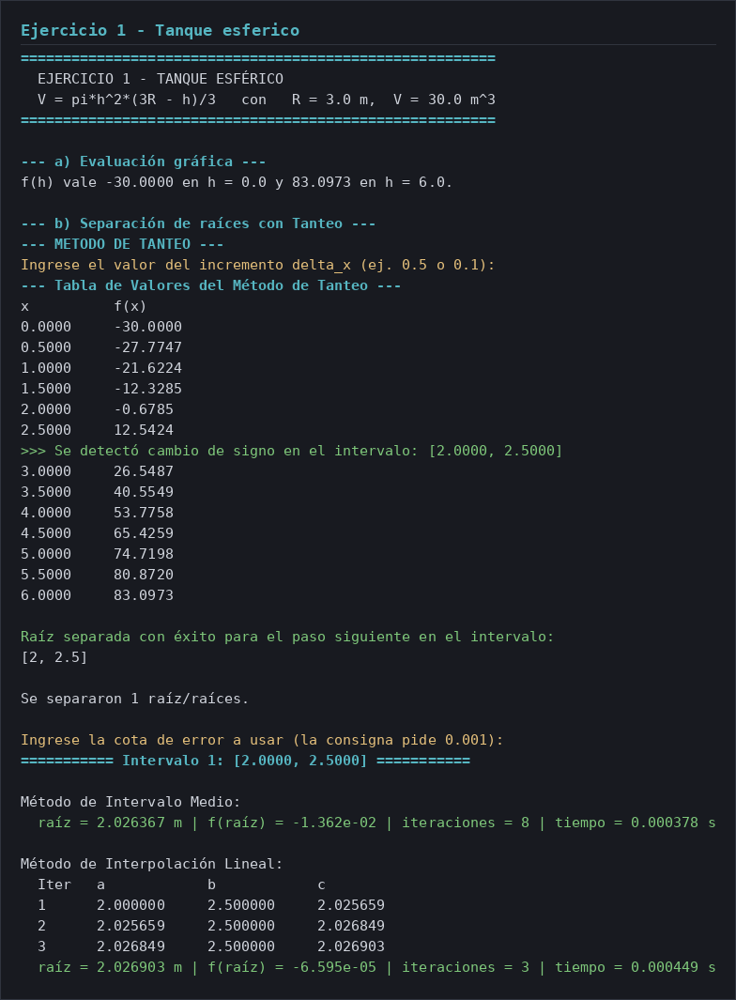
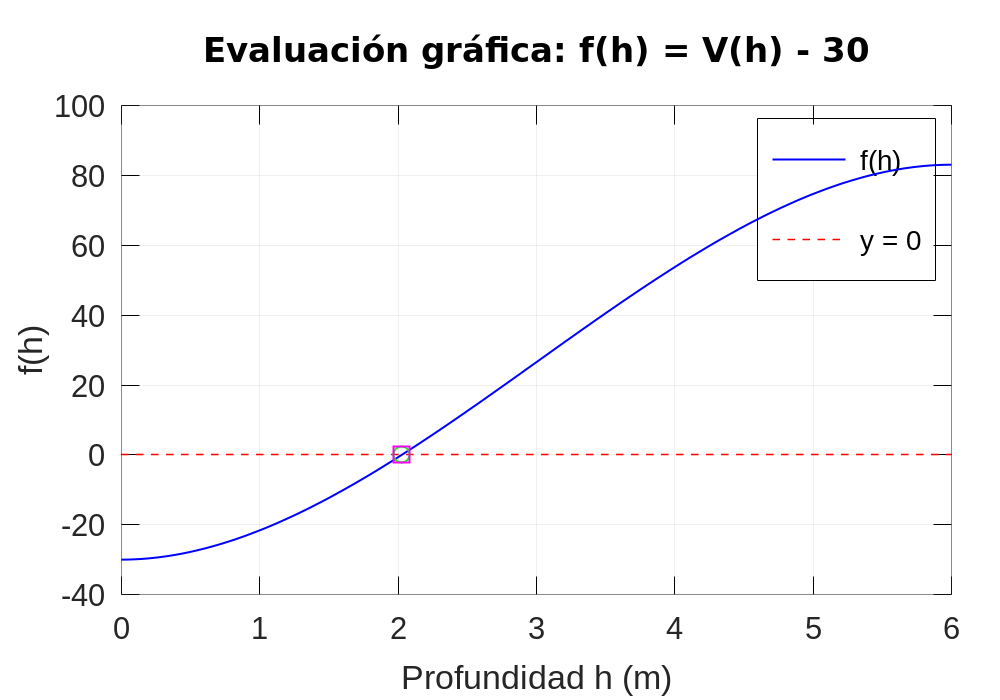
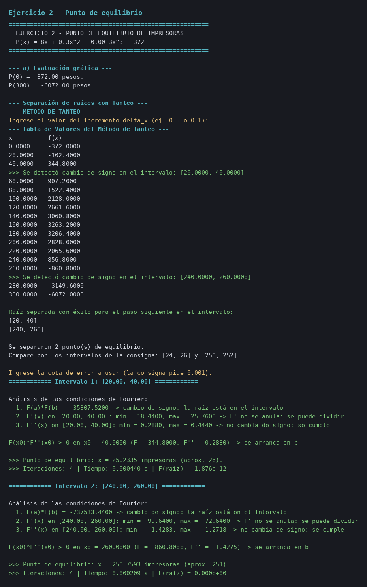
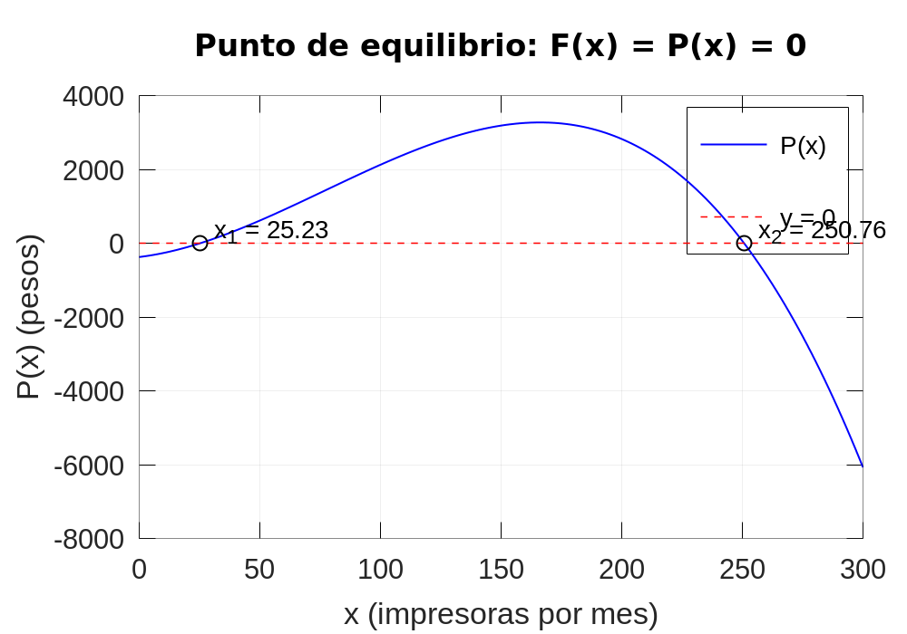
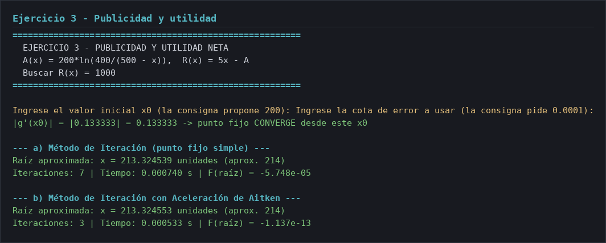
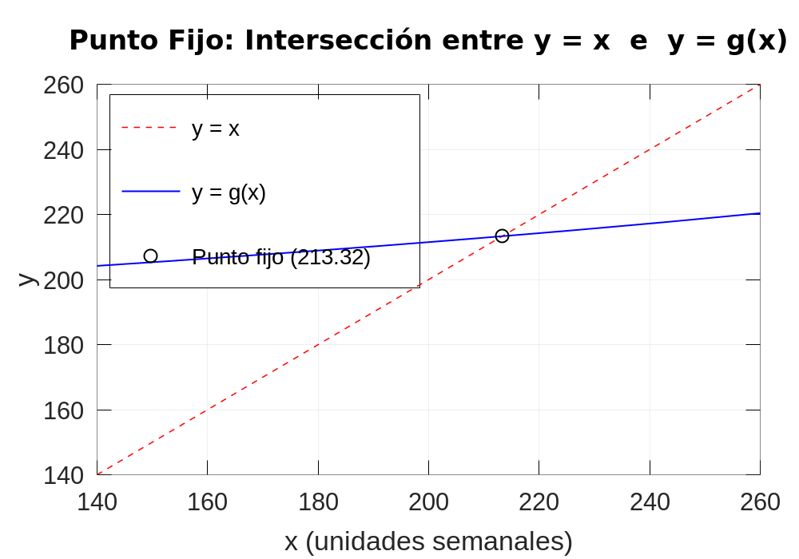

# Informe — Guía 3: Raíces de ecuaciones por métodos numéricos

Métodos Computacionales · Laboratorio 3 · Octave 6.4.0

---

## Ejercicio 1 — Tanque esférico

### `01-tanque-esferico.m`

````octave
% 01-tanque-esferico.m - Ejercicio 1 de la Guía 3: raíces de una ecuación.
%
% Problema: tanque esférico de radio R = 3 m que debe contener V = 30 m^3.
%   V = pi * h^2 * (3R - h)/3   con h = profundidad del agua en metros.
% Se busca la profundidad h que cumple V = 30, es decir la raíz de
%   f(h) = pi * h^2 * (3R - h)/3 - V = 0.
%
% Estructura de la consigna:
%   a) Evaluación gráfica de las raíces con fplot.
%   b) Separación de todas las raíces con el Método de Tanteo.
%   c) Aproximación con Intervalo Medio e Interpolación Lineal, E < 0.001.
%   d) Comparación de convergencia y tiempo de ejecución entre ambos métodos.
%
% Este script entrega los resultados crudos de cada método (raíz, f(raíz),
% iteraciones y tiempo). La comparación entre ellos y las conclusiones van en
% el informe, no acá.
%
% Los algoritmos viven en archivos aparte (tanteo.m, intervalo_medio.m,
% interpolacion_lineal.m).

clc;

% ----------------------------------------------------------------------
% Datos del problema
% ----------------------------------------------------------------------
R = 3;   % radio del tanque en metros
V = 30;  % volumen objetivo en metros cubicos

% f(h) = volumen que hay a profundidad h, menos el volumen buscado.
% Los operadores element-wise (.*, ./) son obligatorios: fplot evalúa vectores.
f = @(h) pi * (h.^2) .* ((3 * R - h) / 3) - V;

% Rango de búsqueda. h va de 0 (vacío) hasta 2R = 6 (lleno hasta el ecuador),
% que es el rango donde la fórmula describe un volumen de agua real. Más allá del
% ecuador el polinomio sigue dando valores, pero ya no son volúmenes posibles.
h_min = 0;
h_max = 2 * R;

fprintf('\n========================================================\n');
fprintf('  EJERCICIO 1 - TANQUE ESFÉRICO\n');
fprintf('  V = pi*h^2*(3R - h)/3   con   R = %.1f m,  V = %.1f m^3\n', R, V);
fprintf('========================================================\n');

% ----------------------------------------------------------------------
% a) Evaluación gráfica de las raíces con fplot
% ----------------------------------------------------------------------
figure('Name', 'Ejercicio 1 - Tanque esférico');
fplot(f, [h_min, h_max], 'b-', 'LineWidth', 2);
grid on;
hold on;

% Eje horizontal en y = 0: los cruces con esta recta son las raíces.
plot([h_min, h_max], [0, 0], 'r--', 'LineWidth', 1.5);

title('Evaluación gráfica: f(h) = V(h) - 30');
xlabel('Profundidad h (m)');
ylabel('f(h)');
legend({'f(h)', 'y = 0'}, 'Location', 'northeast');

fprintf('\n--- a) Evaluación gráfica ---\n');
fprintf('f(h) vale %.4f en h = %.1f y %.4f en h = %.1f.\n', ...
        f(h_min), h_min, f(h_max), h_max);

% ----------------------------------------------------------------------
% b) Separación de las raíces con el Método de Tanteo
% ----------------------------------------------------------------------
fprintf('\n--- b) Separación de raíces con Tanteo ---\n');
intervalos = tanteo(f, h_min, h_max);

if (isempty(intervalos))
  fprintf('\nNo se separó ninguna raíz: revise el incremento delta_x.\n');
  return;
endif

fprintf('\nSe separaron %d raíz/raíces.\n', rows(intervalos));

% ----------------------------------------------------------------------
% c) Aproximación con Intervalo Medio e Interpolación Lineal
% ----------------------------------------------------------------------
tol = input(sprintf('\nIngrese la cota de error a usar (la consigna pide 0.001): '));

for k = 1:rows(intervalos)
  a = intervalos(k, 1);
  b = intervalos(k, 2);

  fprintf('\n=========== Intervalo %d: [%.4f, %.4f] ===========\n', k, a, b);

  % --- Método de Intervalo Medio (bisección) ---
  tic;
  [raiz_im, iter_im] = intervalo_medio(f, a, b, tol);
  tiempo_im = toc;

  fprintf('\nMétodo de Intervalo Medio:\n');
  fprintf('  raíz = %.6f m | f(raíz) = %.3e | iteraciones = %d | tiempo = %.6f s\n', ...
          raiz_im, f(raiz_im), iter_im, tiempo_im);

  % --- Método de Interpolación Lineal ---
  tic;
  [raiz_il, iter_il, tabla_il] = interpolacion_lineal(f, a, b, tol);
  tiempo_il = toc;

  fprintf('\nMétodo de Interpolación Lineal:\n');
  fprintf('  %-6s %-12s %-12s %-12s\n', 'Iter', 'a', 'b', 'c');
  for i = 1:rows(tabla_il)
    fprintf('  %-6d %-12.6f %-12.6f %-12.6f\n', tabla_il(i, 1), tabla_il(i, 2), ...
            tabla_il(i, 3), tabla_il(i, 4));
  endfor
  fprintf('  raíz = %.6f m | f(raíz) = %.3e | iteraciones = %d | tiempo = %.6f s\n', ...
          raiz_il, f(raiz_il), iter_il, tiempo_il);

  % Se marcan ambas raíces sobre el gráfico del punto a.
  plot(raiz_im, f(raiz_im), 'go', 'MarkerSize', 8, 'LineWidth', 2);
  plot(raiz_il, f(raiz_il), 'ms', 'MarkerSize', 8, 'LineWidth', 2);
endfor

hold off;
````

### Salida de ejecución



### Gráfico



---

## Ejercicio 2 — Punto de equilibrio de impresoras

### `02-punto-equilibrio-impresoras.m`

````octave
% 02-punto-equilibrio-impresoras.m - Ejercicio 2 de la Guía 3: Newton-Raphson.
%
% Problema: un fabricante de impresoras tiene como utilidad total (en pesos)
%   P(x) = 8x + 0.3x^2 - 0.0013x^3 - 372
% Se pide el punto de equilibrio, es decir las raíces de
%   F(x) = P(x) = 0.
% Estructura de la consigna:
%   a) Hallar las raíces en forma gráfica (fplot) y separarlas con Tanteo.
%   b) Aproximar los dos puntos con Newton-Raphson y E < 1e-3, analizando antes
%      las condiciones de convergencia en los intervalos iniciales.
%
% La consigna propone los intervalos [24; 26] y [250; 252]. Tanteo los confirma.
%
% Este script entrega los resultados crudos (raíz, iteraciones, tiempo) y el
% estado de cada condición de Fourier. La comparación entre intervalos y las
% conclusiones van en el informe, no acá.
%
% Los algoritmos viven en tanteo.m y newton_raphson.m.

clc;

% ----------------------------------------------------------------------
% Datos del problema
% ----------------------------------------------------------------------
% Operadores element-wise (.*, .^) obligatorios: fplot evalúa vectores.
F = @(x) 8 * x + 0.3 * (x.^2) - 0.0013 * (x.^3) - 372;

% Rango de graficado: alcanza para ver las dos raíces y el máximo.
x_min = 0;
x_max = 300;

% Paso para aproximar derivadas por diferencias finitas.
h = 1e-4;
dF  = @(x) (F(x + h) - F(x - h)) / (2 * h);                 % F'(x)  por diferencia central
d2F = @(x) (F(x + h) - 2 * F(x) + F(x - h)) / (h ^ 2);      % F''(x) por diferencias centradas

fprintf('\n========================================================\n');
fprintf('  EJERCICIO 2 - PUNTO DE EQUILIBRIO DE IMPRESORAS\n');
fprintf('  P(x) = 8x + 0.3x^2 - 0.0013x^3 - 372\n');
fprintf('========================================================\n');

% ----------------------------------------------------------------------
% a) Raíces en forma gráfica
% ----------------------------------------------------------------------
figure('Name', 'Ejercicio 2 - Punto de equilibrio');
fplot(F, [x_min, x_max], 'b-', 'LineWidth', 2);
grid on;
hold on;

% Eje horizontal en y = 0: los cruces son los puntos de equilibrio.
plot([x_min, x_max], [0, 0], 'r--', 'LineWidth', 1.5);

title('Punto de equilibrio: F(x) = P(x) = 0');
xlabel('x (impresoras por mes)');
ylabel('P(x) (pesos)');
legend({'P(x)', 'y = 0'}, 'Location', 'northeast');

fprintf('\n--- a) Evaluación gráfica ---\n');
fprintf('P(0) = %.2f pesos.\n', F(0));
fprintf('P(300) = %.2f pesos.\n', F(300));

% Separación de las raíces con Tanteo. El incremento se pide por teclado:
% con uno chico se pueden separar las dos raíces en un solo barrido.
fprintf('\n--- Separación de raíces con Tanteo ---\n');
intervalos = tanteo(F, x_min, x_max);

if (isempty(intervalos))
  fprintf('\nNo se separó ninguna raíz: revise el incremento delta_x.\n');
  return;
endif

fprintf('\nSe separaron %d punto(s) de equilibrio.\n', rows(intervalos));
fprintf('Compare con los intervalos de la consigna: [24, 26] y [250, 252].\n');

% ----------------------------------------------------------------------
% b) Newton-Raphson con análisis previo de las condiciones de Fourier
% ----------------------------------------------------------------------
tol = input(sprintf('\nIngrese la cota de error a usar (la consigna pide 0.001): '));

for k = 1:rows(intervalos)  a = intervalos(k, 1);
  b = intervalos(k, 2);

  fprintf('\n============ Intervalo %d: [%.2f, %.2f] ============\n', k, a, b);

  % --- Condiciones de Fourier ---
  % Son tres, y las tres tienen que cumplirse para que Newton-Raphson converja
  % desde x0 hacia la raíz que hay dentro de [a, b]:
  %   1. F(a)*F(b) < 0            -> la raíz está dentro del intervalo (Bolzano).
  %   2. F'(x) != 0 en todo [a, b] -> se puede dividir por la derivada.
  %   3. F''(x) no cambia de signo  -> la función es cóncava o convexa en el
  %                                   intervalo, así que la raíz es simple.
  fprintf('\nAnálisis de las condiciones de Fourier:\n');

  fa = F(a);
  fb = F(b);
  fprintf('  1. F(a)*F(b) = %.4f -> %s\n', fa * fb, ...
          merge(fa * fb < 0, 'cambio de signo: la raíz está en el intervalo', ...
                'SIN cambio de signo: no hay raíz garantizada'));

  % F' se muestrea en el intervalo para verificar que no se anula.
  malla = linspace(a, b, 100);
  df_malla = dF(malla);
  derivada_nula = any(abs(df_malla) < 1e-8);
  fprintf('  2. F''(x) en [%.2f, %.2f]: min = %.4f, max = %.4f -> %s\n', ...
          a, b, min(df_malla), max(df_malla), ...
          merge(derivada_nula, 'F'' SE ANULA: no se puede dividir', ...
                'F'' no se anula: se puede dividir'));

  % F'' también se muestrea para verificar que no cambia de signo.
  d2f_malla = d2F(malla);
  d2f_cambio_signo = (min(d2f_malla) < 0 && max(d2f_malla) > 0);
  fprintf('  3. F''''(x) en [%.2f, %.2f]: min = %.4f, max = %.4f -> %s\n', ...
          a, b, min(d2f_malla), max(d2f_malla), ...
          merge(d2f_cambio_signo, 'CAMBIA de signo: no se cumple', ...
                'no cambia de signo: se cumple'));

  % --- Elección de x0 ---
  % La condición de Fourier que elige dónde arrancar es F(x0)*F''(x0) > 0:
  % se arranca en el extremo donde la función está más "hacia afuera" de la
  % raíz, para que las tangentes no empujen la iteración al lado equivocado.
  if (fa * d2F(a) > 0)
    x0 = a;
  else
    x0 = b;
  endif
  fprintf('\nF(x0)*F''''(x0) > 0 en x0 = %.4f (F = %.4f, F'''' = %.4f) -> se arranca en %s\n\n', ...
          x0, F(x0), d2F(x0), merge(x0 == a, 'a', 'b'));

  % --- Newton-Raphson ---
  tic;
  [raiz, iter, convergio] = newton_raphson(F, x0, tol);
  tiempo = toc;

  if (!convergio)
    fprintf('Newton-Raphson no convergió desde x0 = %.4f.\n', x0);
    continue;
  endif

  fprintf('>>> Punto de equilibrio: x = %.4f impresoras (aprox. %d).\n', raiz, ceil(raiz));
  fprintf('>>> Iteraciones: %d | Tiempo: %.6f s | F(raíz) = %.3e\n', iter, tiempo, F(raiz));

  % Se marca la raíz sobre el gráfico del punto a.
  plot(raiz, 0, 'ko', 'MarkerSize', 8, 'LineWidth', 2);
  text(raiz, 0, sprintf('  x_%.0f = %.2f', k, raiz), ...
       'VerticalAlignment', 'bottom', 'FontSize', 9);
endfor

hold off;
````

### Salida de ejecución



### Gráfico



---

## Ejercicio 3 — Publicidad y utilidad neta

### `03-publicidad-utilidad.m`

````octave
% 03-publicidad-utilidad.m - Ejercicio 3 de la Guía 3: iteración y Aitken.
%
% Problema: una compañía gasta A = 200*ln(400/(500 - x)) pesos semanales en
% publicidad para vender x unidades. Las unidades se venden a $5, así que la
% utilidad neta es R(x) = 5x - A. Hay que vender las x que den R(x) = $1000:
%   F(x) = 5x - 200*ln(400/(500 - x)) - 1000 = 0
%
% Reordenando para convertirla en ecuación de punto fijo:
%   5x = 1000 + 200*ln(400/(500 - x))
%   x  = 200 + 40*ln(400/(500 - x))
% es decir g(x) = 200 + 40*ln(400/(500 - x)), con x0 = 200.
%
% La consigna pide aplicar el método de iteración Y el mismo método acelerado
% con Aitken, ambos con E < 1e-4, y graficar ambas curvas en un mismo gráfico.
%
% Este script entrega los resultados crudos de cada método (raíz, iteraciones,
% tiempo) y el valor de |g'(x0)|. La comparación entre ambos y las conclusiones
% van en el informe, no acá.
%
% Los algoritmos viven en iteracion.m y aceleracion.m.

clc;

% ----------------------------------------------------------------------
% Datos del problema
% ----------------------------------------------------------------------
% Operadores element-wise (./) obligatorios: fplot evalúa vectores.
F = @(x) 5 * x - 200 * log(400 ./ (500 - x)) - 1000;  % raíz a buscar
g = @(x) 200 + 40 * log(400 ./ (500 - x));            % función de iteración

fprintf('\n========================================================\n');
fprintf('  EJERCICIO 3 - PUBLICIDAD Y UTILIDAD NETA\n');
fprintf('  A(x) = 200*ln(400/(500 - x)),  R(x) = 5x - A\n');
fprintf('  Buscar R(x) = 1000\n');
fprintf('========================================================\n');

% Paso para aproximar g' por diferencia central.
h = 1e-4;
dg = @(x) (g(x + h) - g(x - h)) / (2 * h);

fprintf('\n');
x0      = input('Ingrese el valor inicial x0 (la consigna propone 200): ');
tol     = input('Ingrese la cota de error a usar (la consigna pide 0.0001): ');

% Condición de convergencia del punto fijo simple: |g'(x0)| < 1.
% g'(x) = 40/(500 - x), que en x0 = 200 vale 0.133: converge, pero solo porque
% x0 quedó en el lado izquierdo de x = 500. Cerca de 500 la derivada se dispara
% y el método diverge, así que conviene mostrar el valor antes de correrlo.
g_primo_x0 = dg(x0);
fprintf("\n|g'(x0)| = |%.6f| = %.6f -> %s\n", g_primo_x0, abs(g_primo_x0), ...
        merge(abs(g_primo_x0) < 1, ...
              'punto fijo CONVERGE desde este x0', ...
              'punto fijo DIVERGE desde este x0 (|g''(x0)| >= 1)'));

% ----------------------------------------------------------------------
% Método de iteración simple
% ----------------------------------------------------------------------
fprintf('\n--- a) Método de Iteración (punto fijo simple) ---\n');
tic;
[x_simple, iter_simple, ok_simple] = iteracion(g, x0, tol);
tiempo_simple = toc;

if (ok_simple)
  fprintf('Raíz aproximada: x = %.6f unidades (aprox. %d)\n', x_simple, ceil(x_simple));
  fprintf('Iteraciones: %d | Tiempo: %.6f s | F(raíz) = %.3e\n', ...
          iter_simple, tiempo_simple, F(x_simple));
else
  fprintf('El punto fijo no convergió desde x0 = %.4f: |g''(x0)| >= 1.\n', x0);
  x_simple = NaN;
  iter_simple = NaN;
  tiempo_simple = NaN;
endif

% ----------------------------------------------------------------------
% Método de iteración acelerado con Aitken
% ----------------------------------------------------------------------
fprintf('\n--- b) Método de Iteración con Aceleración de Aitken ---\n');

tic;
[x_aitken, iter_aitken, ok_aitken] = aceleracion(g, x0, tol);
tiempo_aitken = toc;

if (ok_aitken)
  fprintf('Raíz aproximada: x = %.6f unidades (aprox. %d)\n', x_aitken, ceil(x_aitken));
  fprintf('Iteraciones: %d | Tiempo: %.6f s | F(raíz) = %.3e\n', ...
          iter_aitken, tiempo_aitken, F(x_aitken));
else
  fprintf('Aitken no pudo acelerar: se anuló el denominador.\n');
  x_aitken = NaN;
  iter_aitken = NaN;
  tiempo_aitken = NaN;
endif

% ----------------------------------------------------------------------
% Gráfico: y = x contra y = g(x), las dos curvas en la misma figura
% ----------------------------------------------------------------------
figure('Name', 'Ejercicio 3 - Punto fijo');

% Rango centrado en x0, acotado para que se vea bien el punto fijo.
rango = [max(1, x0 - 60), x0 + 60];

% Recta y = x: sus cruces con g son los puntos fijos.
fplot(@(x) x, rango, 'r--', 'LineWidth', 1.5);
hold on;
grid on;

% Curva y = g(x).
fplot(g, rango, 'b-', 'LineWidth', 2);

% Punto fijo encontrado.
if (ok_simple)
  plot(x_simple, x_simple, 'ko', 'MarkerSize', 8, 'LineWidth', 2);
endif

title('Punto Fijo: Intersección entre y = x  e  y = g(x)');
xlabel('x (unidades semanales)');
ylabel('y');
leyenda = {'y = x', 'y = g(x)'};
if (ok_simple)
  leyenda = [leyenda, {sprintf('Punto fijo (%.2f)', x_simple)}];
endif
legend(leyenda, 'Location', 'NorthWest');
hold off;
````

### Salida de ejecución



### Gráfico



---

# Anexo — Métodos numéricos

## Tanteo

````octave
function intervalos = tanteo(f, a, b)
  % TANTEO - Separa raices barriendo [a, b] con paso delta_x y detectando cambios de signo.
  % Entradas:
  %   f - funcion a la que se le buscan raices, ej: @(x) x.^2 - 2
  %   a - extremo inferior del barrido
  %   b - extremo superior del barrido
  % Salida:
  %   intervalos - matriz de Nx2 con los [a, b] donde f cambia de signo (vacia si no hay)
  % Nota: el paso delta_x se pide por teclado a proposito, porque la consigna pide
  % probar el metodo con distintos incrementos y comparar que tan bien separa.
  % El rango [a, b] lo fija el ejercicio, que es quien conoce el dominio fisico.
  if (nargin != 3)
    error("tanteo: se requieren 3 argumentos (f, a, b)");
  endif
  if (!isa(f, "function_handle"))
    error("tanteo: f debe ser un function_handle, ej: @(x) x.^2 - 2");
  endif

  disp('--- METODO DE TANTEO ---');

  % El paso debe ser un numero positivo menor que el ancho del intervalo.
  while (true)
    delta_x = str2double(input('Ingrese el valor del incremento delta_x (ej. 0.5 o 0.1): ', 's'));
    if (isscalar(delta_x) && isfinite(delta_x) && delta_x > 0 && delta_x <= (b - a))
      break;
    endif
    disp('Paso invalido: debe ser un numero positivo no mayor que (b - a)');
  endwhile

  % Punto de partida: se arranca en el extremo inferior.
  x_act = a;
  f_act = f(x_act);

  % Tabla de valores: muestra como evoluciona f en el barrido.
  fprintf('\n--- Tabla de Valores del Método de Tanteo ---\n');
  fprintf('%-10s %-15s\n', 'x', 'f(x)');
  fprintf('%-10.4f %-15.4f\n', x_act, f_act);

  % Acumulador de intervalos con cambio de signo: cada fila es un [x_act, x_sig].
  intervalos_encontrados = [];

  % Barrido: se avanza de a delta_x hasta cubrir [a, b].
  while (x_act + delta_x) <= b
    x_sig = x_act + delta_x; % siguiente punto del barrido
    f_sig = f(x_sig);
    fprintf('%-10.4f %-15.4f\n', x_sig, f_sig);

    % Si f cambia de signo (o toca cero) hay una raiz entre x_act y x_sig.
    if (f_act * f_sig) <= 0
      fprintf('>>> Se detectó cambio de signo en el intervalo: [%.4f, %.4f]\n', x_act, x_sig);
      intervalos_encontrados = [intervalos_encontrados; x_act, x_sig];
    endif

    x_act = x_sig; % se avanza al siguiente punto
    f_act = f_sig;
  endwhile

  % Informe final: lista los intervalos hallados o avisa si no hubo ninguno.
  if isempty(intervalos_encontrados)
    disp('No se encontraron cambios de signo en el rango analizado.');
  else
    fprintf('\nRaíz separada con éxito para el paso siguiente en el intervalo:\n');
    fprintf('[%g, %g]\n', intervalos_encontrados');
  endif

  % Se devuelven los intervalos para que el que llama elija x0 dentro de uno.
  intervalos = intervalos_encontrados;
endfunction
````

## Intervalo Medio (bisección)

````octave
function [raiz, iter] = intervalo_medio(f, a, b, tol, max_iter)
  % INTERVALO_MEDIO - Bisección: parte el intervalo a la mitad y se queda con
  % la mitad donde f cambia de signo. Converge siempre que haya cambio de signo.
  % Entradas:
  %   f        - función a la que se le busca la raíz, ej: @(x) x.^2 - 2
  %   a, b     - extremos del intervalo inicial (se pasa un valor por referencia)
  %   tol      - cota de error: se frena cuando (b - a)/2 <= tol
  %   max_iter - tope de iteraciones para que no quede en loop infinito
  % Salidas:
  %   raiz - punto medio del intervalo final, aproximación de la raíz
  %   iter - cantidad de iteraciones realizadas
  % Nota: el método es INDEPENDIENTE de la velocidad de f, pero converge lento
  % (~log2((b-a)/tol) iteraciones). Ese contraste con interpolación lineal es
  % justamente lo que pide comparar la consigna.

  if (nargin < 4)
    error("intervalo_medio: se requieren al menos 4 argumentos (f, a, b, tol)");
  endif
  if (nargin < 5)
    max_iter = 1000;
  endif
  if (!isa(f, "function_handle"))
    error("intervalo_medio: f debe ser un function_handle, ej: @(x) x.^2 - 2");
  endif
  if (!isnumeric(tol) || !isscalar(tol) || !isfinite(tol) || !(tol > 0))
    error("intervalo_medio: tol debe ser un numero positivo");
  endif

  % Teorema de Bolzano: sin cambio de signo no se puede garantizar la raíz.
  if (f(a) * f(b) > 0)
    error('f(a) y f(b) deben tener signos opuestos.');
  endif

  iter = 0;

  while ((b - a) / 2 > tol && iter < max_iter)
    c = (a + b) / 2;
    f_c = f(c);

    % Caso exacto: se cayó justo en la raíz, no hay nada más que refinar.
    if (f_c == 0)
      a = c;
      b = c;
      iter++;
      break;
    endif

    % Se descarta la mitad donde f no cambia de signo.
    if (f(a) * f_c < 0)
      b = c;
    else
      a = c;
    endif

    iter++;
  endwhile

  % La aproximación es siempre el punto medio del intervalo que quedó.
  raiz = (a + b) / 2;
endfunction
````

## Interpolación Lineal

````octave
function [raiz, iter, tabla] = interpolacion_lineal(f, a, b, tol, max_iter)
  % INTERPOLACION_LINEAL - Método de interpolación lineal.
  % Aproxima la raíz con la intersección de la cuerda entre (a, f(a)) y (b, f(b))
  % con el eje x, en vez de con el punto medio como hace la bisección:
  %   c = b - f(b)*(b - a)/(f(b) - f(a))
  % Entradas:
  %   f        - función a la que se le busca la raíz, ej: @(x) x.^2 - 2
  %   a, b     - extremos del intervalo inicial (se pasa un valor por referencia)
  %   tol      - cota de error: se frena cuando |c_n - c_(n-1)| <= tol
  %   max_iter - tope de iteraciones para que no quede en loop infinito
  % Salidas:
  %   raiz  - última intersección con el eje x calculada
  %   iter  - cantidad de iteraciones realizadas
  %   tabla - matriz Nx4 con [iter, a, b, c] por iteración, para mostrar el avance
  % Nota: si f es muy curva en un extremo, la cuerda queda casi paralela al eje y
  % un extremo se queda pegado sin avanzar.
  % Converge MÁS RÁPIDO que bisección si f es suave, pero puede ser LENTA si f es
  % convexa de forma extrema. Por eso se usa |c_n - c_(n-1)| y no (b-a)/2 como error.

  if (nargin < 4)
    error("interpolacion_lineal: se requieren al menos 4 argumentos (f, a, b, tol)");
  endif
  if (nargin < 5)
    max_iter = 1000;
  endif
  if (!isa(f, "function_handle"))
    error("interpolacion_lineal: f debe ser un function_handle, ej: @(x) x.^2 - 2");
  endif
  if (!isnumeric(tol) || !isscalar(tol) || !isfinite(tol) || !(tol > 0))
    error("interpolacion_lineal: tol debe ser un numero positivo");
  endif

  % Teorema de Bolzano: sin cambio de signo no se puede garantizar la raíz.
  if (f(a) * f(b) > 0)
    error('f(a) y f(b) deben tener signos opuestos.');
  endif

  iter = 0;
  raiz = a;
  c_anterior = [];
  filas = [];

  while (true)
    f_a = f(a);
    f_b = f(b);

    % Intersección de la cuerda con el eje x. La forma a - f(a)*(b-a)/(f(b)-f(a))
    % es equivalente a la del enunciado pero evita pérdida de precisión cuando
    % f(a) y f(b) son grandes y b-a chico.
    raiz = a - f_a * (b - a) / (f_b - f_a);
    f_raiz = f(raiz);

    iter++;
    filas(end + 1, :) = [iter, a, b, raiz]; %#ok<AGROW>

    % Caso exacto: se cayó justo en la raíz.
    if (f_raiz == 0)
      break;
    endif

    % Se descarta el tramo donde f no cambia de signo.
    if (f_a * f_raiz < 0)
      b = raiz;
    else
      a = raiz;
    endif

    % Criterio de parada: dos intersecciones sucesivas difieren menos que la cota.
    if (!isempty(c_anterior) && abs(raiz - c_anterior) <= tol)
      break;
    endif
    c_anterior = raiz;

    if (iter >= max_iter)
      disp('Se alcanzó el tope de iteraciones sin cumplir la cota de error.');
      break;
    endif
  endwhile

  tabla = filas;
endfunction
````

## Newton-Raphson

````octave
function [x_raiz, iter, convergio] = newton_raphson(F, x0, tol)
  % NEWTON_RAPHSON - Metodo de Newton-Raphson: x_{k+1} = x_k - F(x_k)/F'(x_k).
  % Entradas:
  %   F   - funcion a la que se le busca la raiz, ej: @(x) x.^2 - 2
  %   x0  - valor inicial (elegir segun Fourier: F(x0)*F''(x0) > 0)
  %   tol - tolerancia de parada, se frena cuando |x_sig - x_act| < tol
  % Salidas:
  %   x_raiz    - aproximacion de la raiz
  %   iter      - cantidad de iteraciones realizadas
  %   convergio - false si la derivada se anula (no se puede continuar)
  % Ejemplo:
  %   F = @(x) x.^2 - 2;
  %   [x, it, ok] = newton_raphson(F, 1, 1e-4);

  % Validacion de tipos: F handle, x0 escalar finito, tol positiva.
  if (nargin != 3)
    error("newton_raphson: se requieren 3 argumentos (F, x0, tol)");
  endif
  if (!isa(F, "function_handle"))
    error("newton_raphson: F debe ser un function_handle, ej: @(x) x.^2 - 2");
  endif
  if (!isnumeric(x0) || !isscalar(x0) || !isfinite(x0))
    error("newton_raphson: x0 debe ser un numero escalar");
  endif
  if (!isnumeric(tol) || !isscalar(tol) || !isfinite(tol) || !(tol > 0))
    error("newton_raphson: tol debe ser un numero positivo");
  endif

  % Paso para aproximar la derivada primera por diferencia central.
  h = 1e-4;

  % Primera derivada aproximada (Diferencia central).
  dF = @(x) (F(x + h) - F(x - h)) / (2 * h);

  % Inicializacion: se parte de x0.
  x_act = x0;
  iter = 0;

  % Chequeo inicial: si la derivada se anula en x0 no se puede avanzar.
  if (dF(x_act) == 0)
    disp("Derivada nula en x0, el metodo no puede continuar");
    convergio = false;
    x_raiz = x_act;
    return;
  endif

  % Bucle principal: en cada paso se calcula x_sig una sola vez
  % y se frena cuando dos aproximaciones sucesivas difieran menos que tol.
  error_k = 1;
  while (error_k > tol)
    fx = F(x_act);
    dfx = dF(x_act);

    % Si la derivada se anula a mitad de camino, se sale sin romper todo.
    if (dfx == 0)
      disp("Derivada nula durante la iteracion, el metodo se detiene");
      convergio = false;
      x_raiz = x_act;
      return;
    endif

    x_sig = x_act - (fx / dfx); % paso de Newton-Raphson
    error_k = abs(x_sig - x_act); % medida del avance
    x_act = x_sig; % se avanza al siguiente punto
    iter++;
  endwhile

  % Resultado: el ultimo x_act es la raiz aproximada y se marca como convergido.
  % Nota: esta funcion no imprime ni grafica, solo calcula y devuelve.
  % El que llama decide si mostrar o graficar (ver 02-punto-equilibrio-impresoras.m).
  x_raiz = x_act;
  convergio = true;
endfunction
````

## Iteración (punto fijo)

````octave
function [x_raiz, iter, convergio] = iteracion(g, x0, tol)
  % ITERACION - Metodo de punto fijo: resuelve x = g(x) iterando x_{k+1} = g(x_k).
  % Entradas:
  %   g   - funcion de iteracion, ej: @(x) 200 + 40*log(400/(500-x))
  %   x0  - valor inicial
  %   tol - tolerancia de parada, se frena cuando |x_sig - x_act| < tol
  % Salidas:
  %   x_raiz    - aproximacion del punto fijo
  %   iter      - cantidad de iteraciones realizadas
  %   convergio - true si |g'(x0)| < 1 y se alcanzo la tolerancia
  % Ejemplo (usar ./ elemento a elemento para que fplot evalue vectores):
  %   g = @(x) 200 + 40*log(400./(500-x));
  %   [x, it, ok] = iteracion(g, 0, 1e-4);

  % Validacion de tipos: g handle, x0 escalar finito, tol positiva.
  if (nargin != 3)
    error("iteracion: se requieren 3 argumentos (g, x0, tol)");
  endif
  if (!isa(g, "function_handle"))
    error("iteracion: g debe ser un function_handle, ej: @(x) x.^2 - 2");
  endif
  if (!isnumeric(x0) || !isscalar(x0) || !isfinite(x0))
    error("iteracion: x0 debe ser un numero escalar");
  endif
  if (!isnumeric(tol) || !isscalar(tol) || !isfinite(tol) || !(tol > 0))
    error("iteracion: tol debe ser un numero positivo");
  endif

  % Paso para aproximar la derivada primera por diferencia central.
  h = 1e-4;

  % Derivada aproximada de g: sirve para chequear la condicion de convergencia |g'(x0)| < 1.
  dg = @(x) (g(x + h) - g(x - h)) / (2 * h);

  % Si no se cumple la condicion de convergencia, se avisa y se sale sin iterar.
  if (abs(dg(x0)) >= 1)
    disp("El metodo no converge");
    convergio = false;
    x_raiz = x0;
    iter = 0;
    return;
  endif

  % Inicializacion: se parte de x0.
  x_act = x0;
  iter = 0;

  % Bucle principal: en cada paso se calcula x_sig = g(x_act) una sola vez
  % y se frena cuando dos aproximaciones sucesivas difieran menos que tol.
  while (true)
    x_sig = g(x_act); % nuevo valor a partir del actual
    iter++;
    if (abs(x_sig - x_act) < tol)
      break;
    endif
    x_act = x_sig; % se avanza al siguiente punto
  endwhile

  % Resultado: el ultimo x_sig es la raiz aproximada y se marca como convergido.
  % Nota: esta funcion no imprime ni grafica, solo calcula y devuelve.
  % El que llama decide si mostrar o graficar (ver 03-publicidad-utilidad.m).
  x_raiz = x_sig;
  convergio = true;
endfunction
````

## Aceleración de Aitken

````octave
function [x_raiz, iter, convergio] = aceleracion(g, x0, tol)
  % ACELERACION - Aceleracion de Aitken delta-cuadrado.
  % Acelera la iteracion de punto fijo x_{k+1} = g(x_k) con:
  %   x1 = g(x_act), x2 = g(x1)
  %   x_sig = x_act - (x1 - x_act)^2 / (x2 - 2*x1 + x_act)
  % Entradas:
  %   g   - funcion de iteracion, ej: @(x) 200 + 40*log(400/(500-x))
  %   x0  - valor inicial
  %   tol - tolerancia de parada, se frena cuando |x_sig - x_act| < tol
  % Salidas:
  %   x_raiz    - aproximacion del punto fijo acelerada
  %   iter      - cantidad de iteraciones realizadas
  %   convergio - false si el denominador se anula (no se puede acelerar)
  % Ejemplo (usar ./ elemento a elemento para que fplot evalue vectores):
  %   g = @(x) 200 + 40*log(400./(500-x));
  %   [x, it, ok] = aceleracion(g, 0, 1e-4);
  % Nota: no se exige |g'(x0)| < 1 como en punto fijo simple, porque este metodo
  % converge (cuadraticamente) aun donde el punto fijo diverge; solo pide den != 0.

  % Validacion de tipos: g handle, x0 escalar finito, tol positiva.
  if (nargin != 3)
    error("aceleracion: se requieren 3 argumentos (g, x0, tol)");
  endif
  if (!isa(g, "function_handle"))
    error("aceleracion: g debe ser un function_handle, ej: @(x) x.^2 - 2");
  endif
  if (!isnumeric(x0) || !isscalar(x0) || !isfinite(x0))
    error("aceleracion: x0 debe ser un numero escalar");
  endif
  if (!isnumeric(tol) || !isscalar(tol) || !isfinite(tol) || !(tol > 0))
    error("aceleracion: tol debe ser un numero positivo");
  endif

  % Inicializacion: se parte de x0.
  x_act = x0;
  iter = 0;

  % Bucle principal: en cada paso se evalua g dos veces (x1 y x2)
  % y se aplica la formula de Aitken para saltar mas cerca de la raiz.
  while (true)
    x1 = g(x_act); % primera iterada de punto fijo
    x2 = g(x1);    % segunda iterada de punto fijo
    den = x2 - 2 * x1 + x_act; % denominador de Aitken

    % Si el denominador se anula, la aceleracion no esta definida.
    if (den == 0)
      disp("Denominador nulo en Aitken, el metodo se detiene");
      convergio = false;
      x_raiz = x_act;
      return;
    endif

    x_sig = x_act - ((x1 - x_act)^2) / den; % valor acelerado
    iter++;
    if (abs(x_sig - x_act) < tol)
      break;
    endif
    x_act = x_sig; % se avanza al valor acelerado
  endwhile

  % Resultado: el ultimo x_sig es la raiz aproximada y se marca como convergido.
  % Nota: esta funcion no imprime ni grafica, solo calcula y devuelve.
  x_raiz = x_sig;
  convergio = true;
endfunction
````
