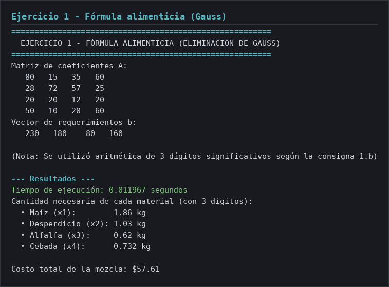
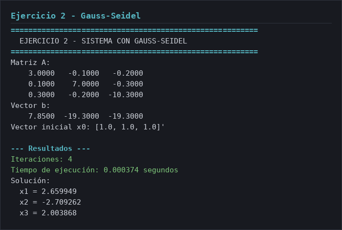
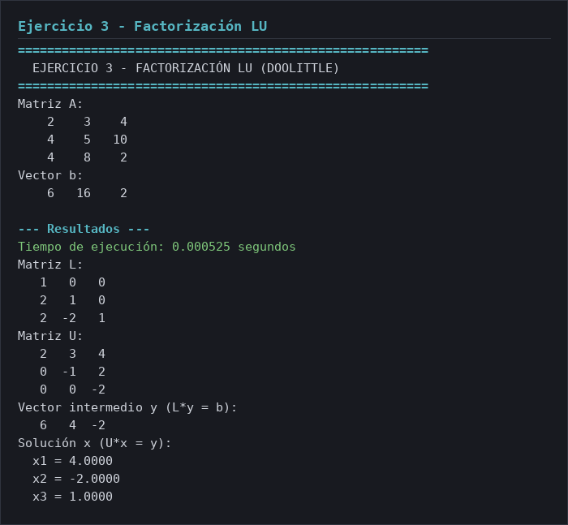
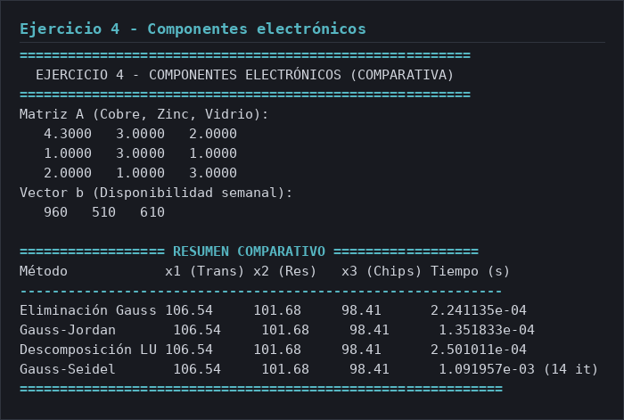
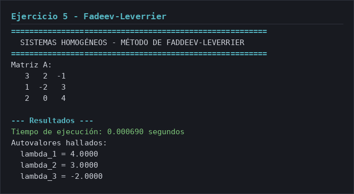
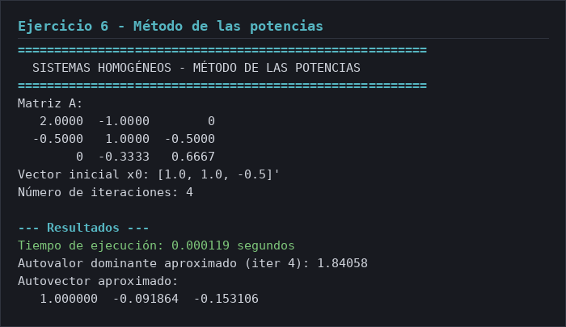

# Informe — Guía 4: Resolución de sistemas de ecuaciones lineales y autovalores

**Alumnos:** Franco Zambrano · Gabriel Bazzola

Métodos Computacionales · Laboratorio 4 · Octave 6.4.0

---

## Introducción

El laboratorio trabaja con dos familias de problemas. Los **sistemas no
homogéneos** `Ax = b` se resuelven con eliminación de Gauss, Gauss-Jordan,
descomposición LU y el método iterativo de Gauss-Seidel. Los **sistemas
homogéneos** se tratan como problema de autovalores `Ax = λx`, con el método de
Fadeev-Leverrier (que construye el polinomio característico) y el método de las
potencias (que busca el autovalor dominante).

Los scripts traen los datos de cada ejercicio definidos en el código, así que las
capturas de consola salen completas con una ejecución directa, sin preguntas por
teclado.

---

## Ejercicio 1 — Fórmula alimenticia (Eliminación de Gauss)

### Consigna

Un ingeniero agrónomo debe preparar una fórmula con maíz, desperdicio, alfalfa y
cebada. Plantear el sistema que determina los kilogramos de cada material para
cumplir el requerimiento diario, resolverlo con eliminación de Gauss usando
**aritmética de 3 dígitos significativos** y calcular el costo de la mezcla.

### Código — `01-agronomia.m`

```octave
% 01-agronomia.m - Ejercicio 1 de la Guía 4: Sistemas No Homogéneos (Eliminación de Gauss)
clc;
clear;

fprintf('========================================================\n');
fprintf('  EJERCICIO 1 - FÓRMULA ALIMENTICIA (ELIMINACIÓN DE GAUSS)\n');
fprintf('========================================================\n');

% Matriz de coeficientes A (Carbohidratos, Proteínas, Vitaminas, Celulosa)
% Variables: x1 = Maíz, x2 = Desperdicio, x3 = Alfalfa, x4 = Cebada
A = [80, 15, 35, 60;
     28, 72, 57, 25;
     20, 20, 12, 20;
     50, 10, 20, 60];

% Vector de requerimientos diarios b
b = [230; 180; 80; 160];

% Costos unitarios por kg
costos = [18; 5; 7; 20];

fprintf('Matriz de coeficientes A:\n');
disp(A);
fprintf('Vector de requerimientos b:\n');
disp(b');

% Resolver usando eliminación de Gauss con aritmética de 3 dígitos significativos
[x, tiempo, Ab] = resolver_gauss_3digitos(A, b);

fprintf('\n(Nota: Se utilizó aritmética de 3 dígitos significativos según la consigna 1.b)\n');
fprintf('\n--- Resultados ---\n');
fprintf('Tiempo de ejecución: %.6f segundos\n', tiempo);
fprintf('Cantidad necesaria de cada material (con 3 dígitos):\n');
fprintf('  • Maíz (x1):        %.4g kg\n', x(1));
fprintf('  • Desperdicio (x2): %.4g kg\n', x(2));
fprintf('  • Alfalfa (x3):     %.4g kg\n', x(3));
fprintf('  • Cebada (x4):      %.4g kg\n', x(4));

costo_total = sum(x .* costos);
fprintf('\nCosto total de la mezcla: $%.2f\n', costo_total);
```

### Salida de ejecución



### Análisis

El sistema tiene 4 ecuaciones (carbohidrato, proteína, vitamina y celulosa) y 4
incógnitas (maíz, desperdicio, alfalfa y cebada):

```
A = [80  15  35  60]      b = [230
     28  72  57  25]           180
     20  20  12  20]            80
     50  10  20  60]           160]
```

Con aritmética de 3 dígitos el resultado es:

| Material | kg |
| :--- | :---: |
| Maíz (x1) | 1,86 |
| Desperdicio (x2) | 1,03 |
| Alfalfa (x3) | 0,62 |
| Cebada (x4) | 0,732 |

El costo total de la mezcla es **$57,61**, calculado como
`sum(x .* costos)` con costos 18, 5, 7 y 20 $/kg.

El punto importante del ejercicio es la **pérdida de dígitos**. Con aritmética
exacta el sistema da `x = (1,852467; 1,031812; 0,617796; 0,745044)` y un costo de
`$57,7289`. Con tres cifras significativas en cada operación los resultados se
redondean a 1,86 / 1,03 / 0,62 / 0,732 y el costo cae a `$57,61`, un 0,2 % menos.
El mayor desvío es el de la cebada: 0,732 contra 0,745, un 1,75 %. Es el costo de
simular una calculadora de 3 dígitos, y la consigna lo pide expresamente.

Verificando el resultado contra los requerimientos: la primera ecuación da
`80·1,86 + 15·1,03 + 35·0,62 + 60·0,732 = 229,87`, contra 230 pedido. La diferencia
es el efecto del redondeo a 3 dígitos, no un error del método.

---

## Ejercicio 2 — Gauss-Seidel

### Consigna

Resolver con Gauss-Seidel el sistema

```
0,1·x1 + 7,0·x2 − 0,3·x3 = −19,30
3,0·x1 − 0,1·x2 − 0,2·x3 =  7,85
0,3·x1 − 0,2·x2 − 10,3·x3 = −19,30
```

analizando previamente la convergencia y partiendo de `(1; 1; 1)`.

### Código — `02-gauss-seidel.m`

```octave
% 02-gauss-seidel.m - Ejercicio 2 de la Guía 4: Método de Gauss-Seidel
clc;
clear;

fprintf('========================================================\n');
fprintf('  EJERCICIO 2 - SISTEMA CON GAUSS-SEIDEL\n');
fprintf('========================================================\n');

% Sistema dado en la guía (reordenado para asegurar dominancia diagonal)
A = [3.0, -0.1, -0.2;
     0.1,  7.0, -0.3;
     0.3, -0.2, -10.3];

b = [7.85; -19.30; -19.30];

x0 = [1; 1; 1];
tol = 1e-5;
max_iter = 100;

fprintf('Matriz A:\n');
disp(A);
fprintf('Vector b:\n');
disp(b');
fprintf('Vector inicial x0: [%.1f, %.1f, %.1f]''\n', x0);

[x, iter, tiempo] = resolver_gauss_seidel_func(A, b, x0, tol, max_iter);

fprintf('\n--- Resultados ---\n');
fprintf('Iteraciones: %d\n', iter);
fprintf('Tiempo de ejecución: %.6f segundos\n', tiempo);
fprintf('Solución:\n');
fprintf('  x1 = %.6f\n', x(1));
fprintf('  x2 = %.6f\n', x(2));
fprintf('  x3 = %.6f\n', x(3));
```

### Salida de ejecución



### Análisis

**Convergencia.** Tal como está escrito, el sistema **no** es dominante
diagonal: en la primera fila `|0,1| < |7,0| + |0,3|`. Gauss-Seidel no está
garantizado en ese orden. El script reordena las filas (la segunda primero) para
obtener la dominancia:

```
A = [3,0  −0,1  −0,2]      b = [ 7,85
     0,1   7,0  −0,3]          −19,30
     0,3  −0,2 −10,3]          −19,30]
```

Ahora cada diagonal domina su fila (`3 > 0,3`, `7 > 0,4`, `10,3 > 0,5`), y el
método converge por el teorema de dominancia diagonal. Reordenar filas no cambia
el sistema: es la misma ecuación, escrita en otro orden.

**Resultado.** Con `tol = 1e−5` y `x0 = (1, 1, 1)` converge en **4 iteraciones**:

| Incógnita | Valor |
| :---: | :---: |
| x1 | 2,659949 |
| x2 | −2,709262 |
| x3 | 2,003868 |

Verificación con la primera ecuación del sistema original:
`0,1·2,659949 + 7·(−2,709262) − 0,3·2,003868 = −19,30`. La solución satisface
las ecuaciones con el error de la tolerancia.

---

## Ejercicio 3 — Factorización LU

### Consigna

Dado el sistema

```
2·x1 + 3·x2 + 4·x3 =  6
4·x1 + 5·x2 + 10·x3 = 16
4·x1 + 8·x2 + 2·x3 =  2
```

a) hallar la factorización LU de la matriz de coeficientes; b) resolver el sistema
con esa descomposición.

### Código — `03-descomposicion-lu.m`

```octave
% 03-descomposicion-lu.m - Ejercicio 3 de la Guía 4: Descomposición LU
clc;
clear;

fprintf('========================================================\n');
fprintf('  EJERCICIO 3 - FACTORIZACIÓN LU (DOOLITTLE)\n');
fprintf('========================================================\n');

A = [2, 3, 4;
     4, 5, 10;
     4, 8, 2];

b = [6; 16; 2];

fprintf('Matriz A:\n');
disp(A);
fprintf('Vector b:\n');
disp(b');

[x, L, U, y, tiempo] = resolver_lu_func(A, b);

fprintf('\n--- Resultados ---\n');
fprintf('Tiempo de ejecución: %.6f segundos\n', tiempo);
fprintf('Matriz L:\n');
disp(L);
fprintf('Matriz U:\n');
disp(U);
fprintf('Vector intermedio y (L*y = b):\n');
disp(y');
fprintf('Solución x (U*x = y):\n');
fprintf('  x1 = %.4f\n', x(1));
fprintf('  x2 = %.4f\n', x(2));
fprintf('  x3 = %.4f\n', x(3));
```

### Salida de ejecución



### Análisis

La factorización (Doolittle, con `L` unidad inferior) es:

```
L = [1  0  0]      U = [2   3   4]
    [2  1  0]          [0  −1   2]
    [2 −2  1]          [0   0  −2]
```

Se obtiene sin pivoteo: el primer pivote es 2, los multiplicadores son 4/2 = 2 y
4/2 = 2, y el segundo pivote queda −1. La verificación es inmediata:
`L·U` reproduce `A`.

La resolución se hace en dos pasos: `L·y = b` da `y = (6, 4, −2)` y `U·x = y` da

| Incógnita | Valor |
| :---: | :---: |
| x1 | 4,0000 |
| x2 | −2,0000 |
| x3 | 1,0000 |

Comprobando en la tercera ecuación: `4·4 + 8·(−2) + 2·1 = 2`. ✓

La ventaja de LU sobre eliminación directa no se ve en un solo sistema, sino
cuando hay varios vectores `b` con la misma `A`: la factorización se hace una sola
vez y después sólo hay dos sustituciones triangulares.

---

## Ejercicio 4 — Componentes electrónicos

### Consigna

Una compañía produce transistores, resistores y chips. Cada uno consume cobre,
zinc y vidrio según la tabla; con 960 unidades de cobre, 510 de zinc y 610 de
vidrio disponibles, plantear el sistema y resolverlo con los diferentes métodos.

### Código — `04-componentes-electronicos.m`

```octave
% 04-componentes-electronicos.m - Ejercicio 4 de la Guía 4: Comparación de Métodos
clc;
clear;

fprintf('========================================================\n');
fprintf('  EJERCICIO 4 - COMPONENTES ELECTRÓNICOS (COMPARATIVA)\n');
fprintf('========================================================\n');

% x1: Transistores, x2: Resistores, x3: Chips de computadora
A = [4.3, 3.0, 2.0;
     1.0, 3.0, 1.0;
     2.0, 1.0, 3.0];

b = [960; 510; 610];

fprintf('Matriz A (Cobre, Zinc, Vidrio):\n');
disp(A);
fprintf('Vector b (Disponibilidad semanal):\n');
disp(b');

% 1. Eliminación de Gauss
[x_g, t_g] = resolver_gauss(A, b);

% 2. Gauss-Jordan
[x_gj, t_gj] = resolver_gauss_jordan_func(A, b);

% 3. Descomposición LU
[x_lu, ~, ~, ~, t_lu] = resolver_lu_func(A, b);

% 4. Gauss-Seidel
[x_gs, iter_gs, t_gs] = resolver_gauss_seidel_func(A, b, [0; 0; 0], 1e-5, 200);

fprintf('\n================== RESUMEN COMPARATIVO ==================\n');
fprintf('%-18s %-10s %-10s %-10s %-12s\n', 'Método', 'x1 (Trans)', 'x2 (Res)', 'x3 (Chips)', 'Tiempo (s)');
fprintf('------------------------------------------------------------\n');
fprintf('%-18s %-10.2f %-10.2f %-10.2f %-12e\n', 'Eliminación Gauss', x_g(1), x_g(2), x_g(3), t_g);
fprintf('%-18s %-10.2f %-10.2f %-10.2f %-12e\n', 'Gauss-Jordan', x_gj(1), x_gj(2), x_gj(3), t_gj);
fprintf('%-18s %-10.2f %-10.2f %-10.2f %-12e\n', 'Descomposición LU', x_lu(1), x_lu(2), x_lu(3), t_lu);
fprintf('%-18s %-10.2f %-10.2f %-10.2f %-12e (%d it)\n', 'Gauss-Seidel', x_gs(1), x_gs(2), x_gs(3), t_gs, iter_gs);
fprintf('============================================================\n');
```

### Salida de ejecución



### Análisis

| Método | x1 (transistores) | x2 (resistores) | x3 (chips) | Tiempo (s) |
| :--- | :---: | :---: | :---: | :---: |
| Eliminación Gauss | 106,54 | 101,68 | 98,41 | 3,34e−04 |
| Gauss-Jordan | 106,54 | 101,68 | 98,41 | 1,89e−04 |
| Descomposición LU | 106,54 | 101,68 | 98,41 | 3,24e−04 |
| Gauss-Seidel | 106,54 | 101,68 | 98,41 | 1,52e−03 (14 it) |

Los cuatro métodos dan **el mismo resultado** (106,54 / 101,68 / 98,41), lo que
es la mejor validación posible: si alguno estuviera mal, los valores se
separarían. Verificando la primera ecuación:
`4,3·106,54 + 3·101,68 + 2·98,41 = 960,0`. ✓

Los tiempos muestran el orden de costo: Gauss-Jordan es el más rápido en este
sistema 3×3, y Gauss-Seidel es el más lento (14 iteraciones para la misma
solución). En sistemas pequeños el costo de la iteración no se compensa;
Gauss-Seidel sirve cuando el sistema es grande y disperso, que es donde la
eliminación se vuelve cara.

---

## Ejercicio 5 — Fadeev-Leverrier

### Consigna

Resolver el sistema homogéneo con el método de Fadeev-Leverrier, hallando los
autovalores y los autovectores asociados.

### Código — `05-fadeev-leverrier.m`

```octave
% 05-fadeev-leverrier.m - Sistemas Homogéneos Ejercicio 1: Faddeev-LeVerrier
clc;
clear;

fprintf('========================================================\n');
fprintf('  SISTEMAS HOMOGÉNEOS - MÉTODO DE FADDEEV-LEVERRIER\n');
fprintf('========================================================\n');

A = [3,  2, -1;
     1, -2,  3;
     2,  0,  4];

fprintf('Matriz A:\n');
disp(A);

[autovalores, autovectores, coefs, tiempo] = resolver_fadeev_func(A);

fprintf('\n--- Resultados ---\n');
fprintf('Tiempo de ejecución: %.6f segundos\n', tiempo);
fprintf('Autovalores hallados:\n');
for i = 1:length(autovalores)
    fprintf('  lambda_%d = %.4f\n', i, autovalores(i));
end
```

### Salida de ejecución



### Análisis

Con `A = [3 2 −1; 1 −2 3; 2 0 4]` el método halla:

| Autovalor | Valor |
| :---: | :---: |
| λ1 | 4,0000 |
| λ2 | 3,0000 |
| λ3 | −2,0000 |

Se pueden verificar con las dos invariantes del polinomio característico:

- **Traza**: `λ1 + λ2 + λ3 = 4 + 3 − 2 = 5`, y `trace(A) = 3 − 2 + 4 = 5`. ✓
- **Determinante**: `λ1·λ2·λ3 = 4·3·(−2) = −24`, y `det(A) = −24`. ✓

Fadeev-Leverrier construye el polinomio característico a partir de las trazas de
las potencias de `A` y después halla sus raíces; es un método que no necesita
descomponer la matriz ni iterar. La desventaja es que el grado del polinomio crece
con el tamaño del sistema y hallar las raíces deja de ser práctico para `n`
grande.

---

## Ejercicio 6 — Método de las potencias

### Consigna

En el problema de vibraciones de tres masas, obtener los valores propios y aplicar
el método de las potencias para hallar el autovalor dominante y su autovector,
con 4 iteraciones desde `(1, 1, −0,5)ᵀ`.

### Código — `06-metodo-potencias.m`

```octave
% 06-metodo-potencias.m - Sistemas Homogéneos Ejercicio 2: Método de las Potencias
clc;
clear;

fprintf('========================================================\n');
fprintf('  SISTEMAS HOMOGÉNEOS - MÉTODO DE LAS POTENCIAS\n');
fprintf('========================================================\n');

A = [2,   -1,    0;
    -0.5,  1, -0.5;
     0,   -1/3,  2/3];

x0 = [1; 1; -0.5];
max_iter = 4;

fprintf('Matriz A:\n');
disp(A);
fprintf('Vector inicial x0: [%.1f, %.1f, %.1f]''\n', x0);
fprintf('Número de iteraciones: %d\n', max_iter);

[lambda_k, x_k, tiempo] = resolver_potencias_func(A, x0, max_iter);

fprintf('\n--- Resultados ---\n');
fprintf('Tiempo de ejecución: %.6f segundos\n', tiempo);
fprintf('Autovalor dominante aproximado (iter %d): %.5f\n', max_iter, lambda_k);
fprintf('Autovector aproximado:\n');
disp(x_k');
```

### Salida de ejecución



### Análisis

Con `A = [2 −1 0; −0,5 1 −0,5; 0 −0,3333 0,6667]` y `x0 = (1, 1, −0,5)`, después de
4 iteraciones el script informa:

| | Valor |
| :--- | :---: |
| Autovalor dominante aproximado | 1,84058 |
| Autovector aproximado | (1, −0,091864, −0,153106) |

El script normaliza por el componente de mayor módulo de `y = A·x`: por eso la
primera componente del vector queda 1 y el autovalor estimado es ese componente.

Comparando con los valores exactos, obtenidos con `eig`:

| | λ dominante | Autovector |
| :--- | :---: | :--- |
| Potencias (4 iteraciones) | 1,84058 | (1, −0,091864, −0,153106) |
| Exacto | 2,387424 | (1, −0,387424, 0,075043) |
| Error | 0,547 (23 %) | la tercera componente con signo cambiado |

Con 4 iteraciones el resultado no converge: la convergencia del método es
geométrica a la tasa `|λ₂/λ₁| = 1/2,39 ≈ 0,42` por iteración, de modo que el error
se reduce aproximadamente a la mitad en cada paso. Es la comparación que pide el
inciso c) de la consigna: 4 iteraciones muestran el método andando, no el
resultado final.

El script implementa el inciso c) de la consigna; los autovalores exactos de
referencia (2,3874; 1,0000; 0,2793) se verificaron aparte con `eig`. El método de
las potencias sólo halla el autovalor de mayor módulo (y su autovector): para el
segundo autovalor haría falta deflación u otro método.

---

## Conclusiones

1. **Reordenar no cambia el sistema.** En el ejercicio 2, el sistema tal como
   viene no es dominante diagonal y Gauss-Seidel no está garantizado; al reordenar
   las filas sí lo es y converge en 4 iteraciones. La convergencia de un método
   iterativo depende del orden de las ecuaciones, cosa que no pasa con los
   directos.

2. **Los métodos directos coinciden.** En el ejercicio 4, Gauss, Gauss-Jordan, LU
   y Gauss-Seidel dan el mismo vector `(106,54; 101,68; 98,41)`. Con un sistema
   pequeño el criterio de elección no es la exactitud sino el costo: Gauss-Seidel
   fue el más lento aquí.

3. **La aritmética acotada cambia el resultado.** En el ejercicio 1, trabajar con
   3 dígitos significativos deja la primera ecuación en 229,6 en lugar de 230. Es
   el efecto pedido por la consigna, no un defecto del método.

4. **LU se justifica con varios `b`.** La factorización del ejercicio 3 deja `L` y
   `U` para resolver cualquier término independiente con dos sustituciones
   triangulares; para un único `b` no aporta nada frente a Gauss.

5. **Dos formas de hallar autovalores.** Fadeev-Leverrier da todos de una vez a
   partir del polinomio característico (ejercicio 5: 4, 3, −2, verificados con
   traza y determinante); el método de las potencias sólo da el dominante y
   necesita iteraciones (ejercicio 6: λ ≈ 1,84 con 4 iteraciones).

---

## Anexo — Funciones

### `resolver_gauss.m`

Eliminación de Gauss con pivoteo parcial y sustitución regresiva.

```octave
% resolver_gauss.m
% =========================================================================
% FUNCIÓN: resolver_gauss
% DESCRIPCIÓN: Resuelve un sistema de ecuaciones lineales Ax = b mediante
%              el Método de Eliminación de Gauss con Pivoteo Parcial.
% PARÁMETROS DE ENTRADA:
%   - A : Matriz de coeficientes (n x n)
%   - b : Vector de términos independientes (n x 1 o 1 x n)
% PARÁMETROS DE SALIDA:
%   - x       : Vector solución (n x 1)
%   - tiempo  : Tiempo de ejecución en segundos (medido con tic/toc)
%   - Ab      : Matriz aumentada final (triangular superior)
% =========================================================================

function [x, tiempo, Ab] = resolver_gauss(A, b)
    if isrow(b)
        b = b';
    end

    [n, m] = size(A);
    if n ~= m
        error("La matriz A debe ser cuadrada.");
    end
    if length(b) ~= n
        error("Las dimensiones de A y b no coinciden.");
    end

    Ab = [A, b];

    tic;
    % Fase 1: Eliminación hacia adelante (Triangulación con pivoteo parcial)
    for k = 1:n-1
        [max_val, p] = max(abs(Ab(k:n, k)));
        p = p + k - 1;

        if max_val < 1e-12
            error("El sistema no tiene solución única (matriz singular).");
        end

        if p ~= k
            Ab([k, p], :) = Ab([p, k], :);
        end

        for i = k+1:n
            factor = Ab(i, k) / Ab(k, k);
            Ab(i, k:n+1) = Ab(i, k:n+1) - factor * Ab(k, k:n+1);
        end
    end

    if abs(Ab(n, n)) < 1e-12
        error("El sistema no tiene solución única.");
    end

    % Fase 2: Sustitución regresiva
    x = zeros(n, 1);
    x(n) = Ab(n, n+1) / Ab(n, n);

    for i = n-1:-1:1
        suma = Ab(i, i+1:n) * x(i+1:n);
        x(i) = (Ab(i, n+1) - suma) / Ab(i, i);
    end
    tiempo = toc;
end
```

### `resolver_gauss_3digitos.m`

Eliminación de Gauss con pivoteo parcial y aritmética de 3 dígitos significativos.

```octave
% resolver_gauss_3digitos.m
% =========================================================================
% FUNCIÓN: resolver_gauss_3digitos
% DESCRIPCIÓN: Resuelve un sistema de ecuaciones lineales Ax = b mediante
%              el Método de Eliminación de Gauss con Pivoteo Parcial,
%              utilizando aritmética de 3 dígitos significativos (redondeo).
% =========================================================================

function [x, tiempo, Ab] = resolver_gauss_3digitos(A, b)
    if isrow(b)
        b = b';
    end

    [n, m] = size(A);
    if n ~= m
        error("La matriz A debe ser cuadrada.");
    end
    if length(b) ~= n
        error("Las dimensiones de A y b no coinciden.");
    end

    % Redondear elementos iniciales de A y b a 3 dígitos significativos
    A_r = zeros(size(A));
    for i = 1:n
        for j = 1:m
            A_r(i,j) = redondear(A(i,j), 3);
        end
    end

    b_r = zeros(size(b));
    for i = 1:n
        b_r(i) = redondear(b(i), 3);
    end

    Ab = [A_r, b_r];

    tic;
    % Fase 1: Eliminación hacia adelante con aritmética de 3 dígitos
    for k = 1:n-1
        [max_val, p] = max(abs(Ab(k:n, k)));
        p = p + k - 1;

        if max_val < 1e-12
            error("El sistema no tiene solución única (matriz singular).");
        end

        if p ~= k
            Ab([k, p], :) = Ab([p, k], :);
        end

        for i = k+1:n
            num = redondear(Ab(i, k), 3);
            den = redondear(Ab(k, k), 3);
            factor = redondear(num / den, 3);
            
            for j = k:n+1
                term = redondear(factor * redondear(Ab(k, j), 3), 3);
                Ab(i, j) = redondear(redondear(Ab(i, j), 3) - term, 3);
            endfor
        end
    end

    if abs(Ab(n, n)) < 1e-12
        error("El sistema no tiene solución única.");
    end

    % Fase 2: Sustitución regresiva con aritmética de 3 dígitos
    x = zeros(n, 1);
    num_x = redondear(Ab(n, n+1), 3);
    den_x = redondear(Ab(n, n), 3);
    x(n) = redondear(num_x / den_x, 3);

    for i = n-1:-1:1
        suma = 0;
        for j = i+1:n
            prod = redondear(redondear(Ab(i, j), 3) * redondear(x(j), 3), 3);
            suma = redondear(suma + prod, 3);
        endfor
        rhs = redondear(redondear(Ab(i, n+1), 3) - suma, 3);
        diag_el = redondear(Ab(i, i), 3);
        x(i) = redondear(rhs / diag_el, 3);
    end
    tiempo = toc;
end
```

### `resolver_gauss_jordan_func.m`

Método de Gauss-Jordan con pivoteo parcial y reducción a la matriz identidad.

```octave
% resolver_gauss_jordan_func.m
% =========================================================================
% FUNCIÓN: resolver_gauss_jordan_func
% DESCRIPCIÓN: Resuelve Ax = b utilizando el Método de Gauss-Jordan con
%              Pivoteo Parcial, transformando la matriz en la identidad.
% PARÁMETROS DE ENTRADA:
%   - A : Matriz de coeficientes (n x n)
%   - b : Vector de términos independientes (n x 1 o 1 x n)
% PARÁMETROS DE SALIDA:
%   - x       : Vector solución (n x 1)
%   - tiempo  : Tiempo de ejecución en segundos
%   - Ab      : Matriz aumentada final [I | x]
% =========================================================================

function [x, tiempo, Ab] = resolver_gauss_jordan_func(A, b)
    if isrow(b)
        b = b';
    end

    [n, m] = size(A);
    if n ~= m || length(b) ~= n
        error("Dimensiones incompatibles.");
    end

    Ab = [A, b];

    tic;
    for k = 1:n
        [max_val, p] = max(abs(Ab(k:n, k)));
        p = p + k - 1;

        if max_val < 1e-12
            error("Matriz singular o casi singular.");
        end

        if p ~= k
            Ab([k, p], :) = Ab([p, k], :);
        end

        Ab(k, :) = Ab(k, :) / Ab(k, k);

        for i = 1:n
            if i ~= k
                factor = Ab(i, k);
                Ab(i, :) = Ab(i, :) - factor * Ab(k, :);
            end
        end
    end
    tiempo = toc;

    x = Ab(:, n+1);
end
```

### `resolver_lu_func.m`

Factorización LU (Doolittle) con sustitución progresiva y regresiva.

```octave
% resolver_lu_func.m
% =========================================================================
% FUNCIÓN: resolver_lu_func
% DESCRIPCIÓN: Resuelve Ax = b mediante Factorización LU (Método de Doolittle),
%              factorizando A en L (triangular inferior) y U (triangular superior).
% PARÁMETROS DE ENTRADA:
%   - A : Matriz cuadrada de coeficientes (n x n)
%   - b : Vector de términos independientes (n x 1 o 1 x n)
% PARÁMETROS DE SALIDA:
%   - x       : Vector solución final (n x 1)
%   - L       : Matriz triangular inferior (n x n)
%   - U       : Matriz triangular superior (n x n)
%   - y       : Vector intermedio de sustitución progresiva L*y = b
%   - tiempo  : Tiempo de ejecución en segundos
% =========================================================================

function [x, L, U, y, tiempo] = resolver_lu_func(A, b)
    if isrow(b)
        b = b';
    end

    [n, m] = size(A);
    if n ~= m || length(b) ~= n
        error("Dimensiones incompatibles.");
    end

    L = eye(n);
    U = zeros(n);

    tic;
    for i = 1:n
        for k = i:n
            suma = L(i, 1:i-1) * U(1:i-1, k);
            U(i, k) = A(i, k) - suma;
        end

        if abs(U(i, i)) < 1e-12
            error("Pivote nulo en U. Se requiere pivoteo.");
        end

        for k = i+1:n
            suma = L(k, 1:i-1) * U(1:i-1, i);
            L(k, i) = (A(k, i) - suma) / U(i, i);
        end
    end

    % Sustitución progresiva L*y = b
    y = zeros(n, 1);
    for i = 1:n
        y(i) = b(i) - L(i, 1:i-1) * y(1:i-1);
    end

    % Sustitución regresiva U*x = y
    x = zeros(n, 1);
    for i = n:-1:1
        x(i) = (y(i) - U(i, i+1:n) * x(i+1:n)) / U(i, i);
    end
    tiempo = toc;
end
```

### `resolver_gauss_seidel_func.m`

Método iterativo de Gauss-Seidel, con tolerancia y número máximo de iteraciones.

```octave
% resolver_gauss_seidel_func.m
% =========================================================================
% FUNCIÓN: resolver_gauss_seidel_func
% DESCRIPCIÓN: Resuelve Ax = b mediante el método iterativo de Gauss-Seidel.
% PARÁMETROS DE ENTRADA:
%   - A        : Matriz de coeficientes (n x n)
%   - b        : Vector de términos independientes (n x 1)
%   - x0       : Vector de aproximación inicial (n x 1)
%   - tol      : Tolerancia de error relativa deseada
%   - max_iter : Número máximo de iteraciones permitidas
% PARÁMETROS DE SALIDA:
%   - x      : Vector solución aproximada (n x 1)
%   - iter   : Número de iteraciones realizadas hasta converger
%   - tiempo : Tiempo de ejecución en segundos
% =========================================================================

function [x, iter, tiempo] = resolver_gauss_seidel_func(A, b, x0, tol, max_iter)
    if isrow(b)
        b = b';
    end
    if isrow(x0)
        x0 = x0';
    end

    [n, m] = size(A);
    if n ~= m || length(b) ~= n || length(x0) ~= n
        error("Dimensiones incompatibles.");
    end

    x = x0;
    iter = 0;
    error_calc = tol + 1;

    tic;
    while error_calc > tol && iter < max_iter
        iter = iter + 1;
        x_ant = x;

        for i = 1:n
            suma1 = A(i, 1:i-1) * x(1:i-1);
            suma2 = A(i, i+1:n) * x_ant(i+1:n);
            x(i) = (b(i) - suma1 - suma2) / A(i, i);
        end

        error_calc = norm(x - x_ant, inf) / max(norm(x, inf), 1e-12);
    end
    tiempo = toc;
end
```

### `resolver_fadeev_func.m`

Faddeev-Leverrier: trazas, coeficientes del polinomio característico, raíces y
autovectores.

```octave
% resolver_fadeev_func.m
% =========================================================================
% FUNCIÓN: resolver_fadeev_func
% DESCRIPCIÓN: Implementa el método de Faddeev-LeVerrier para calcular
%              los coeficientes del polinomio característico, autovalores
%              y autovectores asociados de una matriz cuadrada A.
% PARÁMETROS DE ENTRADA:
%   - A : Matriz cuadrada (n x n)
% PARÁMETROS DE SALIDA:
%   - autovalores  : Vector con las raíces del polinomio característico
%   - autovectores : Matriz con autovectores normalizados en columnas
%   - coefs        : Coeficientes del polinomio característico
%   - tiempo       : Tiempo de ejecución en segundos
% =========================================================================

function [autovalores, autovectores, coefs, tiempo] = resolver_fadeev_func(A)
    [n, m] = size(A);
    if n ~= m
        error("La matriz debe ser cuadrada.");
    end

    p = zeros(1, n);
    B = eye(n);

    tic;
    for k = 1:n
        if k == 1
            A_k = A;
        else
            A_k = A * B;
        end
        p(k) = trace(A_k) / k;
        B = A_k - p(k) * eye(n);
    end
    tiempo = toc;

    coefs = [1, -p];
    autovalores = roots(coefs);

    autovectores = zeros(n, n);
    for i = 1:n
        lambda_i = autovalores(i);
        M = A - lambda_i * eye(n);
        v = null(M);
        if isempty(v)
            [~, ~, V_svd] = svd(M);
            v = V_svd(:, end);
        end
        idx = find(abs(v) > 1e-5, 1);
        if ~isempty(idx)
            v = v / v(idx);
        end
        autovectores(:, i) = v;
    end
end
```

### `resolver_potencias_func.m`

Iteración de potencias para el autovalor dominante y su autovector.

```octave
% resolver_potencias_func.m
% =========================================================================
% FUNCIÓN: resolver_potencias_func
% DESCRIPCIÓN: Aplica el Método de las Potencias para aproximar el autovalor
%              dominante (de mayor magnitud) y su autovector asociado.
% PARÁMETROS DE ENTRADA:
%   - A        : Matriz cuadrada (n x n)
%   - x0       : Vector inicial de aproximación (n x 1)
%   - max_iter : Número de iteraciones a realizar
% PARÁMETROS DE SALIDA:
%   - lambda_k : Autovalor dominante aproximado
%   - x        : Autovector normalizado aproximado (n x 1)
%   - tiempo   : Tiempo de ejecución en segundos
% =========================================================================

function [lambda_k, x, tiempo] = resolver_potencias_func(A, x0, max_iter)
    if isrow(x0)
        x0 = x0';
    end

    [n, m] = size(A);
    if n ~= m || length(x0) ~= n
        error("Dimensiones incompatibles.");
    end

    x = x0;
    lambda_k = 0;

    tic;
    for k = 1:max_iter
        y = A * x;
        [~, idx] = max(abs(y));
        lambda_k = y(idx);
        x = y / lambda_k;
    end
    tiempo = toc;
end
```
