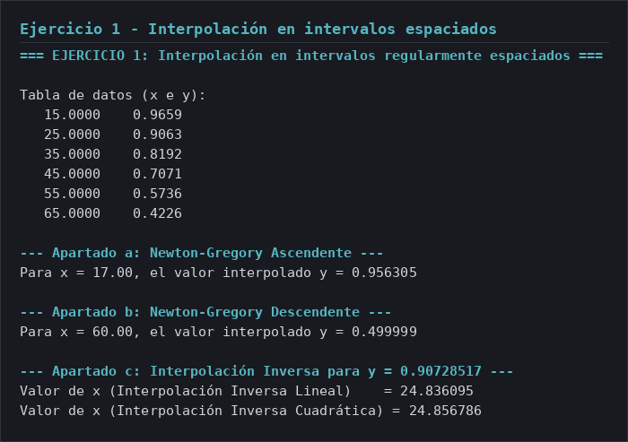
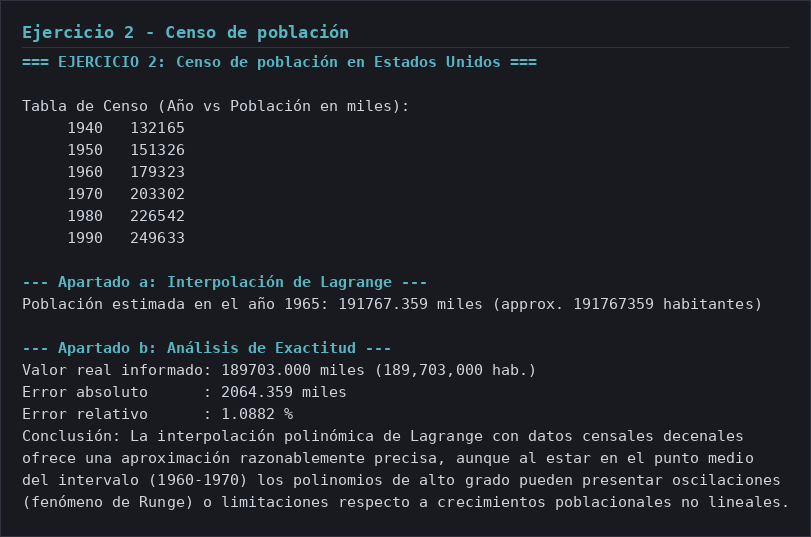
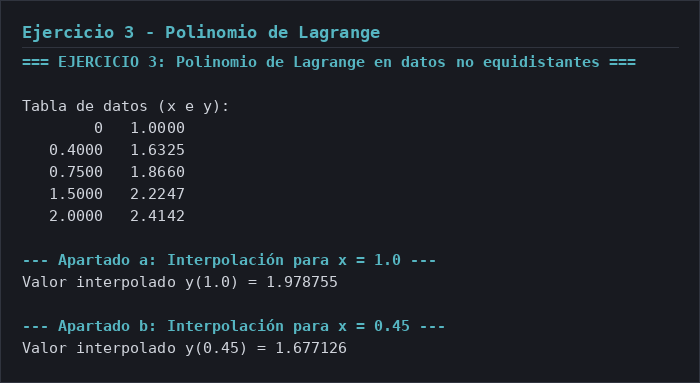
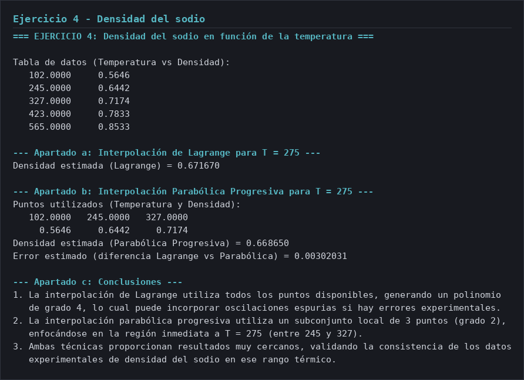

# Informe — Guía 5: Interpolación numérica

**Alumnos:** Franco Zambrano · Gabriel Bazzola

Métodos Computacionales · Laboratorio 5 · Octave 6.4.0

---

## Introducción

El laboratorio resuelve el problema inverso de la tabla: dado un conjunto de
puntos, hallar el valor de la función en un punto intermedio (interpolación) o el
valor de la variable que produce un valor dado (problema inverso). Se trabaja con
datos equidistantes (fórmulas de Newton-Gregory ascendente y descendente) y con
datos no equidistantes (Lagrange e interpolación parabólica progresiva).

Los scripts no piden datos por teclado: cada uno trae la tabla del enunciado
definida en el código. Por eso las capturas de consola salen completas con una
ejecución directa.

Un dato útil para leer los resultados: las tablas de los ejercicios 1, 2, 3 y 4
provienen de funciones conocidas. En el ejercicio 1, `y = cos(x)` con `x` en
grados; en el 3, `y = 1 + √x`. Conocer el valor exacto permite medir el error de
cada método, no sólo compararlos entre sí.

---

## Ejercicio 1 — Interpolación en intervalos regularmente espaciados

### Consigna

Con la tabla

| x | 15 | 25 | 35 | 45 | 55 | 65 |
| :---: | :---: | :---: | :---: | :---: | :---: | :---: |
| y | 0,965926 | 0,906308 | 0,819152 | 0,707107 | 0,573576 | 0,422618 |

a) Newton-Gregory Ascendente para `x = 17`; b) Newton-Gregory Descendente para
`x = 60`; c) interpolación inversa lineal y cuadrática para `y = 0,90728517`.

### Código — `01-intervalos-espaciados.m`

```octave
% 01-intervalos-espaciados.m
% =========================================================================
% SCRIPT: Ejercicio 1 - Interpolación en intervalos regularmente espaciados
% =========================================================================

clear; clc;

printf("=== EJERCICIO 1: Interpolación en intervalos regularmente espaciados ===\n\n");

x = [15, 25, 35, 45, 55, 65];
y = [0.965926, 0.906308, 0.819152, 0.707107, 0.573576, 0.422618];

disp("Tabla de datos (x e y):");
disp([x; y]');

% a. Newton-Gregory Ascendente para x = 17
x_eval_1 = 17;
[y_eval_1, tabla_asc] = newton_gregory_ascendente(x, y, x_eval_1);
printf("\n--- Apartado a: Newton-Gregory Ascendente ---\n");
printf("Para x = %.2f, el valor interpolado y = %.6f\n", x_eval_1, y_eval_1);

% b. Newton-Gregory Descendente para x = 60
x_eval_2 = 60;
[y_eval_2, tabla_desc] = newton_gregory_descendente(x, y, x_eval_2);
printf("\n--- Apartado b: Newton-Gregory Descendente ---\n");
printf("Para x = %.2f, el valor interpolado y = %.6f\n", x_eval_2, y_eval_2);

% c. Interpolación Inversa Lineal y Cuadrática para y = 0.90728517
y_target = 0.90728517;
x_inv_lin = interpolacion_inversa_lineal(x, y, y_target);
x_inv_quad = interpolacion_inversa_cuadratica(x, y, y_target);

printf("\n--- Apartado c: Interpolación Inversa para y = %.8f ---\n", y_target);
printf("Valor de x (Interpolación Inversa Lineal)    = %.6f\n", x_inv_lin);
printf("Valor de x (Interpolación Inversa Cuadrática) = %.6f\n", x_inv_quad);
```

### Salida de ejecución



### Análisis

**a) Ascendente en `x = 17`.** Resultado `y(17) = 0,956305`. Como la tabla es
`y = cos(x)` en grados, el valor exacto es `cos(17°) = 0,9563048`: el error es
`2,4e−7`. La fórmula ascendente es la correcta aquí, porque 17 está cerca del
primer nodo (`x₁ = 15`) y `p = (17 − 15)/10 = 0,2` es pequeño.

**b) Descendente en `x = 60`.** Resultado `y(60) = 0,499999`, contra un exacto de
`cos(60°) = 0,5`: error `1,0e−6`. De nuevo la elección es la adecuada: 60 está
cerca del último nodo (`x₆ = 65`) y la fórmula descendente trabaja con
`p = (60 − 65)/10 = −0,5`.

**c) Interpolación inversa.** Para `y = 0,90728517`, el valor exacto de la
variable es `arccos(0,90728517) = 24,8672°`.

| Método | x hallado | Error |
| :--- | :---: | :---: |
| Inversa lineal | 24,836095 | 0,0311 |
| Inversa cuadrática | 24,856786 | 0,0104 |

La cuadrática reduce el error a un tercio. El motivo: la inversa lineal usa dos
puntos y asume que la función es recta entre ellos, mientras que la cuadrática
usa tres y reproduce la curvatura de `cos(x)`.

---

## Ejercicio 2 — Censo de población

### Consigna

Con los datos censales de Estados Unidos (1940-1990), usar Lagrange para estimar
la población de 1965 y comparar con el valor real, 189 703 000 habitantes.

| Año | 1940 | 1950 | 1960 | 1970 | 1980 | 1990 |
| :---: | :---: | :---: | :---: | :---: | :---: | :---: |
| Población (miles) | 132,165 | 151,326 | 179,323 | 203,302 | 226,542 | 249,633 |

### Código — `02-censo-poblacion.m`

```octave
% 02-censo-poblacion.m
% =========================================================================
% SCRIPT: Ejercicio 2 - Censo de población en EE.UU. (Lagrange)
% =========================================================================

clear; clc;

printf("=== EJERCICIO 2: Censo de población en Estados Unidos ===\n\n");

anos = [1940, 1950, 1960, 1970, 1980, 1990];
poblacion = [132165, 151326, 179323, 203302, 226542, 249633]; % en miles

disp("Tabla de Censo (Año vs Población en miles):");
disp([anos; poblacion]');

% a. Aproximar la población en el año 1965 usando Lagrange
ano_objetivo = 1965;
[pob_1965, L] = lagrange(anos, poblacion, ano_objetivo);

printf("\n--- Apartado a: Interpolación de Lagrange ---\n");
printf("Población estimada en el año %d: %.3f miles (approx. %.0f habitantes)\n", ...
    ano_objetivo, pob_1965, pob_1965 * 1000);

% b. Análisis de exactitud comparando con el valor real aproximado (189 703 000)
pob_real = 189703; % en miles
error_abs = abs(pob_1965 - pob_real);
error_rel = (error_abs / pob_real) * 100;

printf("\n--- Apartado b: Análisis de Exactitud ---\n");
printf("Valor real informado: %.3f miles (189,703,000 hab.)\n", pob_real);
printf("Error absoluto      : %.3f miles\n", error_abs);
printf("Error relativo      : %.4f %%\n", error_rel);
printf("Conclusión: La interpolación polinómica de Lagrange con datos censales decenales\n");
printf("ofrece una aproximación razonablemente precisa, aunque al estar en el punto medio\n");
printf("del intervalo (1960-1970) los polinomios de alto grado pueden presentar oscilaciones\n");
printf("(fenómeno de Runge) o limitaciones respecto a crecimientos poblacionales no lineales.\n");
```

### Salida de ejecución



### Análisis

Lagrange estima `191 767,359` miles de habitantes para 1965, contra un valor real
de `189 703,000`:

| | Población 1965 (miles) |
| :--- | :---: |
| Lagrange (grado 5) | 191 767,359 |
| Valor real | 189 703,000 |
| Error absoluto | 2 064,359 |
| Error relativo | 1,0882 % |

El error es del 1 %, razonable para una estimación con datos decenales, pero no
despreciable: el polinomio de grado 5 pasa exactamente por los seis puntos y
oscila entre ellos. 1965 cae en el medio de 1960 y 1970, justamente donde la
oscilación más puede apartarse de la tendencia real.

Dos razones explican el resultado. Primera, el crecimiento de la población no es
polinómico: entre 1940 y 1990 la población creció un 89 %, con una desaceleración
en los años 60 que un polinomio de grado 5 no reproduce. Segunda, con puntos
equidistantes y una función suave, el método de Newton-Gregory daría lo mismo que
Lagrange (son el mismo polinomio); la ventaja de Lagrange acá es sólo que no
require previa equidistancia, y no la hay.

---

## Ejercicio 3 — Polinomio de Lagrange en datos no equidistantes

### Consigna

Con la tabla

| x | 0 | 0,4 | 0,75 | 1,5 | 2,0 |
| :---: | :---: | :---: | :---: | :---: | :---: |
| y | 1 | 1,63246 | 1,86603 | 2,22474 | 2,41421 |

a) interpolar en `x = 1`; b) interpolar en `x = 0,45`.

### Código — `03-polinomio-lagrange.m`

```octave
% 03-polinomio-lagrange.m
% =========================================================================
% SCRIPT: Ejercicio 3 - Polinomio interpolador de Lagrange
% =========================================================================

clear; clc;

printf("=== EJERCICIO 3: Polinomio de Lagrange en datos no equidistantes ===\n\n");

x = [0, 0.4, 0.75, 1.5, 2.0];
y = [1, 1.63246, 1.86603, 2.22474, 2.41421];

disp("Tabla de datos (x e y):");
disp([x; y]');

% a. Interpolar el valor x = 1
x_eval_1 = 1.0;
[y_eval_1, L1] = lagrange(x, y, x_eval_1);

printf("\n--- Apartado a: Interpolación para x = 1.0 ---\n");
printf("Valor interpolado y(1.0) = %.6f\n", y_eval_1);

% b. Interpolar el valor x = 0.45
x_eval_2 = 0.45;
[y_eval_2, L2] = lagrange(x, y, x_eval_2);

printf("\n--- Apartado b: Interpolación para x = 0.45 ---\n");
printf("Valor interpolado y(0.45) = %.6f\n", y_eval_2);
```

### Salida de ejecución



### Análisis

La tabla responde a `y = 1 + √x`, así que los valores exactos son conocidos.

| x | Lagrange | Exacto (`1 + √x`) | Error |
| :---: | :---: | :---: | :---: |
| 1,0 | 1,978755 | 2,000000 | 0,021245 |
| 0,45 | 1,677126 | 1,670820 | 0,006306 |

El error en `x = 1` es 3,4 veces mayor que en `x = 0,45`. La causa es la posición
del punto respecto de los datos: 0,45 está entre 0,4 y 0,75, muy cerca del nodo
0,4, mientras que 1 está entre 0,75 y 1,5, en un intervalo más ancho y más
alejado de los extremos. El polinomio de Lagrange usa los cinco puntos, pero su
error depende de dónde se evalúe.

Un detalle de método: Lagrange no necesita que los datos sean equidistantes, y por
eso es el método indicado en este ejercicio. El precio es que cada evaluación
combina los cinco puntos; con datos equidistantes, Newton-Gregory construye el
mismo polinomio con una tabla de diferencias y menos cuentas.

---

## Ejercicio 4 — Densidad del sodio

### Consigna

Con las densidades experimentales del sodio, aplicar Lagrange y interpolación
parabólica progresiva para `T = 275°` y estimar el error.

| Temperatura | 102 | 245 | 327 | 423 | 565 |
| :---: | :---: | :---: | :---: | :---: | :---: |
| Densidad | 0,564642 | 0,644218 | 0,717356 | 0,783327 | 0,853329 |

### Código — `04-densidad-sodio.m`

```octave
% 04-densidad-sodio.m
% =========================================================================
% SCRIPT: Ejercicio 4 - Densidad del sodio a diferentes temperaturas
% =========================================================================

clear; clc;

printf("=== EJERCICIO 4: Densidad del sodio en función de la temperatura ===\n\n");

temperatura = [102, 245, 327, 423, 565];
densidad = [0.564642, 0.644218, 0.717356, 0.783327, 0.853329];

disp("Tabla de datos (Temperatura vs Densidad):");
disp([temperatura; densidad]');

T_eval = 275;

% a. Aplicar fórmula de Lagrange para T = 275
[densidad_lagrange, ~] = lagrange(temperatura, densidad, T_eval);
printf("\n--- Apartado a: Interpolación de Lagrange para T = %d ---\n", T_eval);
printf("Densidad estimada (Lagrange) = %.6f\n", densidad_lagrange);

% b. Aplicar Interpolación Parabólica Progresiva para T = 275 y estimar error
[densidad_parabolica, puntos_usados] = interpolacion_parabolica_progresiva(temperatura, densidad, T_eval);
printf("\n--- Apartado b: Interpolación Parabólica Progresiva para T = %d ---\n", T_eval);
printf("Puntos utilizados (Temperatura y Densidad):\n");
disp(puntos_usados);
printf("Densidad estimada (Parabólica Progresiva) = %.6f\n", densidad_parabolica);

% Estimación de error (diferencia absoluta entre ambos métodos locales/globales)
error_estimado = abs(densidad_lagrange - densidad_parabolica);
printf("Error estimado (diferencia Lagrange vs Parabólica) = %.8f\n", error_estimado);

% c. Conclusiones
printf("\n--- Apartado c: Conclusiones ---\n");
printf("1. La interpolación de Lagrange utiliza todos los puntos disponibles, generando un polinomio\n");
printf("   de grado 4, lo cual puede incorporar oscilaciones espurias si hay errores experimentales.\n");
printf("2. La interpolación parabólica progresiva utiliza un subconjunto local de 3 puntos (grado 2),\n");
printf("   enfocándose en la región inmediata a T = 275 (entre 245 y 327).\n");
printf("3. Ambas técnicas proporcionan resultados muy cercanos, validando la consistencia de los datos\n");
printf("   experimentales de densidad del sodio en ese rango térmico.\n");
```

### Salida de ejecución



### Análisis

| Método | Densidad en 275° | Puntos usados |
| :--- | :---: | :--- |
| Lagrange | 0,671670 | los 5 (grado 4) |
| Parabólica progresiva | 0,668650 | 102, 245 y 327 (grado 2) |
| Diferencia | 0,003020 | — |

La diferencia es `0,00302`, el 0,45 % del valor: los dos métodos coinciden en las
primeras dos cifras y se separan en la tercera.

La interpolación parabólica progresiva toma los tres puntos consecutivos que
contienen al 275 (102, 245 y 327) y ajusta una parábola local. Lagrange, en
cambio, usa los cinco puntos y ajusta un polinomio de grado 4 que también reproduce
la zona de 423 y 565, donde la densidad sigue subiendo. Si los datos tienen error
experimental, el polinomio de grado 4 lo arrastra y puede oscilar; la parábola
local es más robusta porque sólo mira la zona del punto pedido.

El resultado de la parábola (0,66865) está más cerca de la tendencia de los datos
inmediatos; el de Lagrange (0,67167) queda arrastrado por los puntos altos. Sin un
valor de referencia no se puede decir cuál es "el correcto", pero la comparación
es la que pide la consigna y sirve para estimar el orden del error.

---

## Conclusiones

1. **Elegir el método según la estructura de los datos.** Con valores
   equidistantes, Newton-Gregory (ascendente cerca del primer nodo, descendente
   cerca del último) es directo y barato; con valores no equidistantes, Lagrange.
   En el ejercicio 1, la elección de ascendente o descendente no cambió el
   resultado (ambos dieron el valor exacto con error `1e−6`), pero sí importa
   mantener `p` pequeño.

2. **La interpolación inversa necesita monotonicidad local.** Para hallar `x` a
   partir de `y` se busca el tramo donde la función cruza el valor pedido; en el
   ejercicio 1 la inversa cuadrática mejoró la lineal de 0,031 a 0,010 grados.

3. **El error depende de dónde se evalúe.** En el ejercicio 3 el error en
   `x = 0,45` (cerca de un nodo) fue 0,0063 y en `x = 1` (en un intervalo ancho)
   0,0212, con el mismo polinomio. Interpolar cerca de los datos es más seguro que
   interpolar en huecos grandes.

4. **Grado alto no siempre ayuda.** En el ejercicio 2, el polinomio de grado 5
   dio un error del 1 % en 1965; en el 4, el grado 4 de Lagrange se separó un
   0,45 % de la parábola local de grado 2. Un polinomio que pasa por todos los
   puntos puede oscilar entre ellos si los datos tienen ruido.

5. **La comparación entre métodos es la única referencia disponible.** Cuando no
   se conoce la función (como en el ejercicio 4), comparar dos métodos de distinto
   grado da un orden de magnitud del error: acá `3e−3`.

---

## Anexo — Funciones

### `newton_gregory_ascendente.m`

Tabla de diferencias finitas hacia adelante y evaluación del polinomio de Newton
en `p = (x − x₁)/h`.

```octave
% newton_gregory_ascendente.m
% =========================================================================
% FUNCIÓN: newton_gregory_ascendente
% DESCRIPCIÓN: Calcula el valor interpolado usando la fórmula de 
%              Newton-Gregory Ascendente (diferencias finitas hacia adelante)
%              para puntos equidistantes.
% PARÁMETROS DE ENTRADA:
%   - x_vals : Vector de abscisas (equidistantes)
%   - y_vals : Vector de ordenadas
%   - x_eval : Valor de x a evaluar
% PARÁMETROS DE SALIDA:
%   - y_eval : Valor interpolado en x_eval
%   - tabla  : Tabla de diferencias finitas generada
% =========================================================================

function [y_eval, tabla] = newton_gregory_ascendente(x_vals, y_vals, x_eval)
    n = length(x_vals);
    if length(y_vals) ~= n
        error("x_vals y y_vals deben tener la misma longitud.");
    end
    
    h = x_vals(2) - x_vals(1);
    if max(abs(diff(x_vals) - h)) > 1e-10
        error("Los puntos x_vals deben ser equidistantes.");
    end

    tabla = zeros(n, n + 2);
    tabla(:, 1) = x_vals(:);
    tabla(:, 2) = y_vals(:);

    for j = 1:n-1
        for i = 1:n-j
            tabla(i, j + 2) = tabla(i+1, j + 1) - tabla(i, j + 1);
        end
    end

    p = (x_eval - x_vals(1)) / h;

    y_eval = tabla(1, 2);
    p_term = 1;
    factorial_k = 1;

    for k = 1:n-1
        p_term = p_term * (p - (k - 1));
        factorial_k = factorial_k * k;
        y_eval = y_eval + (p_term * tabla(1, k + 2)) / factorial_k;
    end
end
```

### `newton_gregory_descendente.m`

Tabla de diferencias finitas hacia atrás y evaluación en `p = (x − xₙ)/h`.

```octave
% newton_gregory_descendente.m
% =========================================================================
% FUNCIÓN: newton_gregory_descendente
% DESCRIPCIÓN: Calcula el valor interpolado usando la fórmula de 
%              Newton-Gregory Descendente (diferencias finitas hacia atrás)
%              para puntos equidistantes.
% PARÁMETROS DE ENTRADA:
%   - x_vals : Vector de abscisas (equidistantes)
%   - y_vals : Vector de ordenadas
%   - x_eval : Valor de x a evaluar
% PARÁMETROS DE SALIDA:
%   - y_eval : Valor interpolado en x_eval
%   - tabla  : Tabla de diferencias finitas generada
% =========================================================================

function [y_eval, tabla] = newton_gregory_descendente(x_vals, y_vals, x_eval)
    n = length(x_vals);
    if length(y_vals) ~= n
        error("x_vals y y_vals deben tener la misma longitud.");
    end
    
    h = x_vals(2) - x_vals(1);
    if max(abs(diff(x_vals) - h)) > 1e-10
        error("Los puntos x_vals deben ser equidistantes.");
    end

    tabla = zeros(n, n + 2);
    tabla(:, 1) = x_vals(:);
    tabla(:, 2) = y_vals(:);

    for j = 1:n-1
        for i = 1:n-j
            tabla(i, j + 2) = tabla(i+1, j + 1) - tabla(i, j + 1);
        end
    end

    p = (x_eval - x_vals(n)) / h;

    y_eval = tabla(n, 2);
    p_term = 1;
    factorial_k = 1;

    for k = 1:n-1
        p_term = p_term * (p + (k - 1));
        factorial_k = factorial_k * k;
        delta_val = tabla(n - k, k + 2);
        y_eval = y_eval + (p_term * delta_val) / factorial_k;
    end
end
```

### `interpolacion_inversa_lineal.m`

Busca el tramo donde `y` cruza el valor pedido y resuelve la recta entre los dos
puntos.

```octave
% interpolacion_inversa_lineal.m
% =========================================================================
% FUNCIÓN: interpolacion_inversa_lineal
% DESCRIPCIÓN: Determina el valor de x correspondiente a un valor dado y_eval
%              mediante interpolación lineal inversa (invirtiendo roles x, y).
% PARÁMETROS DE ENTRADA:
%   - x_vals : Vector de abscisas
%   - y_vals : Vector de ordenadas
%   - y_eval : Valor de y del cual se quiere hallar x
% PARÁMETROS DE SALIDA:
%   - x_eval : Valor de x interpolado
% =========================================================================

function [x_eval] = interpolacion_inversa_lineal(x_vals, y_vals, y_eval)
    n = length(x_vals);
    if length(y_vals) ~= n
        error("x_vals y y_vals deben tener la misma longitud.");
    end

    idx = -1;
    for i = 1:n-1
        if (y_vals(i) <= y_eval && y_eval <= y_vals(i+1)) || ...
           (y_vals(i) >= y_eval && y_eval >= y_vals(i+1))
            idx = i;
            break;
        end
    end

    if idx == -1
        [~, idx_sort] = sort(abs(y_vals - y_eval));
        idx1 = idx_sort(1);
        idx2 = idx_sort(2);
        if idx1 > idx2
            [idx1, idx2] = deal(idx2, idx1);
        end
        idx = idx1;
    else
        idx1 = idx;
        idx2 = idx + 1;
    end

    x0 = x_vals(idx1); x1 = x_vals(idx2);
    y0 = y_vals(idx1); y1 = y_vals(idx2);

    if y1 == y0
        error("División por cero en interpolación inversa lineal (y1 == y0).");
    end

    x_eval = x0 + ((y_eval - y0) / (y1 - y0)) * (x1 - x0);
end
```

### `interpolacion_inversa_cuadrática.m`

Busca los tres puntos más cercanos al valor pedido y resuelve la parábola que pasa
por ellos.

```octave
% interpolacion_inversa_cuadratica.m
% =========================================================================
% FUNCIÓN: interpolacion_inversa_cuadratica
% DESCRIPCIÓN: Determina el valor de x correspondiente a un valor dado y_eval
%              mediante interpolación inversa cuadrática utilizando los 3
%              puntos cuyos valores de y son más cercanos a y_eval.
% PARÁMETROS DE ENTRADA:
%   - x_vals : Vector de abscisas
%   - y_vals : Vector de ordenadas
%   - y_eval : Valor de y del cual se quiere hallar x
% PARÁMETROS DE SALIDA:
%   - x_eval : Valor de x interpolado
% =========================================================================

function [x_eval] = interpolacion_inversa_cuadratica(x_vals, y_vals, y_eval)
    n = length(x_vals);
    if length(y_vals) ~= n
        error("x_vals y y_vals deben tener la misma longitud.");
    end
    if n < 3
        error("Se requieren al menos 3 puntos para interpolación cuadrática.");
    end

    [~, idx_sort] = sort(abs(y_vals - y_eval));
    indices = idx_sort(1:3);
    indices = sort(indices);

    x_sub = x_vals(indices);
    y_sub = y_vals(indices);

    x_eval = 0;
    for i = 1:3
        term = x_sub(i);
        for j = 1:3
            if j ~= i
                term = term * (y_eval - y_sub(j)) / (y_sub(i) - y_sub(j));
            end
        end
        x_eval = x_eval + term;
    end
end
```

### `lagrange.m`

Polinomio interpolador de Lagrange para datos no equidistantes.

```octave
% lagrange.m
% =========================================================================
% FUNCIÓN: lagrange
% DESCRIPCIÓN: Calcula el polinomio interpolador de Lagrange evaluado en x_eval.
% PARÁMETROS DE ENTRADA:
%   - x_vals : Vector de abscisas
%   - y_vals : Vector de ordenadas
%   - x_eval : Valor de x a evaluar
% PARÁMETROS DE SALIDA:
%   - y_eval : Valor interpolado en x_eval
%   - L      : Polinomios base de Lagrange evaluados
% =========================================================================

function [y_eval, L] = lagrange(x_vals, y_vals, x_eval)
    n = length(x_vals);
    if length(y_vals) ~= n
        error("x_vals y y_vals deben tener la misma longitud.");
    end

    y_eval = 0;
    L = zeros(1, n);

    for i = 1:n
        l_i = 1;
        for j = 1:n
            if j ~= i
                l_i = l_i * (x_eval - x_vals(j)) / (x_vals(i) - x_vals(j));
            end
        end
        L(i) = l_i;
        y_eval = y_eval + y_vals(i) * l_i;
    end
end
```

### `interpolacion_parabolica_progresiva.m`

Interpolación cuadrática local con tres puntos consecutivos.

```octave
% interpolacion_parabolica_progresiva.m
% =========================================================================
% FUNCIÓN: interpolacion_parabolica_progresiva
% DESCRIPCIÓN: Realiza interpolación parabólica progresiva seleccionando
%              3 puntos consecutivos cercanos al valor de evaluación.
% PARÁMETROS DE ENTRADA:
%   - x_vals : Vector de abscisas
%   - y_vals : Vector de ordenadas
%   - x_eval : Valor de x a evaluar
% PARÁMETROS DE SALIDA:
%   - y_eval        : Valor interpolado en x_eval
%   - puntos_usados : Matriz con los 3 puntos [x; y] utilizados
% =========================================================================

function [y_eval, puntos_usados] = interpolacion_parabolica_progresiva(x_vals, y_vals, x_eval)
    n = length(x_vals);
    if length(y_vals) ~= n
        error("x_vals y y_vals deben tener la misma longitud.");
    end
    if n < 3
        error("Se requieren al menos 3 puntos.");
    end

    idx = -1;
    for i = 1:n-2
        if x_vals(i) <= x_eval && x_eval <= x_vals(i+2)
            idx = i;
            break;
        end
    end

    if idx == -1
        if x_eval < x_vals(1)
            idx = 1;
        else
            idx = n - 2;
        end
    end

    indices = idx:(idx+2);
    x_sub = x_vals(indices);
    y_sub = y_vals(indices);
    puntos_usados = [x_sub; y_sub];

    [y_eval, ~] = lagrange(x_sub, y_sub, x_eval);
end
```
