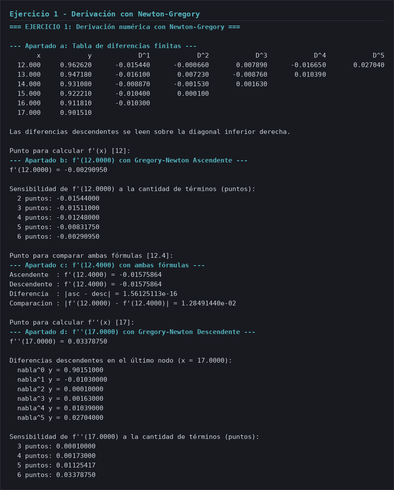
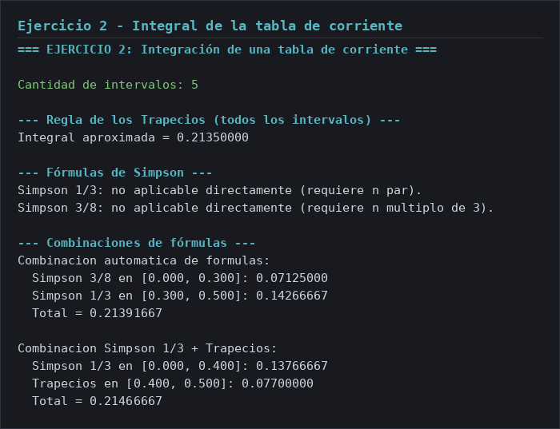
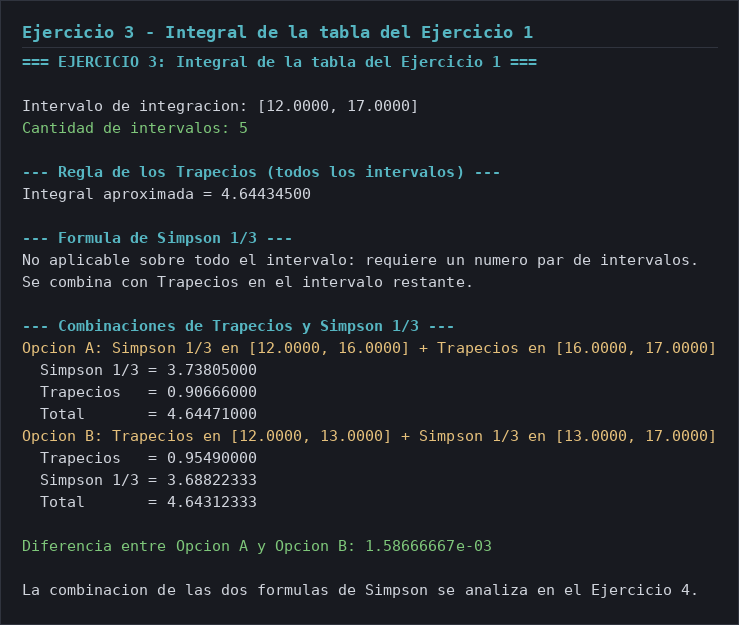
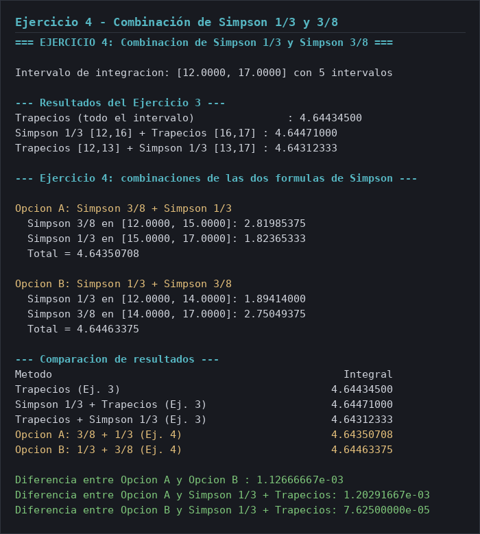
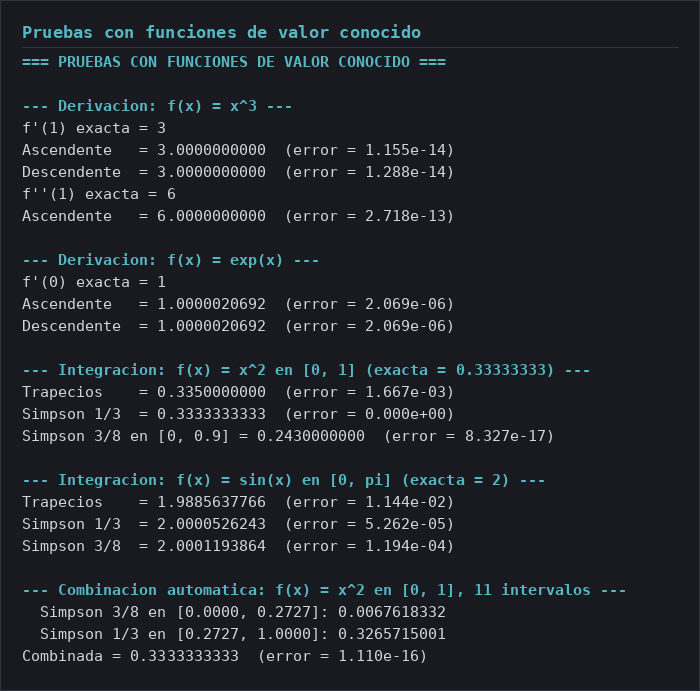

# Informe — Guía 6: Derivación e integración numérica

**Alumnos:** Franco Zambrano · Gabriel Bazzola

Métodos Computacionales · Laboratorio 6 · Octave 6.4.0

---

## Introducción

El laboratorio trabaja sobre dos operaciones que no se pueden hacer exactamente con
tablas de datos: derivar e integrar. La derivación se aproxima con las fórmulas de
Newton-Gregory (ascendente y descendente) sobre la tabla de diferencias finitas, y
la integración con las reglas de Trapecios, Simpson 1/3 y Simpson 3/8, combinadas
cuando la cantidad de intervalos no permite aplicar una sola.

Todos los scripts piden los datos por teclado y, si se presiona **Enter**, usan los
valores del enunciado. Las capturas de consola corresponden a una ejecución no
interactiva con esos valores; por eso se omite la línea de preguntas de `input`.

Una advertencia que aparece en las capturas de este laboratorio: el ingreso de
vectores por teclado necesita los corchetes (`[12 13 14 15 16 17]`), porque Octave
lee la línea con `input` como una expresión.

---

## Ejercicio 1 — Derivación con Newton-Gregory

### Consigna

Con la tabla

| x | 12 | 13 | 14 | 15 | 16 | 17 |
| :---: | :---: | :---: | :---: | :---: | :---: | :---: |
| y | 0,96262 | 0,94718 | 0,93108 | 0,92221 | 0,91181 | 0,90151 |

a) construir la tabla de diferencias; b) calcular `f'(12)` con la fórmula
ascendente; c) calcular `f'(12,4)` y comparar ambas fórmulas; d) calcular `f''(17)`
con la fórmula descendente.

### Código — `01-derivacion-newton-gregory.m`

```octave
% 01-derivacion-newton-gregory.m
% =========================================================================
% SCRIPT: Ejercicio 1 - Derivación con fórmulas de Newton-Gregory
% =========================================================================

clear; clc;

printf("=== EJERCICIO 1: Derivación numérica con Newton-Gregory ===\n\n");

x_def = [12, 13, 14, 15, 16, 17];
y_def = [0.96262, 0.94718, 0.93108, 0.92221, 0.91181, 0.90151];

printf("Ingrese los datos de la tabla (Enter para usar los del enunciado).\n");
x = leer_vector("x = ", x_def);
y = leer_vector("y = ", y_def);

if length(x) ~= length(y)
    error("Los vectores x e y deben tener la misma longitud.");
end

% -------------------------------------------------------------------------
% a. Tabla de diferencias
% -------------------------------------------------------------------------
T = tabla_diferencias(x, y);
printf("\n--- Apartado a: Tabla de diferencias finitas ---\n");
mostrar_tabla_diferencias(T);
printf("\nLas diferencias descendentes se leen sobre la diagonal inferior derecha.\n");

% -------------------------------------------------------------------------
% b. f'(x) con la fórmula ascendente
% -------------------------------------------------------------------------
x1 = leer_escalar("\nPunto para calcular f'(x) [12]: ", 12);
[f1_asc, ~] = newton_gregory_derivada(x, y, x1, 1, "ascendente");

printf("\n--- Apartado b: f'(%.4f) con Gregory-Newton Ascendente ---\n", x1);
printf("f'(%.4f) = %.8f\n", x1, f1_asc);

printf("\nSensibilidad de f'(%.4f) a la cantidad de términos (puntos):\n", x1);
for k = 2:length(x)
    dk = newton_gregory_derivada(x(1:k), y(1:k), x1, 1, "ascendente");
    printf("  %d puntos: %.8f\n", k, dk);
end

% -------------------------------------------------------------------------
% c. f'(x) con ambas fórmulas
% -------------------------------------------------------------------------
x2 = leer_escalar("\nPunto para comparar ambas fórmulas [12.4]: ", 12.4);
[f2_asc, ~] = newton_gregory_derivada(x, y, x2, 1, "ascendente");
[f2_desc, ~] = newton_gregory_derivada(x, y, x2, 1, "descendente");

printf("\n--- Apartado c: f'(%.4f) con ambas fórmulas ---\n", x2);
printf("Ascendente  : f'(%.4f) = %.8f\n", x2, f2_asc);
printf("Descendente : f'(%.4f) = %.8f\n", x2, f2_desc);
printf("Diferencia  : |asc - desc| = %.8e\n", abs(f2_asc - f2_desc));
printf("Comparacion : |f'(%.4f) - f'(%.4f)| = %.8e\n", ...
    x1, x2, abs(f1_asc - f2_asc));

% -------------------------------------------------------------------------
% d. f''(x) con la fórmula descendente
% -------------------------------------------------------------------------
x3 = leer_escalar("\nPunto para calcular f''(x) [17]: ", 17);
[f3_desc, ~] = newton_gregory_derivada(x, y, x3, 2, "descendente");

printf("\n--- Apartado d: f''(%.4f) con Gregory-Newton Descendente ---\n", x3);
printf("f''(%.4f) = %.8f\n", x3, f3_desc);

printf("\nDiferencias descendentes en el último nodo (x = %.4f):\n", x(end));
anterior = y(end);
printf("  nabla^0 y = %.8f\n", anterior);
for k = 1:length(x)-1
    actual = T(length(x) - k, k + 2);
    printf("  nabla^%d y = %.8f\n", k, actual);
end

printf("\nSensibilidad de f''(%.4f) a la cantidad de términos (puntos):\n", x3);
for k = 3:length(x)
    dk = newton_gregory_derivada(x(end-k+1:end), y(end-k+1:end), x3, 2, "descendente");
    printf("  %d puntos: %.8f\n", k, dk);
end

printf("\n");
```

### Salida de ejecución



### Análisis

**Tabla de diferencias.** El script construye la tabla hacia adelante y la imprime
en forma triangular: las diferencias descendentes se leen sobre la diagonal
inferior derecha (`nabla^1 y = −0,0103`, `nabla^2 y = 0,0001`, y así hasta
`nabla^5 y = 0,02704`).

**b) `f'(12)` ascendente.** El resultado es `f'(12) = −0,00290950`. El script
además muestra la sensibilidad a la cantidad de puntos:

| Puntos | `f'(12)` |
| :---: | :---: |
| 2 | −0,01544000 |
| 3 | −0,01511000 |
| 4 | −0,01248000 |
| 5 | −0,00831750 |
| 6 | −0,00290950 |

Con dos puntos la derivada es simplemente el cociente incremental
`(y₂ − y₁)/h = −0,01544`, y cada punto adicional la corrige. Con los seis puntos
el valor cae a −0,00291: el polinomio de grado 5 se aparta mucho de la recta
secante, así que el resultado depende fuertemente de cuántos términos se usan.
Esa es la limitación de derivar con diferencias finitas sobre una tabla corta.

**c) `f'(12,4)` con ambas fórmulas.** Ascendente y descendente dan exactamente el
mismo valor, `−0,01575864`, con una diferencia de `1,56e−16` (cero en precisión de
máquina). No es casualidad: con una tabla equidistante, el polinomio de Newton
ascendente y el descendente son el **mismo polinomio** expresado en potencias de
`p = (x − x₁)/h` o de `p = (x − xₙ)/h`. Cambiar de fórmula no cambia el
polinomio interpolante, sólo el punto desde donde se lo escribe.

La comparación pedida entre `f'(12)` y `f'(12,4)` da `1,28e−02`: la derivada
cambia de signo magnitud en ese tramo, lo que confirma que la función tiene
curvatura apreciable.

**d) `f''(17)` descendente.** Resultado: `f''(17) = 0,03378750`. La sensibilidad
vuelve a ser grande: con 3 puntos `f'' = 0,0001`, con 4 puntos `0,00173`, con 5
puntos `0,01125` y con 6 puntos `0,03379`. La segunda derivada es más sensible que
la primera, porque cada diferencia dividida amplifica el error de los datos: acá
`f''` se obtiene de la segunda diferencia dividida por `h²`, y `h = 1` no atenúa
nada.

---

## Ejercicio 2 — Integral de la tabla de corriente

### Consigna

Calcular `∫ f(x) dx` sobre la tabla

| t | 0 | 0,1 | 0,2 | 0,3 | 0,4 | 0,5 |
| :---: | :---: | :---: | :---: | :---: | :---: | :---: |
| i | 0,0 | 0,15 | 0,3 | 0,55 | 0,73 | 0,81 |

seleccionando adecuadamente entre Trapecios y Simpson, y combinando fórmulas.

### Código — `02-integral-tabla-corriente.m`

```octave
% 02-integral-tabla-corriente.m
% =========================================================================
% SCRIPT: Ejercicio 2 - Integración de una tabla de corriente
% =========================================================================

clear; clc;

printf("=== EJERCICIO 2: Integración de una tabla de corriente ===\n\n");

t_def = [0, 0.1, 0.2, 0.3, 0.4, 0.5];
i_def = [0.0, 0.15, 0.3, 0.55, 0.73, 0.81];

printf("Ingrese los datos de la tabla (Enter para usar los del enunciado).\n");
t = leer_vector("t = ", t_def);
i = leer_vector("i = ", i_def);

if length(t) ~= length(i)
    error("Los vectores t e i deben tener la misma longitud.");
end

n = length(t) - 1;
printf("\nCantidad de intervalos: %d\n", n);

% -------------------------------------------------------------------------
% Regla de los Trapecios
% -------------------------------------------------------------------------
I_trap = trapecios(t, i);
printf("\n--- Regla de los Trapecios (todos los intervalos) ---\n");
printf("Integral aproximada = %.8f\n", I_trap);

% -------------------------------------------------------------------------
% Fórmulas de Simpson por separado
% -------------------------------------------------------------------------
printf("\n--- Fórmulas de Simpson ---\n");
if mod(n, 2) == 0
    I_s13 = simpson_13(t, i);
    printf("Simpson 1/3 (aplicable, n par): %.8f\n", I_s13);
else
    printf("Simpson 1/3: no aplicable directamente (requiere n par).\n");
end
if mod(n, 3) == 0
    I_s38 = simpson_38(t, i);
    printf("Simpson 3/8 (aplicable, n multiplo de 3): %.8f\n", I_s38);
else
    printf("Simpson 3/8: no aplicable directamente (requiere n multiplo de 3).\n");
end

% -------------------------------------------------------------------------
% Combinaciones posibles
% -------------------------------------------------------------------------
printf("\n--- Combinaciones de fórmulas ---\n");

[I_auto, tramos] = integrar(t, i, "auto");
printf("Combinacion automatica de formulas:\n");
for k = 1:length(tramos)
    printf("  %s en [%.3f, %.3f]: %.8f\n", ...
        tramos(k).metodo, tramos(k).xa, tramos(k).xb, tramos(k).valor);
end
printf("  Total = %.8f\n", I_auto);

if mod(n, 2) ~= 0 && n >= 4
    I_alt = simpson_13(t(1:end-1), i(1:end-1)) + ...
        trapecios(t(end-1:end), i(end-1:end));
    printf("\nCombinacion Simpson 1/3 + Trapecios:\n");
    printf("  Simpson 1/3 en [%.3f, %.3f]: %.8f\n", ...
        t(1), t(end-1), simpson_13(t(1:end-1), i(1:end-1)));
    printf("  Trapecios en [%.3f, %.3f]: %.8f\n", ...
        t(end-1), t(end), trapecios(t(end-1:end), i(end-1:end)));
    printf("  Total = %.8f\n", I_alt);
end

printf("\n");
```

### Salida de ejecución



### Análisis

La tabla tiene **5 intervalos** (n = 5), un número impar: Simpson 1/3 necesita un
número par y Simpson 3/8 un múltiplo de 3, así que ninguna de las dos se puede
aplicar sobre todo el intervalo. El script lo informa y pasa a las combinaciones.

| Método | Integral |
| :--- | :---: |
| Trapecios (todo el intervalo) | 0,21350000 |
| Simpson 3/8 en [0; 0,3] + Simpson 1/3 en [0,3; 0,5] | 0,21391667 |
| Simpson 1/3 en [0; 0,4] + Trapecios en [0,4; 0,5] | 0,21466667 |

Las tres difieren en menos de `1,2e−3` (0,5 %), lo que muestra que la integral
está bien determinada por los datos y que la elección de la combinación cambia
poco. La combinación automática del script (3/8 + 1/3) queda entre las otras dos.

Trapecios resulta el valor más bajo: al aproximar con rectas un tramo donde la
curva es convexa, la regla del trapecio queda por debajo. Eso es consistente con
la forma de los datos, que crecen cada vez más lento.

---

## Ejercicio 3 — Integral de la tabla del Ejercicio 1

### Consigna

Con la tabla del Ejercicio 1, calcular `∫₁₂¹⁷ f(x) dx` seleccionando adecuadamente
entre Trapecios y Simpson.

### Código — `03-integral-tabla-ejercicio1.m`

```octave
% 03-integral-tabla-ejercicio1.m
% =========================================================================
% SCRIPT: Ejercicio 3 - Integral de la tabla del Ejercicio 1
% =========================================================================

clear; clc;

printf("=== EJERCICIO 3: Integral de la tabla del Ejercicio 1 ===\n\n");

x_def = [12, 13, 14, 15, 16, 17];
y_def = [0.96262, 0.94718, 0.93108, 0.92221, 0.91181, 0.90151];

printf("Ingrese los datos de la tabla (Enter para usar los del enunciado).\n");
x = leer_vector("x = ", x_def);
y = leer_vector("y = ", y_def);

if length(x) ~= length(y)
    error("Los vectores x e y deben tener la misma longitud.");
end

n = length(x) - 1;
printf("\nIntervalo de integracion: [%.4f, %.4f]\n", x(1), x(end));
printf("Cantidad de intervalos: %d\n", n);

% -------------------------------------------------------------------------
% Regla de los Trapecios
% -------------------------------------------------------------------------
I_trap = trapecios(x, y);
printf("\n--- Regla de los Trapecios (todos los intervalos) ---\n");
printf("Integral aproximada = %.8f\n", I_trap);

% -------------------------------------------------------------------------
% Formula de Simpson 1/3
% -------------------------------------------------------------------------
printf("\n--- Formula de Simpson 1/3 ---\n");
if mod(n, 2) == 0
    I_s13 = simpson_13(x, y);
    printf("Integral aproximada = %.8f\n", I_s13);
else
    printf("No aplicable sobre todo el intervalo: requiere un numero par de intervalos.\n");
    printf("Se combina con Trapecios en el intervalo restante.\n");
end

% -------------------------------------------------------------------------
% Combinaciones de Trapecios y Simpson 1/3
% -------------------------------------------------------------------------
if mod(n, 2) ~= 0 && n >= 4
    printf("\n--- Combinaciones de Trapecios y Simpson 1/3 ---\n");

    I_A_13 = simpson_13(x(1:end-1), y(1:end-1));
    I_A_trap = trapecios(x(end-1:end), y(end-1:end));
    I_A = I_A_13 + I_A_trap;
    printf("Opcion A: Simpson 1/3 en [%.4f, %.4f] + Trapecios en [%.4f, %.4f]\n", ...
        x(1), x(end-1), x(end-1), x(end));
    printf("  Simpson 1/3 = %.8f\n", I_A_13);
    printf("  Trapecios   = %.8f\n", I_A_trap);
    printf("  Total       = %.8f\n", I_A);

    I_B_trap = trapecios(x(1:2), y(1:2));
    I_B_13 = simpson_13(x(2:end), y(2:end));
    I_B = I_B_trap + I_B_13;
    printf("Opcion B: Trapecios en [%.4f, %.4f] + Simpson 1/3 en [%.4f, %.4f]\n", ...
        x(1), x(2), x(2), x(end));
    printf("  Trapecios   = %.8f\n", I_B_trap);
    printf("  Simpson 1/3 = %.8f\n", I_B_13);
    printf("  Total       = %.8f\n", I_B);

    printf("\nDiferencia entre Opcion A y Opcion B: %.8e\n", abs(I_A - I_B));
end

printf("\nLa combinacion de las dos formulas de Simpson se analiza en el Ejercicio 4.\n");

printf("\n");
```

### Salida de ejecución



### Análisis

De nuevo 5 intervalos, así que Simpson 1/3 no aplica sobre todo el intervalo y el
script prueba las dos ubicaciones posibles para el intervalo que queda fuera:

| Combinación | Integral |
| :--- | :---: |
| Trapecios (todo el intervalo) | 4,64434500 |
| Simpson 1/3 en [12; 16] + Trapecios en [16; 17] | 4,64471000 |
| Trapecios en [12; 13] + Simpson 1/3 en [13; 17] | 4,64312333 |

La diferencia entre las dos opciones es `1,59e−3`, el 0,03 % del valor: ambas son
igualmente defendibles y la consigna no determina cuál usar. La Opción A deja el
intervalo corto al final, donde la tabla termina; la Opción B lo deja al principio.

Trapecios puro da 4,64435, apenas por encima de la Opción B y por debajo de la A.
Con una función suave como esta, el error de Trapecios compuesto es del orden de
`h²` con `h = 1`, o sea del orden de la décima: los tres valores coinciden en las
primeras tres cifras.

---

## Ejercicio 4 — Combinación de las dos fórmulas de Simpson

### Consigna

Resolver la misma integral del ejercicio anterior combinando las dos fórmulas de
Simpson y comparar con lo obtenido antes.

### Código — `04-combinacion-simpson.m`

```octave
% 04-combinacion-simpson.m
% =========================================================================
% SCRIPT: Ejercicio 4 - Combinación de las dos fórmulas de Simpson
% =========================================================================

clear; clc;

printf("=== EJERCICIO 4: Combinacion de Simpson 1/3 y Simpson 3/8 ===\n\n");

x_def = [12, 13, 14, 15, 16, 17];
y_def = [0.96262, 0.94718, 0.93108, 0.92221, 0.91181, 0.90151];

printf("Ingrese los datos de la tabla (Enter para usar los del enunciado).\n");
x = leer_vector("x = ", x_def);
y = leer_vector("y = ", y_def);

if length(x) ~= length(y)
    error("Los vectores x e y deben tener la misma longitud.");
end

n = length(x) - 1;
printf("\nIntervalo de integracion: [%.4f, %.4f] con %d intervalos\n", ...
    x(1), x(end), n);

if mod(n, 2) == 0 || n < 3
    error("Este ejercicio requiere un numero impar de intervalos (n >= 3).");
end

% -------------------------------------------------------------------------
% Resultados del Ejercicio 3 (Trapecios y Simpson 1/3)
% -------------------------------------------------------------------------
I_trap = trapecios(x, y);
I_A = simpson_13(x(1:end-1), y(1:end-1)) + trapecios(x(end-1:end), y(end-1:end));
I_B = trapecios(x(1:2), y(1:2)) + simpson_13(x(2:end), y(2:end));

printf("\n--- Resultados del Ejercicio 3 ---\n");
printf("Trapecios (todo el intervalo)               : %.8f\n", I_trap);
printf("Simpson 1/3 [%.0f,%.0f] + Trapecios [%.0f,%.0f] : %.8f\n", ...
    x(1), x(end-1), x(end-1), x(end), I_A);
printf("Trapecios [%.0f,%.0f] + Simpson 1/3 [%.0f,%.0f] : %.8f\n", ...
    x(1), x(2), x(2), x(end), I_B);

% -------------------------------------------------------------------------
% Ejercicio 4: combinacion de las dos formulas de Simpson
% -------------------------------------------------------------------------
printf("\n--- Ejercicio 4: combinaciones de las dos formulas de Simpson ---\n");

% Opcion A: Simpson 3/8 en los 3 primeros intervalos + Simpson 1/3 en los 2
% restantes.
I_A_38 = simpson_38(x(1:4), y(1:4));
I_A_13 = simpson_13(x(4:end), y(4:end));
I_opA = I_A_38 + I_A_13;

printf("\nOpcion A: Simpson 3/8 + Simpson 1/3\n");
printf("  Simpson 3/8 en [%.4f, %.4f]: %.8f\n", x(1), x(4), I_A_38);
printf("  Simpson 1/3 en [%.4f, %.4f]: %.8f\n", x(4), x(end), I_A_13);
printf("  Total = %.8f\n", I_opA);

% Opcion B: Simpson 1/3 en los primeros n-3 intervalos + Simpson 3/8 en los
% 3 ultimos.
I_B_13 = simpson_13(x(1:end-3), y(1:end-3));
I_B_38 = simpson_38(x(end-3:end), y(end-3:end));
I_opB = I_B_13 + I_B_38;

printf("\nOpcion B: Simpson 1/3 + Simpson 3/8\n");
printf("  Simpson 1/3 en [%.4f, %.4f]: %.8f\n", x(1), x(end-3), I_B_13);
printf("  Simpson 3/8 en [%.4f, %.4f]: %.8f\n", x(end-3), x(end), I_B_38);
printf("  Total = %.8f\n", I_opB);

% -------------------------------------------------------------------------
% Comparacion
% -------------------------------------------------------------------------
printf("\n--- Comparacion de resultados ---\n");
printf("%-46s %14s\n", "Metodo", "Integral");
printf("%-46s %14.8f\n", "Trapecios (Ej. 3)", I_trap);
printf("%-46s %14.8f\n", "Simpson 1/3 + Trapecios (Ej. 3)", I_A);
printf("%-46s %14.8f\n", "Trapecios + Simpson 1/3 (Ej. 3)", I_B);
printf("%-46s %14.8f\n", "Opcion A: 3/8 + 1/3 (Ej. 4)", I_opA);
printf("%-46s %14.8f\n", "Opcion B: 1/3 + 3/8 (Ej. 4)", I_opB);

printf("\nDiferencia entre Opcion A y Opcion B : %.8e\n", abs(I_opA - I_opB));
printf("Diferencia entre Opcion A y Simpson 1/3 + Trapecios: %.8e\n", abs(I_opA - I_A));
printf("Diferencia entre Opcion B y Simpson 1/3 + Trapecios: %.8e\n", abs(I_opB - I_A));

printf("\n");
```

### Salida de ejecución



### Análisis

Con 5 intervalos, la partición natural es 3 + 2: tres intervalos para Simpson 3/8
y dos para Simpson 1/3, en cualquiera de los dos órdenes.

| Combinación | Integral |
| :--- | :---: |
| Simpson 3/8 en [12; 15] + Simpson 1/3 en [15; 17] | 4,64350708 |
| Simpson 1/3 en [12; 14] + Simpson 3/8 en [14; 17] | 4,64463375 |

La diferencia entre los dos órdenes es `1,13e−3`, y la Opción B coincide con la
combinación de Simpson 1/3 + Trapecios del ejercicio anterior con una diferencia de
`7,6e−5`. El valor de referencia, si se toma el promedio de todos los métodos, es
`4,6441`, y todos los resultados caen dentro de `±1,6e−3`.

Lo importante es que con los **mismos datos** y **el mismo número de intervalos**
cambiar la fórmula o el orden de la partición mueve el resultado en la cuarta
cifra. No hay un "valor correcto" de la tabla: lo que se compara es la
**consistencia** entre métodos, y acá es del orden del 0,03 %.

---

## Pruebas de verificación

### Código — `05-pruebas.m`

```octave
% 05-pruebas.m
% =========================================================================
% SCRIPT: Pruebas de los algoritmos con funciones de valor conocido
% =========================================================================

clear; clc;

printf("=== PRUEBAS CON FUNCIONES DE VALOR CONOCIDO ===\n");

% -------------------------------------------------------------------------
% Derivación: f(x) = x^3, f'(1) = 3, f''(1) = 6
% -------------------------------------------------------------------------
printf("\n--- Derivacion: f(x) = x^3 ---\n");
x = 1:0.1:1.3;
y = x.^3;

[d1_asc, ~] = newton_gregory_derivada(x, y, 1, 1, "ascendente");
[d1_desc, ~] = newton_gregory_derivada(x, y, 1, 1, "descendente");
[d2_asc, ~] = newton_gregory_derivada(x, y, 1, 2, "ascendente");

printf("f'(1) exacta = 3\n");
printf("Ascendente   = %.10f  (error = %.3e)\n", d1_asc, abs(d1_asc - 3));
printf("Descendente  = %.10f  (error = %.3e)\n", d1_desc, abs(d1_desc - 3));
printf("f''(1) exacta = 6\n");
printf("Ascendente   = %.10f  (error = %.3e)\n", d2_asc, abs(d2_asc - 6));

% -------------------------------------------------------------------------
% Derivación: f(x) = exp(x), f'(0) = 1
% -------------------------------------------------------------------------
printf("\n--- Derivacion: f(x) = exp(x) ---\n");
x = 0:0.1:0.5;
y = exp(x);

[d1_asc, ~] = newton_gregory_derivada(x, y, 0, 1, "ascendente");
[d1_desc, ~] = newton_gregory_derivada(x, y, 0, 1, "descendente");

printf("f'(0) exacta = 1\n");
printf("Ascendente   = %.10f  (error = %.3e)\n", d1_asc, abs(d1_asc - 1));
printf("Descendente  = %.10f  (error = %.3e)\n", d1_desc, abs(d1_desc - 1));

% -------------------------------------------------------------------------
% Integración: f(x) = x^2 en [0, 1], integral exacta = 1/3
% -------------------------------------------------------------------------
printf("\n--- Integracion: f(x) = x^2 en [0, 1] (exacta = 0.33333333) ---\n");
x = 0:0.1:1;
y = x.^2;

exacta = 1/3;
I_trap = trapecios(x, y);
I_s13 = simpson_13(x, y);

printf("Trapecios    = %.10f  (error = %.3e)\n", I_trap, abs(I_trap - exacta));
printf("Simpson 1/3  = %.10f  (error = %.3e)\n", I_s13, abs(I_s13 - exacta));

% Simpson 3/8 necesita un número de intervalos múltiplo de 3.
x = 0:0.1:0.9;
y = x.^2;
exacta = 0.9^3 / 3;
I_s38 = simpson_38(x, y);
printf("Simpson 3/8 en [0, 0.9] = %.10f  (error = %.3e)\n", ...
    I_s38, abs(I_s38 - exacta));

% -------------------------------------------------------------------------
% Integración: f(x) = sin(x) en [0, pi], integral exacta = 2
% -------------------------------------------------------------------------
printf("\n--- Integracion: f(x) = sin(x) en [0, pi] (exacta = 2) ---\n");
x = linspace(0, pi, 13);   % 12 intervalos
y = sin(x);

exacta = 2;
I_trap = trapecios(x, y);
I_s13 = simpson_13(x, y);
I_s38 = simpson_38(x, y);

printf("Trapecios    = %.10f  (error = %.3e)\n", I_trap, abs(I_trap - exacta));
printf("Simpson 1/3  = %.10f  (error = %.3e)\n", I_s13, abs(I_s13 - exacta));
printf("Simpson 3/8  = %.10f  (error = %.3e)\n", I_s38, abs(I_s38 - exacta));

% -------------------------------------------------------------------------
% Combinación automática: f(x) = x^2 en [0, 1] con 11 intervalos
% -------------------------------------------------------------------------
printf("\n--- Combinacion automatica: f(x) = x^2 en [0, 1], 11 intervalos ---\n");
x = linspace(0, 1, 12);
y = x.^2;
[I_auto, tramos] = integrar(x, y, "auto");

for k = 1:length(tramos)
    printf("  %s en [%.4f, %.4f]: %.10f\n", ...
        tramos(k).metodo, tramos(k).xa, tramos(k).xb, tramos(k).valor);
end
printf("Combinada = %.10f  (error = %.3e)\n", I_auto, abs(I_auto - 1/3));

printf("\n");
```

### Salida de ejecución



### Análisis

El script verifica los algoritmos contra funciones de valor conocido:

| Función | Método | Valor | Error |
| :--- | :--- | :---: | :---: |
| `x³` | `f'(1)` ascendente | 3,0000000000 | 1,16e−14 |
| `x³` | `f''(1)` ascendente | 6,0000000000 | 2,72e−13 |
| `e^x` | `f'(0)` ascendente | 1,0000020692 | 2,07e−06 |
| `x²` en [0; 1] | Trapecios | 0,3350000000 | 1,67e−03 |
| `x²` en [0; 1] | Simpson 1/3 | 0,3333333333 | 0 |
| `x²` en [0; 1] | Simpson 3/8 | 0,2430000000 | 8,33e−17 |
| `sen(x)` en [0; π] | Trapecios | 1,9885637766 | 1,14e−02 |
| `sen(x)` en [0; π] | Simpson 1/3 | 2,0000526243 | 5,26e−05 |
| `sen(x)` en [0; π] | Simpson 3/8 | 2,0001193864 | 1,19e−04 |

Dos conclusiones:

1. **Las derivadas son exactas para polinomios de grado suficiente.** Con `x³` el
   error es de redondeo (`1e−14`), porque el polinomio de Newton de grado 3
   interpola exactamente a `x³` y su derivada también es exacta. Con `e^x`, que no
   es polinomio, el error sube a `2,07e−06`: es el error de truncamiento.
2. **Para integrar, Simpson gana por mucho.** En `sen(x)` el error de Trapecios es
   `1,14e−2` y el de Simpson 1/3 es `5,26e−5`: 200 veces menor con el mismo número
   de intervalos. Y Simpson 1/3 integra `x²` con error cero, como corresponde a
   una regla exacta hasta grado 3.

La última prueba combina las reglas sobre 11 intervalos de `x²` (3 + 8): el total
es `0,3333333333` con error `1,1e−16`. La combinación automática funciona.

---

## Conclusiones

1. **Derivar con una tabla corta es inestable.** En el ejercicio 1, `f'(12)` pasa
   de −0,01544 con dos puntos a −0,00291 con seis, y `f''(17)` de 0,0001 a 0,03379.
   La derivada segunda es la más sensible, porque usa diferencias divididas de
   orden superior. Con 6 datos, la derivada primera es defendible; la segunda
   depende demasiado de cuántos términos se tomen.

2. **Ascendente y descendente dan lo mismo.** Con datos equidistantes, ambas
   fórmulas construyen el mismo polinomio (ejercicio 1.c: diferencia `1,56e−16`).
   La elección entre una y otra importa por estabilidad numérica y por dónde cae el
   punto de evaluación, no por el resultado.

3. **La cantidad de intervalos manda en la integración.** Con 5 intervalos, ni
   Simpson 1/3 ni 3/8 aplican solas; hay que combinarlas o combinar con Trapecios.
   Las combinaciones posibles difieren entre sí en `1,6e−3` sobre un valor de 4,64
   (ejercicios 3 y 4), y Trapecios puro cae entre medio.

4. **El orden de la partición cambia la cuarta cifra.** En el ejercicio 4, poner
   Simpson 3/8 primero o segundo mueve el resultado en `1,13e−3`. Con los mismos
   datos no hay un valor "el correcto": lo que se evalúa es la consistencia entre
   métodos.

5. **Las reglas se ordenan por exactitud.** Las pruebas con valor conocido lo
   confirman: Simpson 1/3 tiene error `5,26e−5` donde Trapecios tiene `1,14e−2`, y
   ambas son exactas para polinomios del grado que corresponde. Elegir la regla
   según la suavidad de los datos y la cantidad de intervalos es lo que aporta
   precisión, no la cantidad de puntos.

---

## Anexo — Funciones

### `tabla_diferencias.m`

Construye la tabla de diferencias finitas hacia adelante a partir de `x` e `y`.

```octave
% tabla_diferencias.m
% =========================================================================
% FUNCIÓN: tabla_diferencias
% DESCRIPCIÓN: Construye la tabla de diferencias finitas hacia adelante para
%              un conjunto de puntos equidistantes. La columna 1 contiene las
%              abscisas, la columna 2 las ordenadas y las columnas 3..n+1 las
%              diferencias de orden 1..n-1.
%              Las diferencias hacia atrás se leen sobre la diagonal inferior
%              derecha de la tabla: nabla^k(y_n) = T(n-k, k+2).
% PARÁMETROS DE ENTRADA:
%   - x_vals : Vector de abscisas (equidistantes)
%   - y_vals : Vector de ordenadas
% PARÁMETROS DE SALIDA:
%   - T      : Matriz (n x n+1) con la tabla de diferencias
% =========================================================================

function T = tabla_diferencias(x_vals, y_vals)
    x_vals = x_vals(:);
    y_vals = y_vals(:);
    n = length(x_vals);

    if length(y_vals) ~= n
        error("x_vals y y_vals deben tener la misma longitud.");
    end
    if n < 2
        error("Se necesitan al menos dos puntos.");
    end

    h = x_vals(2) - x_vals(1);
    if max(abs(diff(x_vals) - h)) > 1e-10
        error("Los puntos x_vals deben ser equidistantes.");
    end

    T = nan(n, n + 1);
    T(:, 1) = x_vals;
    T(:, 2) = y_vals;

    for k = 1:n-1
        for i = 1:n-k
            T(i, k + 2) = T(i + 1, k + 1) - T(i, k + 1);
        end
    end
end
```

### `mostrar_tabla_diferencias.m`

Imprime la tabla en forma triangular, con las diferencias de cada orden en su
columna.

```octave
% mostrar_tabla_diferencias.m
% =========================================================================
% FUNCIÓN: mostrar_tabla_diferencias
% DESCRIPCIÓN: Imprime en pantalla la tabla de diferencias finitas generada
%              por tabla_diferencias, omitiendo las posiciones no definidas
%              (triángulo superior de la matriz).
% PARÁMETROS DE ENTRADA:
%   - T : Matriz devuelta por tabla_diferencias
% =========================================================================

function mostrar_tabla_diferencias(T)
    [n, m] = size(T);
    n_dif = m - 2;

    printf("%8s %12s", "x", "y");
    for k = 1:n_dif
        printf(" %14s", sprintf("D^%d", k));
    end
    printf("\n");

    for i = 1:n
        printf("%8.3f %12.6f", T(i, 1), T(i, 2));
        for k = 1:n_dif
            if isnan(T(i, k + 2))
                printf(" %14s", "");
            else
                printf(" %14.6f", T(i, k + 2));
            end
        end
        printf("\n");
    end
end
```

### `newton_gregory_derivada.m`

Deriva el polinomio de Newton-Gregory en la variable auxiliar `p` y devuelve la
derivada del orden pedido, eligiendo la fórmula ascendente o descendente.

```octave
% newton_gregory_derivada.m
% =========================================================================
% FUNCIÓN: newton_gregory_derivada
% DESCRIPCIÓN: Aproxima la derivada de orden indicado de una función tabulada
%              en puntos equidistantes, utilizando el polinomio de
%              Newton-Gregory Ascendente o Descendente.
%              El polinomio se expresa en la variable auxiliar p:
%                 Ascendente : p = (x - x_1) / h  (diferencias hacia adelante)
%                 Descendente: p = (x - x_n) / h  (diferencias hacia atrás)
%              y se deriva analíticamente respecto de p. El factor 1/h^orden
%              convierte la derivada en p a la derivada respecto de x.
% PARÁMETROS DE ENTRADA:
%   - x_vals : Vector de abscisas (equidistantes)
%   - y_vals : Vector de ordenadas
%   - x_eval : Punto donde se evalúa la derivada
%   - orden  : Orden de la derivada (1 por defecto)
%   - tipo   : "ascendente" (por defecto) o "descendente"
% PARÁMETROS DE SALIDA:
%   - d      : Valor aproximado de la derivada
%   - P      : Coeficientes del polinomio de Newton en p (potencias
%              descendentes)
% =========================================================================

function [d, P] = newton_gregory_derivada(x_vals, y_vals, x_eval, orden, tipo)
    if nargin < 4
        orden = 1;
    end
    if nargin < 5
        tipo = "ascendente";
    end

    x_vals = x_vals(:);
    y_vals = y_vals(:);
    n = length(x_vals);

    if length(y_vals) ~= n
        error("x_vals y y_vals deben tener la misma longitud.");
    end
    if orden < 0 || orden ~= fix(orden)
        error("El orden de derivación debe ser un entero no negativo.");
    end
    if n < orden + 1
        error("Se necesitan al menos %d puntos para derivar de orden %d.", orden + 1, orden);
    end

    h = x_vals(2) - x_vals(1);
    if max(abs(diff(x_vals) - h)) > 1e-10
        error("Los puntos x_vals deben ser equidistantes.");
    end

    T = tabla_diferencias(x_vals, y_vals);

    tipo = lower(tipo);
    if strcmp(tipo, "ascendente")
        % Fila superior de la tabla: y_1, D y_1, D^2 y_1, ...
        delta = T(1, 2:n+1);
        p = (x_eval - x_vals(1)) / h;
    elseif strcmp(tipo, "descendente")
        % Diagonal inferior derecha: y_n, nabla y_n, nabla^2 y_n, ...
        delta = zeros(1, n);
        delta(1) = y_vals(n);
        for k = 1:n-1
            delta(k + 1) = T(n - k, k + 2);
        end
        p = (x_eval - x_vals(n)) / h;
    else
        error("El tipo debe ser 'ascendente' o 'descendente'.");
    end

    % Polinomio de Newton en p con coeficientes en potencias descendentes.
    P = zeros(1, n);
    P(n) = delta(1);
    B = 1;
    for k = 1:n-1
        if strcmp(tipo, "ascendente")
            B = conv(B, [1, -(k - 1)]) / k;
        else
            B = conv(B, [1, (k - 1)]) / k;
        end
        Bpad = [zeros(1, n - length(B)), B];
        P = P + delta(k + 1) * Bpad;
    end

    D = P;
    for j = 1:orden
        D = polyder(D);
    end
    d = polyval(D, p) / h^orden;
end
```

### `trapecios.m`

Regla compuesta de los Trapecios.

```octave
% trapecios.m
% =========================================================================
% FUNCIÓN: trapecios
% DESCRIPCIÓN: Aproxima la integral definida de una función tabulada en
%              puntos equidistantes mediante la regla compuesta de los
%              Trapecios.
%              I = h/2 * [ y_1 + 2*(y_2 + ... + y_{n-1}) + y_n ]
% PARÁMETROS DE ENTRADA:
%   - x_vals : Vector de abscisas (equidistantes)
%   - y_vals : Vector de ordenadas
% PARÁMETROS DE SALIDA:
%   - I      : Valor aproximado de la integral
% =========================================================================

function I = trapecios(x_vals, y_vals)
    x_vals = x_vals(:);
    y_vals = y_vals(:);
    n = length(x_vals);

    if length(y_vals) ~= n
        error("x_vals y y_vals deben tener la misma longitud.");
    end
    if n < 2
        error("Se necesitan al menos dos puntos.");
    end

    h = diff(x_vals);
    if max(abs(h - h(1))) > 1e-10
        error("Los puntos x_vals deben ser equidistantes.");
    end
    h = h(1);

    I = (h / 2) * (y_vals(1) + 2 * sum(y_vals(2:end-1)) + y_vals(end));
end
```

### `simpson_13.m`

Regla compuesta de Simpson 1/3; requiere un número par de intervalos.

```octave
% simpson_13.m
% =========================================================================
% FUNCIÓN: simpson_13
% DESCRIPCIÓN: Aproxima la integral definida de una función tabulada en
%              puntos equidistantes mediante la regla compuesta de Simpson 1/3.
%              Requiere un número par de intervalos (cantidad impar de puntos).
%              I = h/3 * [ y_1 + 4*(y_2 + y_4 + ...) + 2*(y_3 + y_5 + ...) + y_n ]
% PARÁMETROS DE ENTRADA:
%   - x_vals : Vector de abscisas (equidistantes)
%   - y_vals : Vector de ordenadas
% PARÁMETROS DE SALIDA:
%   - I      : Valor aproximado de la integral
% =========================================================================

function I = simpson_13(x_vals, y_vals)
    x_vals = x_vals(:);
    y_vals = y_vals(:);
    n = length(x_vals);

    if length(y_vals) ~= n
        error("x_vals y y_vals deben tener la misma longitud.");
    end
    if n < 3
        error("Se necesitan al menos tres puntos.");
    end

    h = diff(x_vals);
    if max(abs(h - h(1))) > 1e-10
        error("Los puntos x_vals deben ser equidistantes.");
    end
    h = h(1);

    if mod(n - 1, 2) ~= 0
        error("Simpson 1/3 requiere un número par de intervalos.");
    end

    suma_impares = sum(y_vals(2:2:n-1));
    suma_pares = sum(y_vals(3:2:n-2));

    I = (h / 3) * (y_vals(1) + 4 * suma_impares + 2 * suma_pares + y_vals(end));
end
```

### `simpson_38.m`

Regla compuesta de Simpson 3/8; requiere un número de intervalos múltiplo de 3.

```octave
% simpson_38.m
% =========================================================================
% FUNCIÓN: simpson_38
% DESCRIPCIÓN: Aproxima la integral definida de una función tabulada en
%              puntos equidistantes mediante la regla compuesta de Simpson 3/8.
%              Requiere un número de intervalos múltiplo de 3.
%              I = 3h/8 * [ y_1 + 3*(y_2 + y_3 + y_5 + y_6 + ...)
%                             + 2*(y_4 + y_7 + ...) + y_n ]
% PARÁMETROS DE ENTRADA:
%   - x_vals : Vector de abscisas (equidistantes)
%   - y_vals : Vector de ordenadas
% PARÁMETROS DE SALIDA:
%   - I      : Valor aproximado de la integral
% =========================================================================

function I = simpson_38(x_vals, y_vals)
    x_vals = x_vals(:);
    y_vals = y_vals(:);
    n = length(x_vals);

    if length(y_vals) ~= n
        error("x_vals y y_vals deben tener la misma longitud.");
    end
    if n < 4
        error("Se necesitan al menos cuatro puntos.");
    end

    h = diff(x_vals);
    if max(abs(h - h(1))) > 1e-10
        error("Los puntos x_vals deben ser equidistantes.");
    end
    h = h(1);

    if mod(n - 1, 3) ~= 0
        error("Simpson 3/8 requiere un número de intervalos múltiplo de 3.");
    end

    suma_3 = sum(y_vals(2:3:n-1)) + sum(y_vals(3:3:n-1));
    suma_2 = sum(y_vals(4:3:n-1));

    I = (3 * h / 8) * (y_vals(1) + 3 * suma_3 + 2 * suma_2 + y_vals(end));
end
```

### `integrar.m`

Selecciona la regla adecuada o combina Simpson 3/8 y Simpson 1/3 automáticamente
según la cantidad de intervalos.

```octave
% integrar.m
% =========================================================================
% FUNCIÓN: integrar
% DESCRIPCIÓN: Aproxima la integral definida de una función tabulada en
%              puntos equidistantes, seleccionando la regla de integración.
%              El método "auto" elige la combinación más conveniente según la
%              cantidad de intervalos:
%                - 1 intervalo                         : Trapecios
%                - intervalos pares                    : Simpson 1/3
%                - intervalos múltiplos de 3           : Simpson 3/8
%                - intervalos impares (n >= 5)         : Simpson 3/8 en los
%                  primeros 3 intervalos + Simpson 1/3 en los restantes
% PARÁMETROS DE ENTRADA:
%   - x_vals : Vector de abscisas (equidistantes)
%   - y_vals : Vector de ordenadas
%   - metodo : "trapecios", "simpson13", "simpson38" o "auto" (por defecto)
% PARÁMETROS DE SALIDA:
%   - I      : Valor aproximado de la integral
%   - tramos : Arreglo de estructuras con los tramos aplicados
%              (campos: metodo, xa, xb, valor)
% =========================================================================

function [I, tramos] = integrar(x_vals, y_vals, metodo)
    if nargin < 3
        metodo = "auto";
    end

    x_vals = x_vals(:)';
    y_vals = y_vals(:)';
    n_puntos = length(x_vals);

    if length(y_vals) ~= n_puntos
        error("x_vals y y_vals deben tener la misma longitud.");
    end
    if n_puntos < 2
        error("Se necesitan al menos dos puntos.");
    end

    n = n_puntos - 1;   % cantidad de intervalos
    tramos = struct('metodo', {}, 'xa', {}, 'xb', {}, 'valor', {});

    switch lower(metodo)
        case "trapecios"
            I = trapecios(x_vals, y_vals);
            tramos(end + 1) = struct('metodo', 'Trapecios', ...
                'xa', x_vals(1), 'xb', x_vals(end), 'valor', I);

        case "simpson13"
            I = simpson_13(x_vals, y_vals);
            tramos(end + 1) = struct('metodo', 'Simpson 1/3', ...
                'xa', x_vals(1), 'xb', x_vals(end), 'valor', I);

        case "simpson38"
            I = simpson_38(x_vals, y_vals);
            tramos(end + 1) = struct('metodo', 'Simpson 3/8', ...
                'xa', x_vals(1), 'xb', x_vals(end), 'valor', I);

        case "auto"
            if n == 1
                I = trapecios(x_vals, y_vals);
                tramos(end + 1) = struct('metodo', 'Trapecios', ...
                    'xa', x_vals(1), 'xb', x_vals(end), 'valor', I);
            elseif mod(n, 2) == 0
                I = simpson_13(x_vals, y_vals);
                tramos(end + 1) = struct('metodo', 'Simpson 1/3', ...
                    'xa', x_vals(1), 'xb', x_vals(end), 'valor', I);
            elseif mod(n, 3) == 0
                I = simpson_38(x_vals, y_vals);
                tramos(end + 1) = struct('metodo', 'Simpson 3/8', ...
                    'xa', x_vals(1), 'xb', x_vals(end), 'valor', I);
            else
                % n impar >= 5: 3/8 sobre los primeros 3 intervalos y 1/3
                % sobre los n-3 intervalos restantes (que son pares).
                I1 = simpson_38(x_vals(1:4), y_vals(1:4));
                I2 = simpson_13(x_vals(4:end), y_vals(4:end));
                I = I1 + I2;
                tramos(end + 1) = struct('metodo', 'Simpson 3/8', ...
                    'xa', x_vals(1), 'xb', x_vals(4), 'valor', I1);
                tramos(end + 1) = struct('metodo', 'Simpson 1/3', ...
                    'xa', x_vals(4), 'xb', x_vals(end), 'valor', I2);
            end

        otherwise
            error("Método desconocido: use 'trapecios', 'simpson13', 'simpson38' o 'auto'.");
    end
end
```

### `leer_escalar.m`

Lee un escalar por teclado con valor por defecto al presionar Enter.

```octave
% leer_escalar.m
% =========================================================================
% FUNCIÓN: leer_escalar
% DESCRIPCIÓN: Solicita por teclado un valor escalar. Si el usuario presiona
%              Enter sin escribir nada, devuelve el valor por defecto.
% PARÁMETROS DE ENTRADA:
%   - mensaje : Texto que se muestra al pedir el dato
%   - defecto : Valor a utilizar si no se ingresa un valor
% PARÁMETROS DE SALIDA:
%   - v       : Valor escalar ingresado (o el valor por defecto)
% =========================================================================

function v = leer_escalar(mensaje, defecto)
    v = input(mensaje);
    if isempty(v)
        v = defecto;
    end
end
```

### `leer_vector.m`

Lee un vector fila por teclado con valor por defecto.

```octave
% leer_vector.m
% =========================================================================
% FUNCIÓN: leer_vector
% DESCRIPCIÓN: Solicita por teclado un vector fila. Si el usuario presiona
%              Enter sin escribir nada, devuelve el vector por defecto.
% PARÁMETROS DE ENTRADA:
%   - mensaje : Texto que se muestra al pedir el dato
%   - defecto : Vector a utilizar si no se ingresa un valor
% PARÁMETROS DE SALIDA:
%   - v       : Vector fila ingresado (o el valor por defecto)
% =========================================================================

function v = leer_vector(mensaje, defecto)
    v = input(mensaje);
    if isempty(v)
        v = defecto;
    end
    v = v(:)';
end
```
