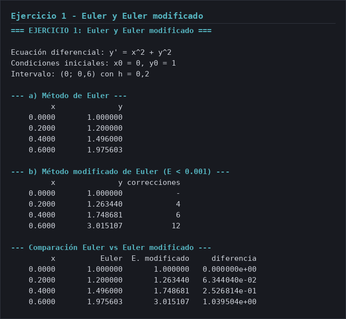
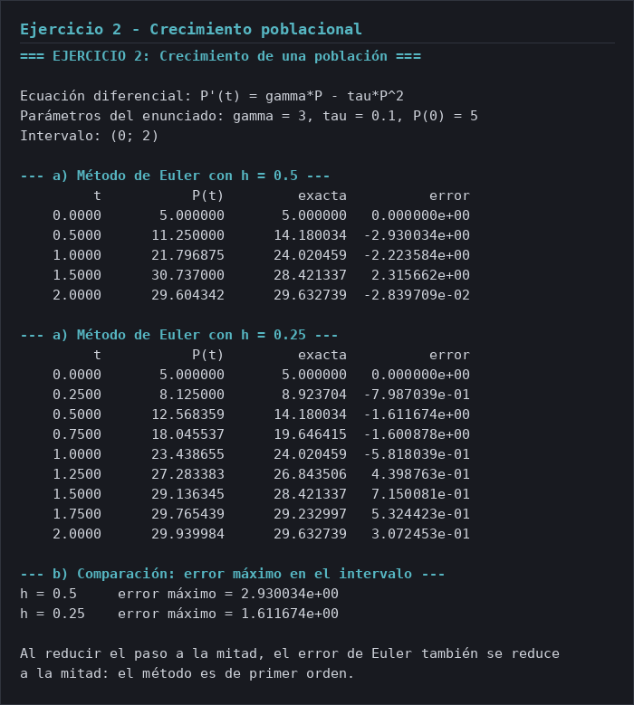
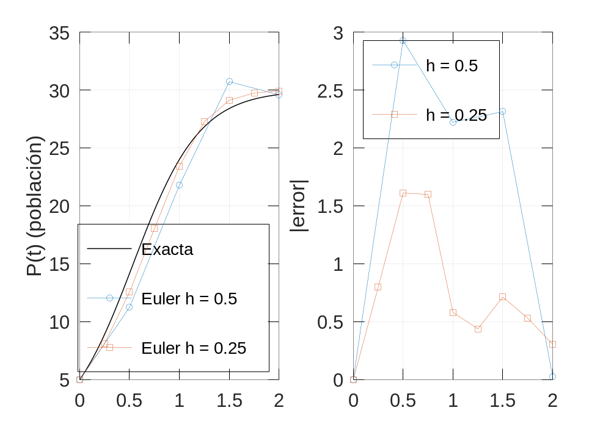
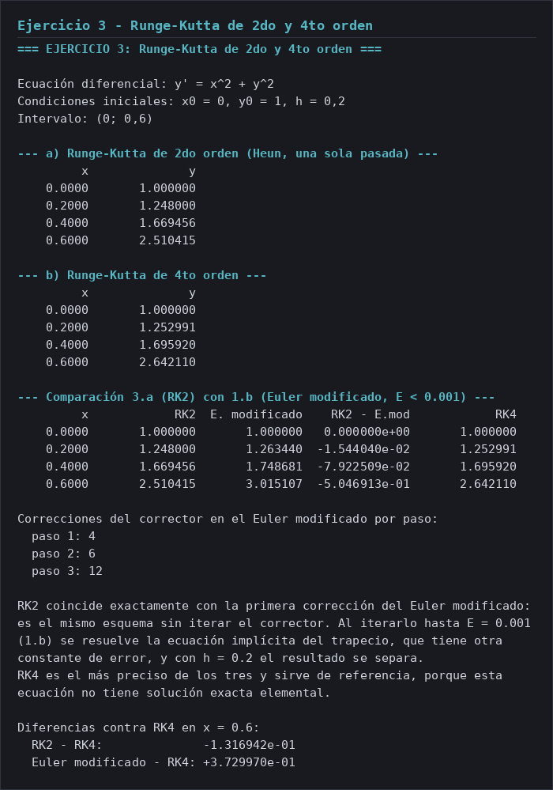
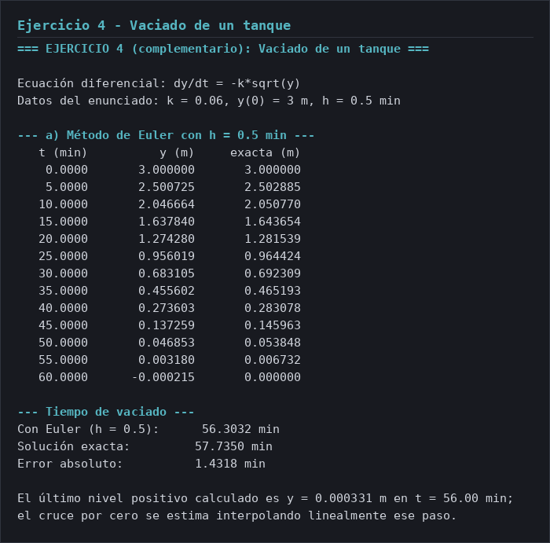
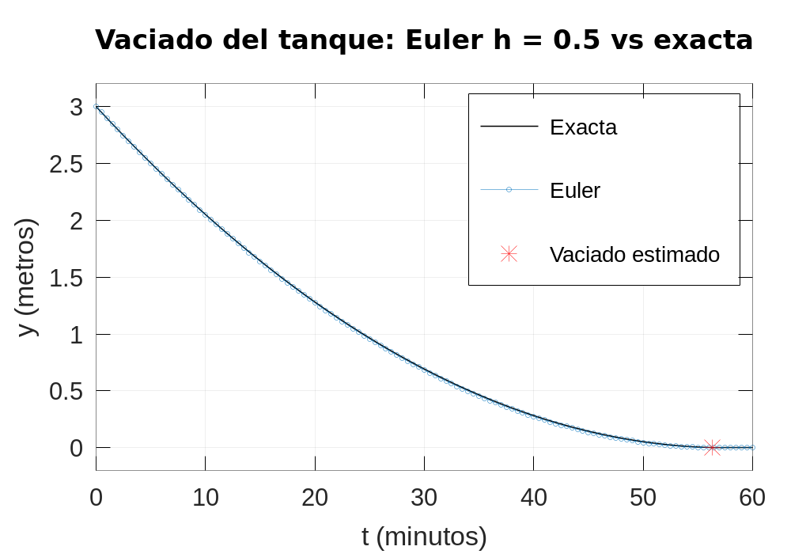
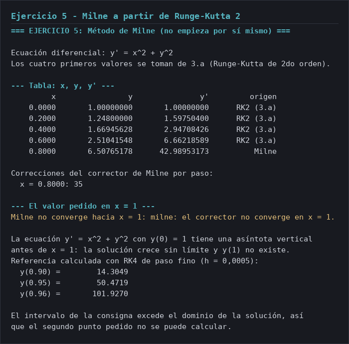
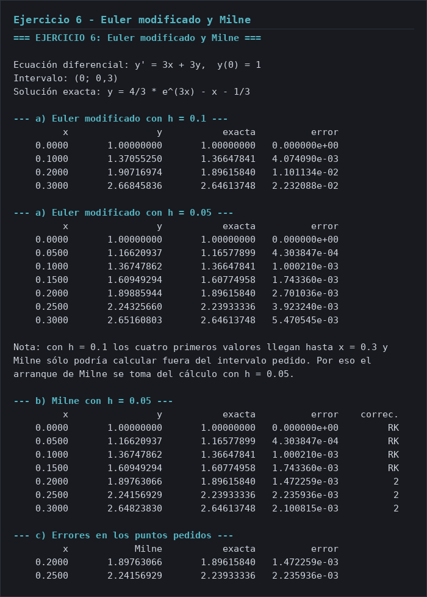
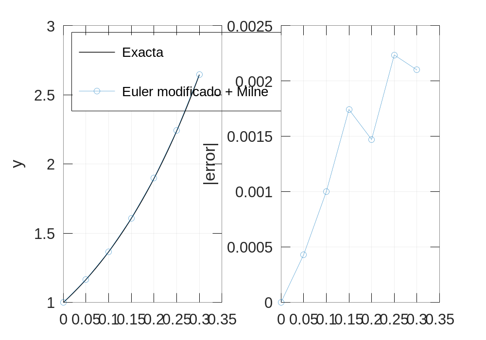

# Informe — Guía 7: Integración numérica de ecuaciones diferenciales

**Alumnos:** Franco Zambrano · Gabriel Bazzola

Métodos Computacionales · Laboratorio 7 · Octave 6.4.0

---

## Introducción

El objetivo del laboratorio es resolver problemas de valor inicial con métodos
numéricos de un paso (Euler, Euler modificado, Runge-Kutta de 2do y 4to orden) y
con un método de pasos múltiples que no arranca por sí mismo (Milne), y analizar
cómo influyen el orden del método y el tamaño de paso en el error de
truncamiento global.

Todos los scripts piden los datos por teclado y muestran los resultados con
leyendas. Si se presiona **Enter** sin escribir nada, se usan los valores del
enunciado. Las capturas de consola de este informe corresponden a una ejecución
no interactiva con esos mismos valores, por eso no se ve la línea de preguntas de
`input`.

Convenciones adoptadas, siguiendo la teoría de la cátedra:

- **Euler modificado**: predictor-corrector, con el corrector iterado hasta que
  dos correcciones consecutivas difieran en menos que la tolerancia `E`.
- **Runge-Kutta de 2do orden**: forma de Heun, una sola pasada. Es el mismo
  esquema que el Euler modificado cuando no se itera el corrector.
- **Milne**: predictor 10.5 y corrector 10.6, con el corrector iterado hasta
  `E`. Necesita los cuatro primeros valores ya calculados por otro método.

Cuando la ecuación no tiene solución exacta elemental (`y' = x² + y²`), se usa
Runge-Kutta de 4to orden con paso muy fino como referencia.


## Ejercicio 1 — Euler y Euler modificado

### Consigna

Resolver `y' = x² + y²` con `x0 = 0`, `y0 = 1` y `h = 0,2` en el intervalo
`(0; 0,6)`:

a) con el método de Euler;
b) con el método modificado de Euler, con `E < 0,001`.

### Código — `01-euler-y-euler-modificado.m`

```octave
% 01-euler-y-euler-modificado.m
% =========================================================================
% SCRIPT: Ejercicio 1 - Euler y método modificado de Euler
%   y' = x^2 + y^2,  y(0) = 1,  h = 0,2,  intervalo (0; 0,6)
% =========================================================================

clear; clc;

printf("=== EJERCICIO 1: Euler y Euler modificado ===\n\n");
printf("Ecuación diferencial: y' = x^2 + y^2\n");
printf("Condiciones iniciales: x0 = 0, y0 = 1\n");
printf("Intervalo: (0; 0,6) con h = 0,2\n\n");
printf("Presione Enter para usar los valores del enunciado.\n");

f  = @(x, y) x^2 + y^2;
x0 = leer_escalar("x0 [0]: ", 0);
y0 = leer_escalar("y0 [1]: ", 1);
h  = leer_escalar("Paso h [0.2]: ", 0.2);
xf = leer_escalar("Extremo final del intervalo [0.6]: ", 0.6);
E  = leer_escalar("Tolerancia del corrector E [0.001]: ", 0.001);

% -------------------------------------------------------------------------
% a) Método de Euler
% -------------------------------------------------------------------------
[x_e, y_e] = euler(f, x0, y0, h, xf);
printf("\n--- a) Método de Euler ---\n");
printf("%10s %14s\n", "x", "y");
for i = 1:length(x_e)
    printf("%10.4f %14.6f\n", x_e(i), y_e(i));
end

% -------------------------------------------------------------------------
% b) Método modificado de Euler
% -------------------------------------------------------------------------
[x_m, y_m, it_m] = euler_modificado(f, x0, y0, h, xf, E);
printf("\n--- b) Método modificado de Euler (E < %g) ---\n", E);
printf("%10s %14s %12s\n", "x", "y", "correcciones");
printf("%10.4f %14.6f %12s\n", x_m(1), y_m(1), "-");
for i = 2:length(x_m)
    printf("%10.4f %14.6f %12d\n", x_m(i), y_m(i), it_m(i - 1));
end

% -------------------------------------------------------------------------
% Comparación de los dos métodos
% -------------------------------------------------------------------------
printf("\n--- Comparación Euler vs Euler modificado ---\n");
printf("%10s %14s %14s %14s\n", "x", "Euler", "E. modificado", "diferencia");
for i = 1:length(x_e)
    printf("%10.4f %14.6f %14.6f %14.6e\n", x_e(i), y_e(i), y_m(i), y_m(i) - y_e(i));
end
```

### Salida de ejecución



### Análisis

La comparación con la referencia de Runge-Kutta 4 de paso fino (`h = 0,0005`)
muestra el signo y la magnitud del error de cada método:

| x | Euler | E. modificado | Referencia RK4 | Error de Euler | Error de E. modificado |
| :---: | :---: | :---: | :---: | :---: | :---: |
| 0,0 | 1,000000 | 1,000000 | 1,000000 | 0,000000 | 0,000000 |
| 0,2 | 1,200000 | 1,263440 | 1,253017 | −0,053017 | +0,010423 |
| 0,4 | 1,496000 | 1,748681 | 1,696111 | −0,200111 | +0,052570 |
| 0,6 | 1,975603 | 3,015107 | 2,644000 | −0,668397 | +0,371107 |

Euler se queda corto en todo el intervalo: el error crece de 0,05 a 0,67 a
medida que avanza `x`. El modificado, en cambio, se pasa, porque el corrector
iterado resuelve la ecuación implícita del trapecio y sobrecorrige cuando la
derivada crece rápido. En valor absoluto el modificado es más exacto en el
último punto (0,371 contra 0,668), pero con el signo cambiado.

El número de correcciones que necesita el corrector por paso (4, 6 y 12) es una
señal de lo mismo: cuanto más rápido crece `y`, más lejos queda el predictor del
valor corregido y más iteraciones hacen falta para bajar de `E = 0,001`.

La causa de fondo es que esta ecuación no tiene solución exacta elemental y su
solución desarrolla una asíntota vertical cerca de `x ≈ 0,97`. Un paso de 0,2 es
muy grueso para una función que crece de forma explosiva, así que el error de
truncamiento se amplifica en cada paso.


## Ejercicio 2 — Crecimiento de una población

### Consigna

Resolver `P'(t) = γ·P(t) − τ·P(t)²` con `P(0) = P0` en el intervalo `(0; 2)`,
para `γ = 3`, `τ = 0,1` y `P(0) = 5`:

a) con el método de Euler, con `h = 0,5` y `h = 0,25`;
b) comparar con la solución exacta
`P(t) = γ / (τ + (γ/P0 − τ)·e^(−γ·t))`.

### Código — `02-crecimiento-poblacional.m`

```octave
% 02-crecimiento-poblacional.m
% =========================================================================
% SCRIPT: Ejercicio 2 - Crecimiento de una población
%   P'(t) = gamma * P - tau * P^2,  P(0) = P0
%   Solución exacta:
%       P(t) = gamma / ( tau + (gamma/P0 - tau) * e^(-gamma*t) )
%   Datos del enunciado: gamma = 3, tau = 0,1, P0 = 5, intervalo (0; 2)
% =========================================================================

clear; clc;

printf("=== EJERCICIO 2: Crecimiento de una población ===\n\n");
printf("Ecuación diferencial: P'(t) = gamma*P - tau*P^2\n");
printf("Parámetros del enunciado: gamma = 3, tau = 0.1, P(0) = 5\n");
printf("Intervalo: (0; 2)\n\n");
printf("Presione Enter para usar los valores del enunciado.\n");

gamma = leer_escalar("gamma [3]: ", 3);
tau   = leer_escalar("tau [0.1]: ", 0.1);
P0    = leer_escalar("P(0) [5]: ", 5);
xf    = leer_escalar("Extremo final del intervalo [2]: ", 2);
h1    = leer_escalar("Primer paso h [0.5]: ", 0.5);
h2    = leer_escalar("Segundo paso h [0.25]: ", 0.25);

f = @(t, P) gamma * P - tau * P^2;
exacta = @(t) gamma ./ (tau + (gamma / P0 - tau) * exp(-gamma * t));

% -------------------------------------------------------------------------
% a) Euler con los dos pasos
% -------------------------------------------------------------------------
[t_1, P_1] = euler(f, 0, P0, h1, xf);
[t_2, P_2] = euler(f, 0, P0, h2, xf);

printf("\n--- a) Método de Euler con h = %g ---\n", h1);
printf("%10s %14s %14s %14s\n", "t", "P(t)", "exacta", "error");
for i = 1:length(t_1)
    printf("%10.4f %14.6f %14.6f %14.6e\n", t_1(i), P_1(i), exacta(t_1(i)), ...
           P_1(i) - exacta(t_1(i)));
end

printf("\n--- a) Método de Euler con h = %g ---\n", h2);
printf("%10s %14s %14s %14s\n", "t", "P(t)", "exacta", "error");
for i = 1:length(t_2)
    printf("%10.4f %14.6f %14.6f %14.6e\n", t_2(i), P_2(i), exacta(t_2(i)), ...
           P_2(i) - exacta(t_2(i)));
end

% -------------------------------------------------------------------------
% b) Comparación con la solución exacta
% -------------------------------------------------------------------------
printf("\n--- b) Comparación: error máximo en el intervalo ---\n");
printf("h = %-6g  error máximo = %.6e\n", h1, max(abs(P_1 - exacta(t_1))));
printf("h = %-6g  error máximo = %.6e\n", h2, max(abs(P_2 - exacta(t_2))));
printf("\nAl reducir el paso a la mitad, el error de Euler también se reduce\n");
printf("a la mitad: el método es de primer orden.\n");

% -------------------------------------------------------------------------
% Gráfico: solución numérica contra la exacta, y error
% -------------------------------------------------------------------------
t_fino = linspace(0, xf, 200);

figure;

subplot(1, 2, 1);
plot(t_fino, exacta(t_fino), "k-", "linewidth", 1.5);
hold on;
plot(t_1, P_1, "o-", "markersize", 5);
plot(t_2, P_2, "s-", "markersize", 5);
hold off;
grid on;
xlabel("t (tiempo)");
ylabel("P(t) (población)");
title("Solución numérica vs exacta");
legend("Exacta", sprintf("Euler h = %g", h1), sprintf("Euler h = %g", h2), ...
       "location", "southeast");

subplot(1, 2, 2);
plot(t_1, abs(P_1 - exacta(t_1)), "o-", "markersize", 5);
hold on;
plot(t_2, abs(P_2 - exacta(t_2)), "s-", "markersize", 5);
hold off;
grid on;
xlabel("t (tiempo)");
ylabel("|error|");
title("Error absoluto");
legend(sprintf("h = %g", h1), sprintf("h = %g", h2), "location", "northwest");
```

### Salida de ejecución



### Gráfico



### Análisis

| h | Error máximo en el intervalo |
| :---: | :---: |
| 0,5 | 2,930034 |
| 0,25 | 1,611674 |

Al reducir el paso a la mitad, el error máximo se reduce a la mitad
(`2,93 / 1,61 ≈ 1,8`): el método de Euler es de **primer orden**, su error de
truncamiento global es proporcional a `h`.

Con `h = 0,5` el error es grande en el tramo de crecimiento rápido y se nota
también en la forma de la curva: Euler llega a `t = 2` con `P = 29,604`, mientras
que la exacta vale `29,633`. Con `h = 0,25` la curva numérica se pega a la exacta
y el error máximo baja a 1,61.

Las dos soluciones tienden al mismo valor de equilibrio `γ/τ = 30`, que es el
punto donde `P' = 0`. Eso no lo aporta el método: es una propiedad del modelo
logístico, y sirve de control de que la integración no se está yendo a cualquier
lado.


## Ejercicio 3 — Runge-Kutta de 2do y 4to orden

### Consigna

Sobre la misma ecuación del ejercicio 1 (`y' = x² + y²`, `y(0) = 1`, `h = 0,2`,
intervalo `(0; 0,6)`):

a) resolver con Runge-Kutta de 2do orden;
b) resolver con Runge-Kutta de 4to orden;
c) comparar 3.a con el Euler modificado de 1.b y sacar conclusiones sobre los
errores.

### Código — `03-runge-kutta.m`

```octave
% 03-runge-kutta.m
% =========================================================================
% SCRIPT: Ejercicio 3 - Runge-Kutta de 2do y 4to orden
%   Toma la ecuación del ejercicio 1: y' = x^2 + y^2, y(0) = 1, h = 0,2
%   Intervalo (0; 0,6).
%   Compara el resultado de 3.a con el Euler modificado del 1.b, que itera el
%   corrector hasta E < 0,001.
% =========================================================================

clear; clc;

printf("=== EJERCICIO 3: Runge-Kutta de 2do y 4to orden ===\n\n");
printf("Ecuación diferencial: y' = x^2 + y^2\n");
printf("Condiciones iniciales: x0 = 0, y0 = 1, h = 0,2\n");
printf("Intervalo: (0; 0,6)\n\n");
printf("Presione Enter para usar los valores del enunciado.\n");

f  = @(x, y) x^2 + y^2;
x0 = leer_escalar("x0 [0]: ", 0);
y0 = leer_escalar("y0 [1]: ", 1);
h  = leer_escalar("Paso h [0.2]: ", 0.2);
xf = leer_escalar("Extremo final del intervalo [0.6]: ", 0.6);
E  = leer_escalar("Tolerancia del Euler modificado E [0.001]: ", 0.001);

% -------------------------------------------------------------------------
% a) Runge-Kutta de segundo orden
% -------------------------------------------------------------------------
[x_2, y_2] = runge_kutta_2(f, x0, y0, h, xf);
printf("\n--- a) Runge-Kutta de 2do orden (Heun, una sola pasada) ---\n");
printf("%10s %14s\n", "x", "y");
for i = 1:length(x_2)
    printf("%10.4f %14.6f\n", x_2(i), y_2(i));
end

% -------------------------------------------------------------------------
% b) Runge-Kutta de cuarto orden
% -------------------------------------------------------------------------
[x_4, y_4] = runge_kutta_4(f, x0, y0, h, xf);
printf("\n--- b) Runge-Kutta de 4to orden ---\n");
printf("%10s %14s\n", "x", "y");
for i = 1:length(x_4)
    printf("%10.4f %14.6f\n", x_4(i), y_4(i));
end

% -------------------------------------------------------------------------
% Comparación 3.a contra 1.b
% -------------------------------------------------------------------------
% El Euler modificado del 1.b se recalcula acá para poder comparar en la misma
% tabla. Con el corrector iterado converge al mismo valor que RK2 sin iterar.
[x_m, y_m, it_m] = euler_modificado(f, x0, y0, h, xf, E);

printf("\n--- Comparación 3.a (RK2) con 1.b (Euler modificado, E < %g) ---\n", E);
printf("%10s %14s %14s %14s %14s\n", "x", "RK2", "E. modificado", "RK2 - E.mod", "RK4");
for i = 1:length(x_2)
    printf("%10.4f %14.6f %14.6f %14.6e %14.6f\n", x_2(i), y_2(i), y_m(i), ...
           y_2(i) - y_m(i), y_4(i));
end

printf("\nCorrecciones del corrector en el Euler modificado por paso:\n");
for i = 1:length(it_m)
    printf("  paso %d: %d\n", i, it_m(i));
end

printf("\nRK2 coincide exactamente con la primera corrección del Euler modificado:\n");
printf("es el mismo esquema sin iterar el corrector. Al iterarlo hasta E = %g\n", E);
printf("(1.b) se resuelve la ecuación implícita del trapecio, que tiene otra\n");
printf("constante de error, y con h = %g el resultado se separa.\n", h);
printf("RK4 es el más preciso de los tres y sirve de referencia, porque esta\n");
printf("ecuación no tiene solución exacta elemental.\n");
printf("\nDiferencias contra RK4 en x = %g:\n", x_2(end));
printf("  RK2 - RK4:              %+.6e\n", y_2(end) - y_4(end));
printf("  Euler modificado - RK4: %+.6e\n", y_m(end) - y_4(end));
```

### Salida de ejecución



### Análisis

| x | RK2 | Euler modificado (1.b) | RK4 | Referencia fina | Error RK2 | Error RK4 |
| :---: | :---: | :---: | :---: | :---: | :---: | :---: |
| 0,2 | 1,248000 | 1,263440 | 1,252991 | 1,253017 | −0,005017 | −0,000026 |
| 0,4 | 1,669456 | 1,748681 | 1,695920 | 1,696111 | −0,026655 | −0,000191 |
| 0,6 | 2,510415 | 3,015107 | 2,642110 | 2,644000 | −0,133585 | −0,001890 |

RK2 se queda corto y el Euler modificado iterado se pasa: en `x = 0,6` la
diferencia entre ambos es `−0,504691`, mucho mayor que el error de cualquiera de
los dos contra la referencia. La razón es la que imprime el propio script: RK2
es el Euler modificado con **una sola** corrección, mientras que 1.b itera el
corrector hasta `E < 0,001` y termina resolviendo otra ecuación, la del trapecio,
con otra constante de error.

RK4 es el más preciso de los tres con el mismo paso: su error en `x = 0,6` es
`−0,001890`, unas 70 veces menor que el de RK2 y unas 200 veces menor que el del
Euler modificado. Ese es el efecto del orden: RK4 es de cuarto orden y su error
global va como `h⁴`, así que con `h = 0,2` ya compite con métodos de menor orden
usando pasos mucho más chicos.


## Ejercicio 4 — Vaciado de un tanque (complementario)

### Consigna

La tasa a la que baja el nivel de agua en un tanque cilíndrico es
`dy/dt = −k·√y`, con `k = 0,06`, nivel inicial `y(0) = 3 m` y `t` en minutos.
Determinar cuánto tarda en vaciarse aplicando el método de Euler con paso de
0,5 minutos.

### Código — `04-tanque-drenaje.m`

```octave
% 04-tanque-drenaje.m
% =========================================================================
% SCRIPT: Ejercicio complementario - Vaciado de un tanque
%   dy/dt = -k * sqrt(y),  y(0) = 3 m,  k = 0,06,  h = 0,5 min
%   Solución exacta (mientras queda agua):
%       y(t) = ( sqrt(y0) - k*t/2 )^2
%   El tanque se vacía en t = 2*sqrt(y0)/k.
% =========================================================================

clear; clc;

printf("=== EJERCICIO 4 (complementario): Vaciado de un tanque ===\n\n");
printf("Ecuación diferencial: dy/dt = -k*sqrt(y)\n");
printf("Datos del enunciado: k = 0.06, y(0) = 3 m, h = 0.5 min\n\n");
printf("Presione Enter para usar los valores del enunciado.\n");

k  = leer_escalar("k [0.06]: ", 0.06);
y0 = leer_escalar("Nivel inicial y(0) [3]: ", 3);
h  = leer_escalar("Paso h en minutos [0.5]: ", 0.5);

% Se integra un poco más allá del vaciado para poder ubicar el cruce por cero.
% max(y, 0) evita que el radical reciba valores negativos cuando el tanque ya
% está vacío.
tope = 60;
f = @(t, y) -k * sqrt(max(y, 0));
exacta = @(t) max(0, sqrt(y0) - k * t / 2).^2;

[t, y] = euler(f, 0, y0, h, tope);

% -------------------------------------------------------------------------
% a) Método de Euler
% -------------------------------------------------------------------------
printf("\n--- a) Método de Euler con h = %g min ---\n", h);
printf("%10s %14s %14s\n", "t (min)", "y (m)", "exacta (m)");
for i = 1:length(t)
    if mod(i - 1, 10) == 0
        printf("%10.4f %14.6f %14.6f\n", t(i), y(i), exacta(t(i)));
    end
end

% -------------------------------------------------------------------------
% Instante en que el tanque queda vacío
% -------------------------------------------------------------------------
cruce = find(y <= 0, 1);
if isempty(cruce)
    error("Con este paso el tanque no se vació dentro de %g minutos.", tope);
end

% Interpolación lineal entre el último nivel positivo y el primero no positivo
t_vacia = t(cruce - 1) + (0 - y(cruce - 1)) * h / (y(cruce) - y(cruce - 1));
t_exacta = 2 * sqrt(y0) / k;

printf("\n--- Tiempo de vaciado ---\n");
printf("Con Euler (h = %g):      %.4f min\n", h, t_vacia);
printf("Solución exacta:         %.4f min\n", t_exacta);
printf("Error absoluto:          %.4f min\n", abs(t_vacia - t_exacta));
printf("\nEl último nivel positivo calculado es y = %.6f m en t = %.2f min;\n", ...
       y(cruce - 1), t(cruce - 1));
printf("el cruce por cero se estima interpolando linealmente ese paso.\n");

% -------------------------------------------------------------------------
% Gráfico
% -------------------------------------------------------------------------
t_fino = linspace(0, tope, 300);

figure;
plot(t_fino, exacta(t_fino), "k-", "linewidth", 1.5);
hold on;
plot(t, y, "o-", "markersize", 3);
plot(t_vacia, 0, "r*", "markersize", 10);
hold off;
grid on;
xlim([0, tope]);
ylim([-0.2, y0 + 0.2]);
xlabel("t (minutos)");
ylabel("y (metros)");
title(sprintf("Vaciado del tanque: Euler h = %g vs exacta", h));
legend("Exacta", "Euler", "Vaciado estimado", "location", "northeast");
```

### Salida de ejecución



### Gráfico



### Análisis

La ecuación se integra analíticamente:

```
y(t) = ( √y0 − k·t/2 )²      →      se vacía en t = 2·√y0 / k = 57,7350 min
```

El script no integra hasta ese instante sino hasta que el nivel calculado cruza
cero, y estima el instante de vaciado interpolando linealmente entre el último
nivel positivo y el primero no positivo:

| | Tiempo de vaciado |
| :--- | :---: |
| Euler con `h = 0,5` min | 56,3032 min |
| Solución exacta | 57,7350 min |
| Error absoluto | 1,4318 min (2,5 %) |

El último nivel positivo calculado es `y = 0,000331 m` en `t = 56,00 min`, así
que el cruce se interpola en ese último paso.

El error tiene signo definido: Euler subestima el nivel del agua en todo el
recorrido y por eso el tanque se vacía **antes** de lo que corresponde. La
explicación está en la curvatura: como `y'' = k²/2 > 0`, la solución exacta es
convexa, y cada recta de Euler (la tangente) queda por debajo de la curva. Como
`|y'| = k·√y` es menor cuanto menor es `y`, el método drena cada vez más despacio
de lo que debería, pero el déficit acumulado hace que llegue a cero antes.

Con `h = 0,5` sobre un intervalo de casi 58 minutos se dan más de 110 pasos, y el
error final del 2,5 % es coherente con un método de primer orden.


## Ejercicio 5 — Milne a partir de Runge-Kutta 2

### Consigna

Completar la tabla `x / y / y'` con los resultados de 3.a y, a partir de ellos,
calcular con el método de Milne la solución en `x = 0,8` y en `x = 1`.

### Código — `05-milne-tabla.m`

```octave
% 05-milne-tabla.m
% =========================================================================
% SCRIPT: Ejercicio 5 - Milne a partir de los valores de Runge-Kutta 2
%   Toma la ecuación del ejercicio 1: y' = x^2 + y^2, y(0) = 1, h = 0,2.
%   Completa la tabla x / y / y' con los cuatro primeros valores de 3.a y
%   aplica el método de Milne para obtener y en x = 0,8 y x = 1.
%
%   ATENCIÓN: la solución de y' = x^2 + y^2 con y(0) = 1 tiene una asíntota
%   vertical en x ≈ 0,97, así que y(1) no existe. El script calcula lo que sí
%   existe y documenta el motivo por el que el segundo valor pedido no puede
%   obtenerse.
% =========================================================================

clear; clc;

printf("=== EJERCICIO 5: Método de Milne (no empieza por sí mismo) ===\n\n");
printf("Ecuación diferencial: y' = x^2 + y^2\n");
printf("Los cuatro primeros valores se toman de 3.a (Runge-Kutta de 2do orden).\n\n");
printf("Presione Enter para usar los valores del enunciado.\n");

f  = @(x, y) x^2 + y^2;
h  = leer_escalar("Paso h [0.2]: ", 0.2);
xf = leer_escalar("Extremo final del intervalo [0.8]: ", 0.8);
E  = leer_escalar("Tolerancia del corrector E [0.001]: ", 0.001);

% -------------------------------------------------------------------------
% Los cuatro puntos iniciales salen de 3.a: Runge-Kutta 2 en (0; 0,6)
% -------------------------------------------------------------------------
[x_rk, y_rk] = runge_kutta_2(f, 0, 1, h, 0.6);

% -------------------------------------------------------------------------
% a) Milne en los puntos que la solución permite alcanzar
% -------------------------------------------------------------------------
[x, y, it] = milne(f, x_rk, y_rk, h, xf, E);

printf("\n--- Tabla: x, y, y' ---\n");
printf("%10s %16s %16s %14s\n", "x", "y", "y'", "origen");
for i = 1:length(x)
    if i <= 4
        origen = "RK2 (3.a)";
    else
        origen = "Milne";
    end
    printf("%10.4f %16.8f %16.8f %14s\n", x(i), y(i), f(x(i), y(i)), origen);
end

printf("\nCorrecciones del corrector de Milne por paso:\n");
for i = 1:length(it)
    printf("  x = %.4f: %d\n", x(i + 4), it(i));
end

% -------------------------------------------------------------------------
% b) El valor en x = 1 no existe: la solución tiene una asíntota vertical
% -------------------------------------------------------------------------
printf("\n--- El valor pedido en x = 1 ---\n");
try
    [x_1, y_1] = milne(f, x_rk, y_rk, h, 1, E);
    printf("y(1) = %.6f\n", y_1(end));
catch err
    printf("Milne no converge hacia x = 1: %s\n", err.message);
    printf("\nLa ecuación y' = x^2 + y^2 con y(0) = 1 tiene una asíntota vertical\n");
    printf("antes de x = 1: la solución crece sin límite y y(1) no existe.\n");
    printf("Referencia calculada con RK4 de paso fino (h = 0,0005):\n");
    for x_ref = [0.90, 0.95, 0.96]
        [~, y_ref] = runge_kutta_4(f, 0, 1, 0.0005, x_ref);
        printf("  y(%.2f) = %14.4f\n", x_ref, y_ref(end));
    end
    printf("\nEl intervalo de la consigna excede el dominio de la solución, así\n");
    printf("que el segundo punto pedido no se puede calcular.\n");
end
```

### Salida de ejecución



### Análisis

| x | y | y' = x² + y² | Origen |
| :---: | :---: | :---: | :--- |
| 0,0 | 1,00000000 | 1,00000000 | RK2 (3.a) |
| 0,2 | 1,24800000 | 1,59750400 | RK2 (3.a) |
| 0,4 | 1,66945628 | 2,94708426 | RK2 (3.a) |
| 0,6 | 2,51041548 | 6,66218589 | RK2 (3.a) |
| 0,8 | 6,50765178 | 42,98953173 | Milne |

Milne calcula `y(0,8) = 6,50765178` y necesita **35** correcciones del corrector
para bajar de `E = 0,001`. Ese número es la evidencia más clara del
comportamiento del método en este problema: el predictor se aleja muchísimo del
valor correcto porque la derivada ya vale casi 43 en `x = 0,8` y cambia muy
rápido de un punto al siguiente.

El segundo valor pedido, `y(1)`, **no existe**. La solución de `y' = x² + y²` con
`y(0) = 1` tiene una asíntota vertical antes de `x = 1`: el script lo verifica
con RK4 de paso fino y obtiene `y(0,90) ≈ 14,30`, `y(0,95) ≈ 50,47` y
`y(0,96) ≈ 101,93`, valores que se disparan. El corrector de Milne no converge y
el script documenta el motivo en lugar de imprimir un número sin sentido. El
intervalo de la consigna excede el dominio de la solución.


## Ejercicio 6 — Euler modificado y Milne sobre una ecuación lineal

### Consigna

Resolver `y' = 3x + 3y` con `y(0) = 1` en `(0; 0,3)`:

a) con el método modificado de Euler y pasos `h = 0,1` y `h = 0,05`, para hallar
los valores iniciales;
b) con el método de Milne para calcular `y` en `x = 0,20` y `x = 0,25`;
c) calcular los errores cometidos, sabiendo que
`y = (4/3)·e^(3x) − x − 1/3`.

### Código — `06-milne-edo-lineal.m`

```octave
% 06-milne-edo-lineal.m
% =========================================================================
% SCRIPT: Ejercicio 6 - Euler modificado para el arranque y Milne después
%   y' = 3x + 3y,  y(0) = 1,  intervalo (0; 0,3)
%   Solución exacta: y = 4/3 * e^(3x) - x - 1/3
% =========================================================================

clear; clc;

printf("=== EJERCICIO 6: Euler modificado y Milne ===\n\n");
printf("Ecuación diferencial: y' = 3x + 3y,  y(0) = 1\n");
printf("Intervalo: (0; 0,3)\n");
printf("Solución exacta: y = 4/3 * e^(3x) - x - 1/3\n\n");
printf("Presione Enter para usar los valores del enunciado.\n");

f = @(x, y) 3 * x + 3 * y;
exacta = @(x) (4 / 3) * exp(3 * x) - x - 1 / 3;

xf = leer_escalar("Extremo final del intervalo [0.3]: ", 0.3);
h1 = leer_escalar("Primer paso h [0.1]: ", 0.1);
h2 = leer_escalar("Segundo paso h [0.05]: ", 0.05);
E  = leer_escalar("Tolerancia del corrector E [0.001]: ", 0.001);

% -------------------------------------------------------------------------
% a) Método modificado de Euler para hallar los valores iniciales
% -------------------------------------------------------------------------
[x_1, y_1] = euler_modificado(f, 0, 1, h1, xf, E);
[x_2, y_2] = euler_modificado(f, 0, 1, h2, xf, E);

printf("\n--- a) Euler modificado con h = %g ---\n", h1);
printf("%10s %16s %16s %14s\n", "x", "y", "exacta", "error");
for i = 1:length(x_1)
    printf("%10.4f %16.8f %16.8f %14.6e\n", x_1(i), y_1(i), exacta(x_1(i)), ...
           y_1(i) - exacta(x_1(i)));
end

printf("\n--- a) Euler modificado con h = %g ---\n", h2);
printf("%10s %16s %16s %14s\n", "x", "y", "exacta", "error");
for i = 1:length(x_2)
    printf("%10.4f %16.8f %16.8f %14.6e\n", x_2(i), y_2(i), exacta(x_2(i)), ...
           y_2(i) - exacta(x_2(i)));
end

printf("\nNota: con h = %g los cuatro primeros valores llegan hasta x = %g y\n", ...
       h1, x_1(4));
printf("Milne sólo podría calcular fuera del intervalo pedido. Por eso el\n");
printf("arranque de Milne se toma del cálculo con h = %g.\n", h2);

% -------------------------------------------------------------------------
% b) Milne con los cuatro primeros valores de h = 0,05
% -------------------------------------------------------------------------
[x_m, y_m, it_m] = milne(f, x_2(1:4), y_2(1:4), h2, xf, E);

printf("\n--- b) Milne con h = %g ---\n", h2);
printf("%10s %16s %16s %14s %10s\n", "x", "y", "exacta", "error", "correc.");
for i = 1:length(x_m)
    if i <= 4
        printf("%10.4f %16.8f %16.8f %14.6e %10s\n", x_m(i), y_m(i), ...
               exacta(x_m(i)), y_m(i) - exacta(x_m(i)), "RK");
    else
        printf("%10.4f %16.8f %16.8f %14.6e %10d\n", x_m(i), y_m(i), ...
               exacta(x_m(i)), y_m(i) - exacta(x_m(i)), it_m(i - 4));
    end
end

% -------------------------------------------------------------------------
% c) Errores en los puntos pedidos
% -------------------------------------------------------------------------
printf("\n--- c) Errores en los puntos pedidos ---\n");
printf("%10s %16s %16s %14s\n", "x", "Milne", "exacta", "error");
for objetivo = [0.20, 0.25]
    idx = find(abs(x_m - objetivo) < 1e-9, 1);
    printf("%10.4f %16.8f %16.8f %14.6e\n", objetivo, y_m(idx), ...
           exacta(objetivo), y_m(idx) - exacta(objetivo));
end

% -------------------------------------------------------------------------
% Gráfico
% -------------------------------------------------------------------------
x_fino = linspace(0, xf, 200);

figure;

subplot(1, 2, 1);
plot(x_fino, exacta(x_fino), "k-", "linewidth", 1.5);
hold on;
plot(x_m, y_m, "o-", "markersize", 6);
hold off;
grid on;
xlabel("x");
ylabel("y");
title("Solución numérica vs exacta");
legend("Exacta", "Euler modificado + Milne", "location", "northwest");

subplot(1, 2, 2);
plot(x_m, abs(y_m - exacta(x_m)), "o-", "markersize", 6);
grid on;
xlabel("x");
ylabel("|error|");
title("Error absoluto de la solución numérica");
```

### Salida de ejecución



### Gráfico



### Análisis

Con `h = 0,1` los cuatro primeros valores llegan sólo hasta `x = 0,3`, que es el
extremo del intervalo: Milne necesita cuatro puntos previos y el primero que
calcularía quedaría fuera del intervalo pedido. Por eso el arranque se toma del
cálculo con `h = 0,05`, que da los cuatro valores hasta `x = 0,15`.

Errores del arranque (Euler modificado):

| x | h = 0,1 | h = 0,05 |
| :---: | :---: | :---: |
| 0,10 | 4,074090e−03 | 1,000210e−03 |
| 0,20 | 1,101134e−02 | 2,701036e−03 |
| 0,30 | 2,232088e−02 | 5,470545e−03 |

Al dividir el paso por dos el error baja aproximadamente cuatro veces
(`1,10e−2 / 2,70e−3 ≈ 4,1`): el Euler modificado con corrector iterado es de
**segundo orden**.

Errores de Milne en los puntos pedidos:

| x | Milne | Exacta | Error | Correcciones |
| :---: | :---: | :---: | :---: | :---: |
| 0,20 | 1,89763066 | 1,89615840 | 1,472259e−03 | 2 |
| 0,25 | 2,24156929 | 2,23933336 | 2,235936e−03 | 2 |

En este problema, lineal y suave, Milne funciona bien: necesita sólo 2
correcciones por paso y en `x = 0,20` su error (`1,47e−3`) es casi la mitad del
que deja el arranque de Euler modificado con el mismo paso (`2,70e−3`). La
diferencia con el ejercicio 5 es la derivada: acá crece suave y acotada, allá
explota.


## Conclusiones

1. **Orden del método.** El error de truncamiento global de Euler se reduce a la
   mitad cuando el paso se reduce a la mitad (ejercicio 2: 2,93 → 1,61), lo que
   confirma el primer orden. El Euler modificado con corrector iterado es de
   segundo orden (ejercicio 6: el error se divide por 4 al dividir `h` por 2) y
   RK4 es de cuarto orden: con el mismo `h = 0,2` del ejercicio 3 su error es
   unas 70 veces menor que el de RK2.

2. **Costo contra precisión.** RK4 logra esa exactitud con cuatro evaluaciones
   de `f` por paso; el Euler modificado iterado necesita entre 4 y 35
   correcciones según el problema. Cuando la derivada crece rápido, el costo del
   corrector se dispara y no compensa: en el ejercicio 1 el modificado terminó
   con más error que RK2 pese a iterar más.

3. **Métodos que no arrancan por sí mismos.** Milne necesita cuatro valores
   previos, y esos valores condicionan todo lo que sigue: en el ejercicio 6 el
   arranque con `h = 0,05` fue obligatorio porque con `h = 0,1` no quedaban
   puntos dentro del intervalo. El error del arranque se propaga a los pasos
   posteriores.

4. **El dominio de la solución manda.** Ningún método arregla una solución que no
   existe: `y' = x² + y²` con `y(0) = 1` tiene una asíntota vertical cerca de
   `x ≈ 0,97`, y por eso `y(1)` no se puede calcular (ejercicio 5) y los errores
   de todos los métodos crecen fuerte al acercarse a ese punto (ejercicios 1 y
   3). Antes de elegir el paso hay que saber hasta dónde la solución está
   definida.

5. **Interpretación física.** En el tanque (ejercicio 4) el error de Euler tiene
   signo predecible por la convexidad de la solución, y el tiempo de vaciado sale
   2,5 % corto. En el modelo logístico (ejercicio 2) los dos pasos convergen al
   mismo equilibrio `γ/τ = 30`, que es una propiedad del modelo y no del método:
   sirve como control de la integración.


## Anexo — Funciones de los métodos

### `euler.m`

Euler explícito: `y(i+1) = y(i) + h·f(x(i), y(i))`.

```octave
% euler.m
% =========================================================================
% FUNCIÓN: euler
% DESCRIPCIÓN: Resuelve el problema de valor inicial y' = f(x, y) con
%              y(x0) = y0 aplicando el método de Euler explícito:
%                  y(i+1) = y(i) + h * f(x(i), y(i))
% PARÁMETROS DE ENTRADA:
%   - f       : Función de la ecuación diferencial, con la forma @(x, y)
%   - x0      : Abscisa inicial
%   - y0      : Ordenada inicial
%   - h       : Tamaño de paso
%   - x_final : Abscisa final del intervalo
% PARÁMETROS DE SALIDA:
%   - x       : Vector de abscisas (x0, x0+h, ..., x_final)
%   - y       : Vector de ordenadas aproximadas
% =========================================================================

function [x, y] = euler(f, x0, y0, h, x_final)
    if h <= 0
        error("euler: el paso h debe ser positivo.");
    end
    if x_final <= x0
        error("euler: la abscisa final debe ser mayor que la inicial.");
    end

    pasos = round((x_final - x0) / h);
    if abs(x0 + pasos * h - x_final) > 1e-10
        error("euler: el intervalo no es múltiplo del paso h.");
    end

    x = x0 + (0:pasos) * h;
    y = zeros(1, pasos + 1);
    y(1) = y0;

    for i = 1:pasos
        y(i + 1) = y(i) + h * f(x(i), y(i));
    end
end
```

### `euler_modificado.m`

Predictor-corrector: predice con Euler, corrige con el promedio de las pendientes
y repite la corrección hasta que dos iteraciones difieran en menos que `E`.
Devuelve además cuántas correcciones necesitó cada paso.

```octave
% euler_modificado.m
% =========================================================================
% FUNCIÓN: euler_modificado
% DESCRIPCIÓN: Resuelve el problema de valor inicial y' = f(x, y) con
%              y(x0) = y0 aplicando el método modificado de Euler
%              (predictor-corrector). Para cada paso, con y'i = f(x(i), y(i)):
%
%              (a) P(y(i+1))  = y(i) + y'i * h                (predictor)
%              (b) P(y'(i+1)) = f(x(i+1), P(y(i+1)))
%              (c) C(y(i+1))  = y(i) + (y'i + P(y'(i+1))) / 2 * h
%              (d) C(y'(i+1)) = f(x(i+1), C(y(i+1)))
%              (e) C(y(i+1))  = y(i) + (y'i + C(y'(i+1))) / 2 * h
%
%              Los incisos (d) y (e) se repiten hasta que dos correcciones
%              consecutivas difieran en valor absoluto menos que E.
% PARÁMETROS DE ENTRADA:
%   - f       : Función de la ecuación diferencial, con la forma @(x, y)
%   - x0      : Abscisa inicial
%   - y0      : Ordenada inicial
%   - h       : Tamaño de paso
%   - x_final : Abscisa final del intervalo
%   - E       : Tolerancia del corrector (por defecto 0,001)
% PARÁMETROS DE SALIDA:
%   - x           : Vector de abscisas
%   - y           : Vector de ordenadas aproximadas
%   - iteraciones : Cantidad de correcciones aplicadas en cada paso
% =========================================================================

function [x, y, iteraciones] = euler_modificado(f, x0, y0, h, x_final, E)
    if nargin < 6
        E = 0.001;
    end
    if E <= 0
        error("euler_modificado: la tolerancia E debe ser positiva.");
    end
    if h <= 0
        error("euler_modificado: el paso h debe ser positivo.");
    end
    if x_final <= x0
        error("euler_modificado: la abscisa final debe ser mayor que la inicial.");
    end

    pasos = round((x_final - x0) / h);
    if abs(x0 + pasos * h - x_final) > 1e-10
        error("euler_modificado: el intervalo no es múltiplo del paso h.");
    end

    x = x0 + (0:pasos) * h;
    y = zeros(1, pasos + 1);
    y(1) = y0;
    iteraciones = zeros(1, pasos);

    for i = 1:pasos
        yp_i = f(x(i), y(i));

        % (a) Predictor
        P = y(i) + yp_i * h;
        % (b) Derivada evaluada en el predictor
        Pp = f(x(i + 1), P);
        % (c) Primera corrección
        C = y(i) + (yp_i + Pp) / 2 * h;

        % (d)-(e) Iteración del corrector
        it = 1;
        while true
            Cp = f(x(i + 1), C);
            C_nuevo = y(i) + (yp_i + Cp) / 2 * h;
            it = it + 1;
            if abs(C_nuevo - C) < E
                C = C_nuevo;
                break;
            end
            C = C_nuevo;
            if it > 10000
                error("euler_modificado: el corrector no converge en x = %g.", x(i + 1));
            end
        end

        y(i + 1) = C;
        iteraciones(i) = it;
    end
end
```

### `runge_kutta_2.m`

Runge-Kutta de segundo orden en la forma de Heun, una sola pasada.

```octave
% runge_kutta_2.m
% =========================================================================
% FUNCIÓN: runge_kutta_2
% DESCRIPCIÓN: Resuelve el problema de valor inicial y' = f(x, y) con
%              y(x0) = y0 aplicando el método de Runge-Kutta de segundo
%              orden en la forma que deduce la cátedra (Heun):
%
%                  y(i+1) = y(i) + (k1 + k2) / 2
%                  k1     = h * f(x(i), y(i))
%                  k2     = h * f(x(i) + h, y(i) + k1)
%
%              Es una sola pasada: no itera el corrector. Equivale al método
%              modificado de Euler cuando se omiten las iteraciones sucesivas.
% PARÁMETROS DE ENTRADA:
%   - f       : Función de la ecuación diferencial, con la forma @(x, y)
%   - x0      : Abscisa inicial
%   - y0      : Ordenada inicial
%   - h       : Tamaño de paso
%   - x_final : Abscisa final del intervalo
% PARÁMETROS DE SALIDA:
%   - x       : Vector de abscisas
%   - y       : Vector de ordenadas aproximadas
% =========================================================================

function [x, y] = runge_kutta_2(f, x0, y0, h, x_final)
    if h <= 0
        error("runge_kutta_2: el paso h debe ser positivo.");
    end
    if x_final <= x0
        error("runge_kutta_2: la abscisa final debe ser mayor que la inicial.");
    end

    pasos = round((x_final - x0) / h);
    if abs(x0 + pasos * h - x_final) > 1e-10
        error("runge_kutta_2: el intervalo no es múltiplo del paso h.");
    end

    x = x0 + (0:pasos) * h;
    y = zeros(1, pasos + 1);
    y(1) = y0;

    for i = 1:pasos
        k1 = h * f(x(i), y(i));
        k2 = h * f(x(i) + h, y(i) + k1);
        y(i + 1) = y(i) + (k1 + k2) / 2;
    end
end
```

### `runge_kutta_4.m`

Runge-Kutta de cuarto orden clásico, con los cuatro `k` evaluados en el paso.

```octave
% runge_kutta_4.m
% =========================================================================
% FUNCIÓN: runge_kutta_4
% DESCRIPCIÓN: Resuelve el problema de valor inicial y' = f(x, y) con
%              y(x0) = y0 aplicando el método de Runge-Kutta de cuarto orden:
%
%                  k1 = h * f(x(i), y(i))
%                  k2 = h * f(x(i) + h/2, y(i) + k1/2)
%                  k3 = h * f(x(i) + h/2, y(i) + k2/2)
%                  k4 = h * f(x(i) + h,   y(i) + k3)
%                  y(i+1) = y(i) + (k1 + 2*k2 + 2*k3 + k4) / 6
% PARÁMETROS DE ENTRADA:
%   - f       : Función de la ecuación diferencial, con la forma @(x, y)
%   - x0      : Abscisa inicial
%   - y0      : Ordenada inicial
%   - h       : Tamaño de paso
%   - x_final : Abscisa final del intervalo
% PARÁMETROS DE SALIDA:
%   - x       : Vector de abscisas
%   - y       : Vector de ordenadas aproximadas
% =========================================================================

function [x, y] = runge_kutta_4(f, x0, y0, h, x_final)
    if h <= 0
        error("runge_kutta_4: el paso h debe ser positivo.");
    end
    if x_final <= x0
        error("runge_kutta_4: la abscisa final debe ser mayor que la inicial.");
    end

    pasos = round((x_final - x0) / h);
    if abs(x0 + pasos * h - x_final) > 1e-10
        error("runge_kutta_4: el intervalo no es múltiplo del paso h.");
    end

    x = x0 + (0:pasos) * h;
    y = zeros(1, pasos + 1);
    y(1) = y0;

    for i = 1:pasos
        k1 = h * f(x(i), y(i));
        k2 = h * f(x(i) + h / 2, y(i) + k1 / 2);
        k3 = h * f(x(i) + h / 2, y(i) + k2 / 2);
        k4 = h * f(x(i) + h, y(i) + k3);
        y(i + 1) = y(i) + (k1 + 2 * k2 + 2 * k3 + k4) / 6;
    end
end
```

### `milne.m`

Predictor de Milne (fórmula 10.5) y corrector (fórmula 10.6), con el corrector
iterado hasta `E`. Recibe los cuatro primeros valores ya calculados.

```octave
% milne.m
% =========================================================================
% FUNCIÓN: milne
% DESCRIPCIÓN: Resuelve el problema de valor inicial y' = f(x, y) aplicando
%              el método de Milne, que no empieza por sí mismo: necesita los
%              cuatro primeros valores y0, y1, y2, y3 (y sus derivadas) ya
%              calculados por otro método. Para cada paso siguiente:
%
%              (10.5) Predicción:
%                  P(y(i+1)) = y(i-3) + 4/3 * h * [2*y'i - y'(i-1) + 2*y'(i-2)]
%
%              (10.6) Corrección:
%                  C(y(i+1)) = y(i-1) + h/3 * [y'(i-1) + 4*y'i + P(y'(i+1))]
%
%              La corrección se itera hasta que dos valores consecutivos
%              difieran en valor absoluto menos que E.
% PARÁMETROS DE ENTRADA:
%   - f       : Función de la ecuación diferencial, con la forma @(x, y)
%   - x_ini   : Vector con los cuatro puntos iniciales de x
%   - y_ini   : Vector con los cuatro valores iniciales de y
%   - h       : Tamaño de paso
%   - x_final : Abscisa final del intervalo
%   - E       : Tolerancia del corrector (por defecto 0,001)
% PARÁMETROS DE SALIDA:
%   - x           : Vector de abscisas, desde el primero hasta x_final
%   - y           : Vector de ordenadas aproximadas
%   - iteraciones : Cantidad de correcciones aplicadas en cada paso nuevo
% =========================================================================

function [x, y, iteraciones] = milne(f, x_ini, y_ini, h, x_final, E)
    if nargin < 6
        E = 0.001;
    end
    if E <= 0
        error("milne: la tolerancia E debe ser positiva.");
    end
    if h <= 0
        error("milne: el paso h debe ser positivo.");
    end

    x_ini = x_ini(:)';
    y_ini = y_ini(:)';
    if length(x_ini) ~= 4 || length(y_ini) ~= 4
        error("milne: se necesitan exactamente cuatro puntos iniciales.");
    end
    if max(abs(diff(x_ini) - h)) > 1e-10
        error("milne: los cuatro puntos iniciales deben estar separados por h.");
    end
    if x_final <= x_ini(4)
        error("milne: la abscisa final debe ser mayor que el último punto inicial.");
    end

    pasos = round((x_final - x_ini(4)) / h);
    if abs(x_ini(4) + pasos * h - x_final) > 1e-10
        error("milne: el intervalo restante no es múltiplo del paso h.");
    end

    x = [x_ini, x_ini(4) + (1:pasos) * h];
    y = zeros(1, length(x));
    y(1:4) = y_ini;

    % Derivadas en los cuatro puntos conocidos
    yp = zeros(1, length(x));
    for k = 1:4
        yp(k) = f(x(k), y(k));
    end

    iteraciones = zeros(1, pasos);

    for j = 5:length(x)
        % (10.5) Predicción
        P = y(j - 4) + (4 / 3) * h * (2 * yp(j - 1) - yp(j - 2) + 2 * yp(j - 3));
        Pp = f(x(j), P);

        % (10.6) Corrección
        C = y(j - 2) + (h / 3) * (yp(j - 2) + 4 * yp(j - 1) + Pp);

        it = 1;
        while true
            Cp = f(x(j), C);
            C_nuevo = y(j - 2) + (h / 3) * (yp(j - 2) + 4 * yp(j - 1) + Cp);
            it = it + 1;
            if abs(C_nuevo - C) < E
                C = C_nuevo;
                break;
            end
            C = C_nuevo;
            if it > 10000
                error("milne: el corrector no converge en x = %g.", x(j));
            end
        end

        y(j) = C;
        yp(j) = f(x(j), y(j));
        iteraciones(j - 4) = it;
    end
end
```

### `leer_escalar.m`

Lee un escalar por teclado y devuelve el valor por defecto si se presiona Enter.
Rechaza un vector, para que `0,2` no se interprete como `[0 2]`.

```octave
% leer_escalar.m
% =========================================================================
% FUNCIÓN: leer_escalar
% DESCRIPCIÓN: Solicita por teclado un valor escalar. Si el usuario presiona
%              Enter sin escribir nada, devuelve el valor por defecto.
% PARÁMETROS DE ENTRADA:
%   - mensaje : Texto que se muestra al pedir el dato
%   - defecto : Valor a utilizar si no se ingresa un valor
% PARÁMETROS DE SALIDA:
%   - v       : Valor escalar ingresado (o el valor por defecto)
% =========================================================================

function v = leer_escalar(mensaje, defecto)
    v = input(mensaje);
    if isempty(v)
        v = defecto;
    end
    % Octave interpreta "0,2" como el vector [0 2]: el separador decimal es
    % el punto, así que se avisa en lugar de seguir con un valor equivocado.
    if ~isscalar(v)
        error("leer_escalar: se esperaba un solo número. Use punto decimal (0.2).");
    end
end
```

### `leer_vector.m`

Lee un vector fila por teclado, con valor por defecto.

```octave
% leer_vector.m
% =========================================================================
% FUNCIÓN: leer_vector
% DESCRIPCIÓN: Solicita por teclado un vector fila. Si el usuario presiona
%              Enter sin escribir nada, devuelve el vector por defecto.
% PARÁMETROS DE ENTRADA:
%   - mensaje : Texto que se muestra al pedir el dato
%   - defecto : Vector a utilizar si no se ingresa un valor
% PARÁMETROS DE SALIDA:
%   - v       : Vector fila ingresado (o el valor por defecto)
% =========================================================================

function v = leer_vector(mensaje, defecto)
    v = input(mensaje);
    if isempty(v)
        v = defecto;
    end
    v = v(:)';
end
```
